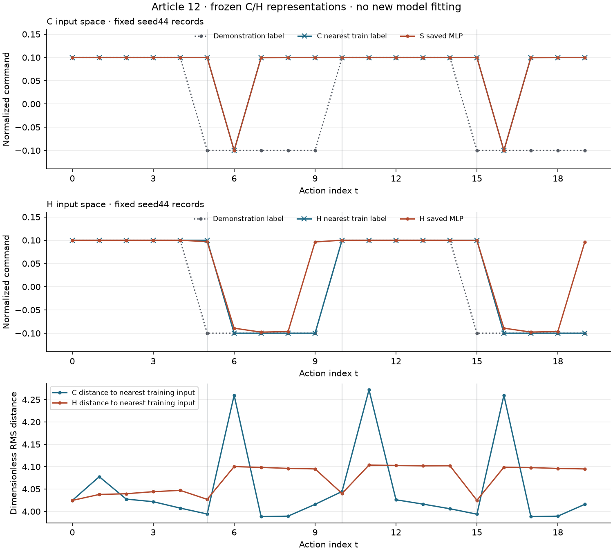

# 先查数据：诊断行为克隆的换向误差

[下载离线复核包](../assets/experiments/12-bc-data-diagnostics/data-diagnostics-files.zip) · [运行说明](../assets/experiments/12-bc-data-diagnostics/README.md) · [解压复核结果](../assets/experiments/12-bc-data-diagnostics/portable-validation.json)

公开包包含可运行的CPU离线代码与必要的真实数值资料，解压后可复算已保存结果。默认不会启动仿真或训练。

[第十一篇](causal-history-policy.html)给模型加入了四份状态历史。整体离线 MAE 从约 0.07997 降到 0.04116，但三个换向点的 MAE 只从约 0.13333 变为 0.13211。这次直接查看模型使用的输入和它周围的训练记录。

实际检查发现，训练数据中两种表示都没有精确相同的输入。H 历史表示下的最近邻标签在 20 步中与脚本符号一致 18 次，第十一篇 H 模型为 16 次。H 最近邻仍在 t=5、15 误判，所以整体指标的改善仍需要与换向表现分开读。

## 先把每一条输入定位清楚

训练来源仍是 seed42、43，共 40 条配对。seed44 的 20 条记录用于本次诊断对照。动作索引从 0 到 19，保存的最后一份状态 20 没有对应动作标签。

C 表示取当前 qpos 和 qvel，各 9 维，按原顺序使用第八篇冻结统计变换成 18 维。H 表示按从旧到新的顺序拼四份这样的状态，长度为 72。t=1 取状态索引 [0,0,0,1]，t=19 取 [16,17,18,19]，跨轨迹时重新从该来源的初始状态开始。

第十一篇 S 组把当前状态重复四次。本篇用单份当前状态 C 展示距离。采用下文的均方根定义时，重复四份会同时把平方和与维数扩大四倍，距离保持相同。本次独立核对了 1600 对 C 与重复当前输入的距离，实测差为零。

## 完全相同的输入有没有相反标签

先对实际 float32 输入做数值相等比较，正零与负零视为相等，非有限值直接报错。没有先四舍五入，也没有按文件名、轨迹名或压缩文件 SHA 判断输入是否相同。

| 表示 | 训练记录 | 不同输入 | 同标签重复组 | 标签冲突组 | 精确冲突产生的 MSE 下界 |
| --- | ---: | ---: | ---: | ---: | ---: |
| C | 40 | 40 | 0 | 0 | 0 |
| H | 40 | 40 | 0 | 0 | 0 |

如果一组完全相同的输入对应不同标签，任何只读取这些输入的确定性预测函数在这一组都只能返回同一个值。该组的标签均值会使组内平方误差最小，把各冲突组的最小平方误差相加、除以训练记录数，可以得到这种精确冲突产生的经验 MSE 下界。

本次这个下界为零，因为没有检测到这种冲突。它没有给出 MLP 能达到多少误差，也无法判断输入是否包含决定动作所需的全部信息。 [NumPy 2.4 unique 文档](https://numpy.org/doc/2.4/reference/generated/numpy.unique.html)

## 用预先固定的距离查相近记录

对两份已经冻结标准化的输入，逐维转成 float64 后计算均方根差。

```python
delta = query.astype(np.float64) - candidate.astype(np.float64)
distance = np.sqrt(np.mean(delta ** 2, dtype=np.float64))
```

每条训练记录分别查最近的其他记录、最近的同标签记录，以及最近的相反标签记录，排除自身。验证记录的候选只有 40 条训练记录。相同距离按 source_id、t 排序，来源和时间仅用于追踪及处理并列，输入向量里仍只有关节状态。 [NumPy 2.4 lexsort 文档](https://numpy.org/doc/2.4/reference/generated/numpy.lexsort.html)

这是冻结输入空间中的无量纲距离。qpos 的前七维原单位为 rad、后两维为 m，qvel 对应 rad/s 和 m/s，各分量先使用自己的冻结尺度变换。因此这个距离不能当成机器人相距多少米。C 和 H 分别排名，分析过程没有设置“足够相近”的阈值。

两种表示中，距离最小的相反标签训练样本分别如下。

| 表示 | 左样本 | 标签 | 右样本 | 标签 | 输入距离 |
| --- | --- | ---: | --- | ---: | ---: |
| C | seed43，t=4 | +0.1 | seed43，t=5 | -0.1 | 0.151896 |
| H | seed43，t=4 | +0.1 | seed43，t=15 | -0.1 | 0.265961 |

这些样本的数值并不完全相同。对应的原始字段差异按单位分开看，下面各项为该样本对在相应字段、全部历史位置上的最大绝对差。

| 表示 | 机械臂位置差（rad） | 手指位置差（m） | 机械臂速度差（rad/s） | 手指速度差（m/s） |
| --- | ---: | ---: | ---: | ---: |
| C | 0.003960667 | 0 | 8.951873e-05 | 1.793778e-06 |
| H | 0.003961425 | 1.974404e-07 | 0.006445918 | 0.0001924894 |

更完整的前十对记录、原始逐维差值及距离贡献保存在 [opposite_pairs.npz](../assets/experiments/12-bc-data-diagnostics/opposite_pairs.npz)，可读表格见 [CSV](../assets/experiments/12-bc-data-diagnostics/opposite_pairs.csv)。相反标签对应的输入在这个排序中靠近，是继续检查数据的线索，不能据此断言任务无法学习。

## 换向时最近的训练标签是什么

seed44 在三个换向位置查到的邻居如下。它们都来自 seed43。

| t | 标签 | C 最近训练记录 | C 最近邻标签 | H 最近训练记录 | H 最近邻标签 |
| ---: | ---: | --- | ---: | --- | ---: |
| 5 | -0.1 | seed43，t=2 | +0.1 | seed43，t=3 | +0.1 |
| 10 | +0.1 | seed43，t=10 | +0.1 | seed43，t=10 | +0.1 |
| 15 | -0.1 | seed43，t=2 | +0.1 | seed43，t=4 | +0.1 |

在 t=5 和 t=15，两种表示找到的最近训练记录都带正指令标签。到了 t=10，最近邻和模型的符号都与脚本一致。H 最近邻的两次误判恰好都在前述负向换向位置，第十一篇 H 模型另外在 t=9、19 给出正向预测。

下面按同一批 20 条记录汇总，标签幅度仍是原始的归一化指令。

| 方法 | MSE | MAE | 符号一致数量 |
| --- | ---: | ---: | ---: |
| C 最近邻 | 0.016000 | 0.080000 | 12/20 |
| H 最近邻 | 0.004000 | 0.020000 | 18/20 |
| 第十一篇 S 模型 | 0.015986 | 0.079966 | 12/20 |
| 第十一篇 H 模型 | 0.007798 | 0.041164 | 16/20 |

<figure class="experiment-figure"><figcaption><a href="../assets/experiments/12-bc-data-diagnostics/diagnostic_plots.png">下载原尺寸图</a></figcaption></figure>

图中的点对应离散动作索引，连线用于帮助阅读。竖线为 t=5、10、15。下图分别画 C、H 到各自最近训练记录的距离，两个表示各自按固定规则取邻居。整体误差与邻居距离的这些读数没有用于调整特征、尺度或阈值。

## 保留全部 20 步

| t | 脚本标签 | C 最近邻 | H 最近邻 | S 模型 | H 模型 |
| ---: | ---: | ---: | ---: | ---: | ---: |
| 0 | +0.100 | +0.100 | +0.100 | +0.100 | +0.100 |
| 1 | +0.100 | +0.100 | +0.100 | +0.100 | +0.100 |
| 2 | +0.100 | +0.100 | +0.100 | +0.100 | +0.100 |
| 3 | +0.100 | +0.100 | +0.100 | +0.100 | +0.100 |
| 4 | +0.100 | +0.100 | +0.100 | +0.100 | +0.100 |
| 5 | -0.100 | +0.100 | +0.100 | +0.100 | +0.097 |
| 6 | -0.100 | -0.100 | -0.100 | -0.100 | -0.089 |
| 7 | -0.100 | +0.100 | -0.100 | +0.100 | -0.098 |
| 8 | -0.100 | +0.100 | -0.100 | +0.100 | -0.096 |
| 9 | -0.100 | +0.100 | -0.100 | +0.100 | +0.096 |
| 10 | +0.100 | +0.100 | +0.100 | +0.100 | +0.100 |
| 11 | +0.100 | +0.100 | +0.100 | +0.100 | +0.100 |
| 12 | +0.100 | +0.100 | +0.100 | +0.100 | +0.100 |
| 13 | +0.100 | +0.100 | +0.100 | +0.100 | +0.100 |
| 14 | +0.100 | +0.100 | +0.100 | +0.100 | +0.100 |
| 15 | -0.100 | +0.100 | +0.100 | +0.100 | +0.099 |
| 16 | -0.100 | -0.100 | -0.100 | -0.100 | -0.089 |
| 17 | -0.100 | +0.100 | -0.100 | +0.100 | -0.097 |
| 18 | -0.100 | +0.100 | -0.100 | +0.100 | -0.096 |
| 19 | -0.100 | +0.100 | -0.100 | +0.100 | +0.096 |

表中数值保留三位小数，完整精度、邻居来源、索引和距离见 [validation_comparison.csv](../assets/experiments/12-bc-data-diagnostics/validation_comparison.csv)。[数值样本](../assets/experiments/12-bc-data-diagnostics/samples.npz)与[来源映射](../assets/experiments/12-bc-data-diagnostics/sample_index.json)能追溯到每条原始配对。

## 运行和独立验收

从项目根目录使用现有环境，在新目录保存重复离线计算的结果。

```bash
python -B evaluate.py --output-dir result
```

独立验收从原始轨迹及冻结统计重建 60 条配对，用另一种逐对计算核对 4800 个距离，并检查邻居候选、并列顺序、原始物理单位差值、全部 CSV 和指标。距离最大数值差约为 8.88×10⁻¹⁶。私有人工用例还检查了正负零、精确冲突的非零下界、相近但不相等、非有限值，以及历史缓存隔离。

所有数值 NPZ 都使用 allow_pickle=False 重新打开。[运行说明](../assets/experiments/12-bc-data-diagnostics/README.md)列出了每个文件，[验收报告](../assets/experiments/12-bc-data-diagnostics/validation.json)保存实际检查结果。 [NumPy 2.4 load 文档](https://numpy.org/doc/2.4/reference/generated/numpy.load.html)

这次保留了冻结统计和已有预测，模型训练、统计拟合、仿真、reset 与 step 调用均为零。三条短轨迹共享换向脚本，seed44 已被多篇教程使用。这是对既有结果的诊断对照，不能当作新的独立测试。当前结果提示了具体值得检查的样本位置，仍不足以判定换向误差的唯一原因，或推断新起点下的闭环表现。
