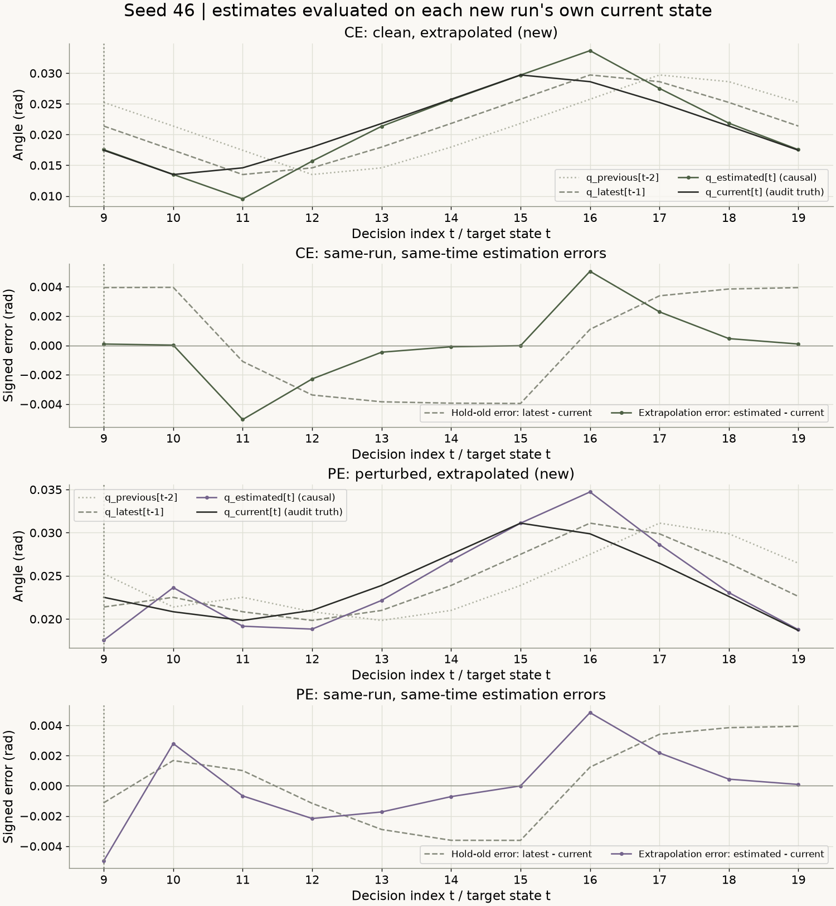
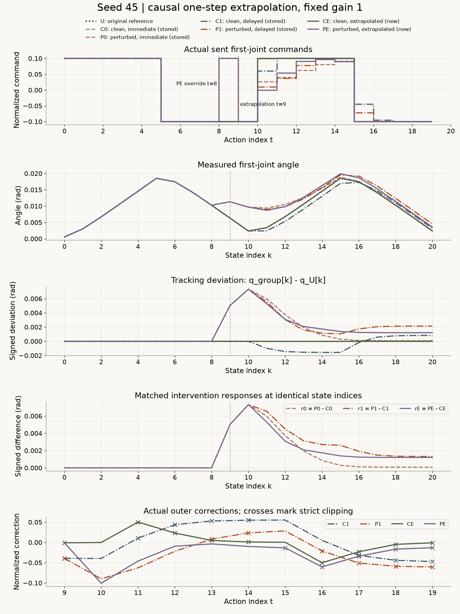
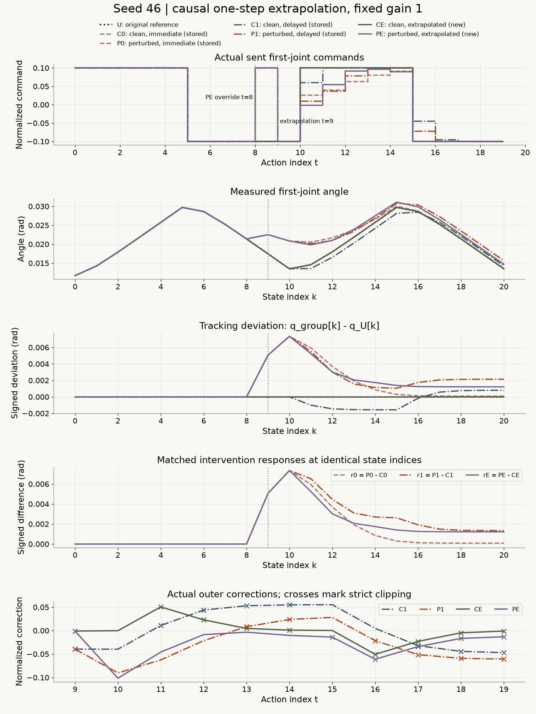
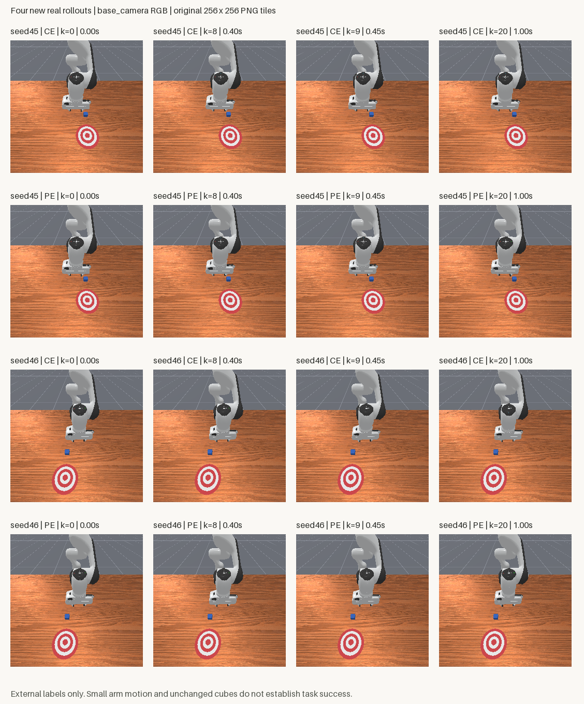

# 用过去估计现在：一步测量延迟的补偿评估

[下载完整离线复核包，约60 MB](../assets/experiments/19-causal-delay-compensation/causal-compensation-files.zip) · [运行说明](../assets/experiments/19-causal-delay-compensation/README.md) · [独立解压验收](../assets/experiments/19-causal-delay-compensation/portable-validation.json)

[第18篇](delayed-feedback-evaluation.html)让外层反馈只看晚到一步的测量，发现无干预组也偏离参考。这一篇保留相同延迟，用最近两份过去位置外推当前角度，再把这个估计送入原来的gain=1反馈规则。

实际结果需要分开说：四条新运行中，外推的估计RMSE都低于保持旧测量，但最大估计误差都更大；无干预补偿组明显更接近参考，有干预补偿组仍留下末端偏差。所有任务success仍为false。下面完整报告估计与闭环两层结果，没有根据结果调整公式或追加采集。

## 七种来源，只有四条新运行

每个已使用seed45、46各有以下七个来源。所有反馈条件gain固定1，参考U不变。

| 名称 | t=8覆盖 | 外层使用的角度 | 来源 | 本次新增 |
| --- | --- | --- | --- | --- |
| U | 否 | 无外层参考修正 | 第13篇A-script参考 | 否 |
| C0 | 否 | 实际obs[t] | 第16篇E即时反馈 | 否 |
| P0 | 是 | 实际obs[t] | 第15篇D即时反馈 | 否 |
| C1 | 否 | 实际obs[t-1] | 第18篇延迟反馈 | 否 |
| P1 | 是 | 实际obs[t-1] | 第18篇延迟反馈 | 否 |
| CE | 否 | 用实际obs[t-2]、obs[t-1]估计t | 本篇无干预补偿 | 是 |
| PE | 是 | 用实际obs[t-2]、obs[t-1]估计t | 本篇有干预补偿 | 是 |

E表示外推，不表示延迟两步。最新可用测量仍为t−1，只是额外使用更旧的t−2。

两个seed共14条完整数值来源：10条历史复用含U，4条新增。新增顺序事先固定为seed45 CE、seed45 PE、seed46 CE、seed46 PE，每组单环境、显式reset一次，构造器初始化另外记录。旧来源没有重采或改写审计。

[来源清单](../assets/experiments/19-causal-delay-compensation/dataset_manifest.json)为14条记录分配全局ID，同时保留第18篇原来源编号。压缩文件SHA与数值内容指纹分别核对，复制文件不算新增实验，也不表示来源统计独立。

## 固定外推：把上一次位置变化再走一遍

动作时刻t只有两份过去位置可供外层估计：

```python
q_latest = np.float64(actual_qpos[t - 1, 0, 0])
q_previous = np.float64(actual_qpos[t - 2, 0, 0])
delta_q = q_latest - q_previous
q_estimated = q_latest + delta_q
```

两份测量间隔都是一个0.05秒控制周期，因此这是按最近一次位置变化向前外推一步。程序固定上述float64计算顺序，没有拟合系数、裁剪估计角度或根据验证结果选择参数。

可以用delta_q/0.05记录过去区间的平均变化率，单位rad/s；它不是仿真器当前qvel，也不是已知的当前真实速度。恒速只是这条手写估计的假设，换向、覆盖或动力学变化后可能不成立。这里没有训练动力学模型。

当前参考与前馈仍使用t：

```python
q_ref = reference_qpos[t, 0, 0]
u_ff = reference_actions[t, 0]
error_estimated_rad = np.float64(q_ref) - q_estimated
correction = 1.0 * error_estimated_rad / np.float64(0.1)
u_raw = np.float64(u_ff) + correction
limit = np.float64(np.float32(0.1))
u_sent = np.float32(np.clip(u_raw, -limit, limit))
```

gain仍为1，尺度0.1rad，限幅精确沿用0.10000000149011612。误差和尺度都用rad，修正项成为归一化动作量；没有使用状态统计标准化替代物理单位换算。严格超界截断与发送值触边分别记录。[NumPy2.4 clip](https://numpy.org/doc/2.4/reference/generated/numpy.clip.html)

底层PD继续及时读取当前状态，use_target=false仍以当前关节位置为目标锚点。归一化机械臂输入[-1,1]映射到约[-0.1,0.1]rad目标增量；演示输入0.1约对应0.01rad目标增量，实际下一时刻运动另由PD和动力学决定。夹爪输入1保留原打开目标。本篇只更换外层使用的角度估计，没有延迟执行动作或改动底层动力学。[ManiSkill3.0.1关节控制器](https://github.com/mani-skill/ManiSkill/blob/v3.0.1/mani_skill/agents/controllers/pd_joint_pos.py)

## 缓存怎样保证只看过去

第18篇缓存接口只允许delay为0或1。本篇在新模块中实现past_pair，直接返回本条实际运行的t−2、t−1及其时间，不修改旧模块，也不向旧select强行传2。

```python
past = cache.past_pair(run_id, t)
delta = past["q_latest"] - past["q_previous"]
estimated = past["q_latest"] + delta
# 复用原标量反馈；当前真实角度尚未传入
result = feedback(q_ref_t, estimated, u_ff_t)
# 完整指令算出后，才读取q_current用于诊断
```

缓存从初始化开始追加独立快照，接管不清空，切换运行重建。RGB、当前qvel、物体真值、success和历史动作不参与外推。

| 实际动作索引 | 较旧测量 | 最新可用测量 | 估计目标 |
| --- | --- | --- | --- |
| 9 | 状态7，0.35秒 | 状态8，0.40秒 | 状态9，0.45秒 |
| 10 | 状态8，0.40秒 | 状态9，0.45秒 | 状态10，0.50秒 |
| 19 | 状态17，0.85秒 | 状态18，0.90秒 | 状态19，0.95秒 |

最新测量年龄0.05秒，更旧测量年龄0.10秒，外推目标向前一步。末状态20只保存，没有额外查询或动作。不补零、不重复状态、不拿参考轨迹填缓存。

离线预检先重算第18篇44次真实延迟审计，并核对10条历史来源和210张原图。私有测试确认：固定过去两测量、参考和前馈后，修改obs[t]及未来状态不会改变估计、修正与u_raw；分别修改t−1或t−2会按规则改变结果。常量、正负恒定增量、反向变化、边界、非有限值、错误缓存归属和时间不连续均按冻结规则处理。只比较限幅后的指令不足以发现错误，因为clip可能掩盖差异。

## 正式运行与环境

实际复用Python3.11.9、NumPy2.4.6、PyTorch2.14.1+cpu、Pillow13.0.0、ManiSkill3.0.1、SAPIEN3.0.3、Gymnasium1.4.0，没有安装或升级依赖。任务为PushCube-v1、Panda、单环境、pd_joint_delta_pos，RGB/base_camera256×256/minimal。

控制20Hz、物理100Hz，一次step推进0.05秒，包含5个物理子步。CPU物理、CPU外层计算和CPU图像复制与渲染设备接口分别记录，没有从CPU张量推断完全不使用GPU渲染，也未测GPU利用率。[版本对应的环境与时钟实现](https://github.com/mani-skill/ManiSkill/blob/v3.0.1/mani_skill/envs/sapien_env.py) · [本次环境记录](../assets/experiments/19-causal-delay-compensation/environment.json)

t=0～7执行原脚本；t=8仅PE覆盖为+0.1，CE保留脚本−0.1；t=9～19外推反馈接管。其余机械臂输入0，夹爪1。

四组各20步，恰好80次尝试；每次step前持久化预算记录，没有热身、补步或自动重试。初始化及接管前，CE状态0～9与C1/C0/U、PE状态0～9与P1/P0、CE/PE共同状态0～8都通过原逐字段容差，实际还达到逐项相同。

四组均因20步采集预算停止，原terminated/truncated仍为false。预算结束不等于回合终止。可选Pinocchio未安装提示保留在私人日志，该功能没有使用，未安装依赖来消除提示。

## 第一次查询：同样的过去，不同的当前

下表均为动作t=9，使用状态7、8估计状态9；角度单位rad。q_current仅作事后诊断。

| seed | 条件 | q_previous[7] | q_latest[8] | q_estimated[9] | q_current[9] | u_raw | u_sent |
| --- | --- | --- | --- | --- | --- | --- | --- |
| 45 | CE | +0.014095886610 | +0.010259009898 | +0.006422133185 | +0.006321799476 | -0.101003338583 | -0.100000001490 |
| 45 | PE | +0.014095886610 | +0.010259009898 | +0.006422133185 | +0.011341047473 | -0.101003338583 | -0.100000001490 |
| 46 | CE | +0.025236234069 | +0.021390257403 | +0.017544280738 | +0.017450524494 | -0.100937563926 | -0.100000001490 |
| 46 | PE | +0.025236234069 | +0.021390257403 | +0.017544280738 | +0.022513585165 | -0.100937563926 | -0.100000001490 |

同seed两新增组的过去、估计和指令相同，但PE当前状态9已经受动作8覆盖影响。seed45中，PE外推误差约−0.004919rad，而保持旧测量的误差约−0.001082rad。这一时刻外推更差，程序没有用当前真值或覆盖动作去“纠正”它。

这不意味着物理影响等到测量到达才发生。干预已经作用于状态9，只是最新可用测量仍停在状态8。直到动作10读取状态9，过去测量才包含覆盖后的响应。

## 估计误差：在自己的真实运行上比较

定义两种同一时刻误差：

```text
estimate_error[t] = q_estimated[t] - q_current[t]
hold_error[t] = q_latest[t-1] - q_current[t]
```

每条CE/PE各取实际决策t=9～19，共11份，真值始终是它自己的当前状态。不能拿第18篇另一条轨迹的角度替代，也不能把“保持旧测量”解释成新增执行过的控制器。

| seed | 运行 | 估计方式 | 数量 | 最大绝对误差rad | RMSE rad | 有符号均值rad |
| --- | --- | --- | --- | --- | --- | --- |
| 45 | CE | 固定外推 | 11 | 0.005009585060 | 0.002360351756 | +0.000009108123 |
| 45 | CE | 保持旧测量 | 11 | 0.003958200803 | 0.003463866250 | +0.000357640272 |
| 45 | PE | 固定外推 | 11 | 0.004918914288 | 0.002490641177 | +0.000009233682 |
| 45 | PE | 保持旧测量 | 11 | 0.003938447218 | 0.002752848607 | +0.000248395457 |
| 46 | CE | 固定外推 | 11 | 0.005054367706 | 0.002373937751 | +0.000008511442 |
| 46 | CE | 保持旧测量 | 11 | 0.003958762623 | 0.003473898819 | +0.000357900492 |
| 46 | PE | 固定外推 | 11 | 0.004969304428 | 0.002515610657 | +0.000008625063 |
| 46 | PE | 保持旧测量 | 11 | 0.003940852359 | 0.002769877827 | +0.000247232447 |

四条运行的外推RMSE都更低，但最大绝对误差都更大。均方意义上更接近，并不表示每个时刻更准。换向与覆盖附近尤其需要保留峰值和完整逐步数据，不能只报告总体RMSE。

<figure class="experiment-figure"><figcaption>每个决策t用本条实际当前状态作事后真值，当前角度没有进入补偿；RMSE和峰值要分开看。 <a href="../assets/experiments/19-causal-delay-compensation/seed-0045-estimation.png" download>下载原尺寸图 ↗</a></figcaption></figure>

<figure class="experiment-figure"><figcaption>横轴为决策t及其预测目标状态t；与闭环统计状态9～20的范围不同。 <a href="../assets/experiments/19-causal-delay-compensation/seed-0046-estimation.png" download>下载原尺寸图 ↗</a></figcaption></figure>

## 闭环跟踪：估计指标不能代替实际运动

定义deviation_g[k]=q_g[k]−q_U[k]，k是状态索引。七组实际都完整覆盖，因此统一比较状态9～20，共12份状态，时间0.45～1.00秒。

| seed | 条件 | 最大绝对偏差rad | 角度RMSE rad | k=20有符号偏差rad | k=20绝对偏差rad |
| --- | --- | --- | --- | --- | --- |
| 45 | U | 0.000000000000 | 0.000000000000 | +0.000000000000 | 0.000000000000 |
| 45 | C0 | 0.000000000000 | 0.000000000000 | +0.000000000000 | 0.000000000000 |
| 45 | P0 | 0.007320881123 | 0.003327613387 | +0.000073932577 | 0.000073932577 |
| 45 | C1 | 0.001567836851 | 0.001027570076 | +0.000820209971 | 0.000820209971 |
| 45 | P1 | 0.007320881123 | 0.003470155594 | +0.002136250492 | 0.002136250492 |
| 45 | CE | 0.000008316711 | 0.000005244589 | +0.000003308291 | 0.000003308291 |
| 45 | PE | 0.007320881123 | 0.003323452218 | +0.001204714645 | 0.001204714645 |
| 46 | U | 0.000000000000 | 0.000000000000 | +0.000000000000 | 0.000000000000 |
| 46 | C0 | 0.000000000000 | 0.000000000000 | +0.000000000000 | 0.000000000000 |
| 46 | P0 | 0.007347689010 | 0.003332763891 | +0.000087905675 | 0.000087905675 |
| 46 | C1 | 0.001568127424 | 0.001026124177 | +0.000803562813 | 0.000803562813 |
| 46 | P1 | 0.007347689010 | 0.003476870827 | +0.002144956030 | 0.002144956030 |
| 46 | CE | 0.000007534400 | 0.000004764342 | +0.000003027730 | 0.000003027730 |
| 46 | PE | 0.007347689010 | 0.003328606586 | +0.001220121980 | 0.001220121980 |

无干预CE角度RMSE约5.24e−6、4.76e−6rad，低于C1约0.00103rad，但并没有与U完全相同。有干预PE的末端偏差约0.001205、0.001220rad，低于P1，仍大于即时P0。

CE的小跟踪偏差也不代表其所有角度估计都准确：估计峰值误差可达约0.005rad，而控制发送值还经过限幅，闭环运动由整个系统共同决定。这些实测现象不能简化成“估计更准，所以控制一定更好”。

<figure class="experiment-figure"><figcaption>动作8仅PE覆盖，动作9补偿接管；叉号表示严格截断，角度横轴是状态k。 <a href="../assets/experiments/19-causal-delay-compensation/seed-0045-comparison.png" download>下载原尺寸图 ↗</a></figcaption></figure>

<figure class="experiment-figure"><figcaption>全部来源和指标范围保留，没有按结果筛选；U/C0/P0/C1/P1均为历史复用。 <a href="../assets/experiments/19-causal-delay-compensation/seed-0046-comparison.png" download>下载原尺寸图 ↗</a></figcaption></figure>

## 配对响应：补偿组也需要无干预对照

相同状态索引k下，分别计算：

```text
r0[k] = q_P0[k] - q_C0[k]   # 即时反馈条件内
r1[k] = q_P1[k] - q_C1[k]   # 延迟、不补偿条件内
rE[k] = q_PE[k] - q_CE[k]   # 延迟、外推条件内
```

另外报告rE−r1、CE−C1和PE−P1，区分配对响应、无干预变化和有干预变化。仍使用共同状态9～20，所有数值单位rad。

| seed | 差值 | 最大绝对值 | 角度RMSE | k=20有符号值 | k=20绝对值 |
| --- | --- | --- | --- | --- | --- |
| 45 | r0 | 0.007320881123 | 0.003327613387 | +0.000073932577 | 0.000073932577 |
| 45 | r1 | 0.007320881123 | 0.003837455711 | +0.001316040521 | 0.001316040521 |
| 45 | rE | 0.007320881123 | 0.003325476823 | +0.001201406354 | 0.001201406354 |
| 45 | rE_minus_r1 | 0.001421518624 | 0.000800644435 | -0.000114634167 | 0.000114634167 |
| 45 | CE_minus_C1 | 0.001559520140 | 0.001022348539 | -0.000816901680 | 0.000816901680 |
| 45 | PE_minus_P1 | 0.000931535847 | 0.000597983519 | -0.000931535847 | 0.000931535847 |
| 46 | r0 | 0.007347689010 | 0.003332763891 | +0.000087905675 | 0.000087905675 |
| 46 | r1 | 0.007347689010 | 0.003843895253 | +0.001341393217 | 0.001341393217 |
| 46 | rE | 0.007347689010 | 0.003330424548 | +0.001217094250 | 0.001217094250 |
| 46 | rE_minus_r1 | 0.001436263323 | 0.000803399278 | -0.000124298967 | 0.000124298967 |
| 46 | CE_minus_C1 | 0.001560593024 | 0.001021376124 | -0.000800535083 | 0.000800535083 |
| 46 | PE_minus_P1 | 0.000924834050 | 0.000597319697 | -0.000924834050 | 0.000924834050 |

rE的RMSE低于r1，但峰值没有下降，末端也未回到即时条件r0的水平。保留峰值、RMSE和末端结果，不能挑一个数宣布最佳控制器。这里是固定条件下的有限差值，历史对照复用且没有随机化，不是普遍因果效应估计。

## 方块、reward和成功标志

| seed | 条件 | 实际步数 / 秒 | 反馈数 / 截断数 / 触边数 | 方块净位移m | reward总和 | 任一步success |
| --- | --- | --- | --- | --- | --- | --- |
| 45 | U | 20 / 1.00 | 0 / 不适用 / 不适用 | 7.91621997073e-07 | 1.365849584 | false |
| 45 | C0 | 20 / 1.00 | 11 / 0 / 11 | 7.91621997073e-07 | 1.365849584 | false |
| 45 | P0 | 20 / 1.00 | 11 / 6 / 6 | 7.91621997073e-07 | 1.370473698 | false |
| 45 | C1 | 20 / 1.00 | 11 / 8 / 8 | 7.91621997073e-07 | 1.365037203 | false |
| 45 | P1 | 20 / 1.00 | 11 / 7 / 7 | 7.91621997073e-07 | 1.372055665 | false |
| 45 | CE | 20 / 1.00 | 11 / 9 / 9 | 7.91621997073e-07 | 1.365845025 | false |
| 45 | PE | 20 / 1.00 | 11 / 6 / 6 | 7.91621997073e-07 | 1.371565446 | false |
| 46 | U | 20 / 1.00 | 0 / 不适用 / 不适用 | 8.33992995526e-07 | 1.528464839 | false |
| 46 | C0 | 20 / 1.00 | 11 / 0 / 11 | 8.33992995526e-07 | 1.528464839 | false |
| 46 | P0 | 20 / 1.00 | 11 / 6 / 6 | 8.33992995526e-07 | 1.521865904 | false |
| 46 | C1 | 20 / 1.00 | 11 / 8 / 8 | 8.33992995526e-07 | 1.529646054 | false |
| 46 | P1 | 20 / 1.00 | 11 / 7 / 7 | 8.33992995526e-07 | 1.519598663 | false |
| 46 | CE | 20 / 1.00 | 11 / 9 / 9 | 8.33992995526e-07 | 1.528471231 | false |
| 46 | PE | 20 / 1.00 | 11 / 6 / 6 | 8.33992995526e-07 | 1.520290524 | false |

每个条件都为20步、1秒、success=false，方块净位移仅微米量级。角度偏差、估计误差、reward和推物成功含义不同。本篇不根据更小角度偏差或更高reward宣布推物成功。

<figure class="experiment-figure"><figcaption>16块原始base_camera图块，标签在图外；全部原始PNG保留在ZIP中。 <a href="../assets/experiments/19-causal-delay-compensation/compensated-feedback-frames.png" download>下载原尺寸图 ↗</a></figcaption></figure>

## 保存格式与只读复核

四条新运行保存80个动作、84份独立状态及PNG、44次实际补偿查询。每条obs[t]→actions[t]→obs[t+1]逐项核对。qpos/qvel为(21,1,9)，前7维用rad/rad/s，手指2维用m/m/s；RGB为(21,1,256,256,3)uint8/HWC、0～255，来自策略base_camera。物体真值、success和实际控制器目标单列诊断。

feedback_audit.npz只保存t≥9的11次真实查询，包括两个过去索引及时间、预测目标t、q_previous/q_latest/delta_q/q_estimated、诊断q_current、误差、修正、u_raw/限幅值/发送值、两个边界标志与实际目标。前缀不填NaN，动作8覆盖不记为补偿输出。

公开包已经独立解压，在已有兼容环境实际执行：

```text
python -B evaluate.py --output-dir result-r001
```

输出目录必须不存在。默认入口只做CPU离线复算，不启动仿真、不采集、训练或拟合，不依赖作者本机路径。启动先核对files.json SHA，再用allow_pickle=False读取纯数值NPZ。[NumPy2.4 load](https://numpy.org/doc/2.4/reference/generated/numpy.load.html)

独立算式没有调用实际缓存、决策或标量反馈函数来验证自身。重读14份来源、294张原始PNG，逐像素匹配；20份CSV与数值数组完全相同；闭环指标、估计指标以及6份逐步对照/估计NPZ逐项复现。底层目标仍按当前实际qpos[t]核对，绝不是以预测角度替换目标锚点。

作者项目另外核对5083个旧文件、引用代码、依赖版本和80次持久化预算账本。公开包只复算数值证据，不访问私人文件库存或日志。16块首末及状态8、9真图已重新打开，机器人、桌面、蓝色方块可辨，标签在图块外，原像素未改。

## 完整资料与常见错误

全部真实来源、原始帧、旧审计、新审计与逐步数据在ZIP中。也可单独下载：

- seed45：[完整动作CSV](../assets/experiments/19-causal-delay-compensation/seed-0045-actions.csv)、[状态及全部差值CSV](../assets/experiments/19-causal-delay-compensation/seed-0045-states.csv)、[CE补偿审计](../assets/experiments/19-causal-delay-compensation/seed-0045-CE-feedback.csv)、[PE补偿审计](../assets/experiments/19-causal-delay-compensation/seed-0045-PE-feedback.csv)、[CE逐步估计](../assets/experiments/19-causal-delay-compensation/seed-0045-CE-estimation.csv)、[PE逐步估计](../assets/experiments/19-causal-delay-compensation/seed-0045-PE-estimation.csv)。
- seed46：[完整动作CSV](../assets/experiments/19-causal-delay-compensation/seed-0046-actions.csv)、[状态及全部差值CSV](../assets/experiments/19-causal-delay-compensation/seed-0046-states.csv)、[CE补偿审计](../assets/experiments/19-causal-delay-compensation/seed-0046-CE-feedback.csv)、[PE补偿审计](../assets/experiments/19-causal-delay-compensation/seed-0046-PE-feedback.csv)、[CE逐步估计](../assets/experiments/19-causal-delay-compensation/seed-0046-CE-estimation.csv)、[PE逐步估计](../assets/experiments/19-causal-delay-compensation/seed-0046-PE-estimation.csv)。
- [闭环指标](../assets/experiments/19-causal-delay-compensation/metrics.json)、[估计指标](../assets/experiments/19-causal-delay-compensation/estimation_metrics.json)、[字段说明](../assets/experiments/19-causal-delay-compensation/schema.json)、[冻结配置](../assets/experiments/19-causal-delay-compensation/config.json)、[验收报告](../assets/experiments/19-causal-delay-compensation/validation.json)、[代码副本来源](../assets/experiments/19-causal-delay-compensation/module_sources.json)。

常见错误包括：把q_current传入外推；取成t−1与t而提前看见当前；接管时清空缓存或跨seed拼接；把q_latest再次向前索引造成实际读到t−2；把参考也延迟；把估计角度写成真实观测；把同轨迹hold误差称为另一条闭环；混用11个决策与12份状态计算指标；把角度估计的峰值遗漏；把预算结束改成truncated=true。这些都需要从索引、字段语义和保存数值验证，不能只看最终图片或发送指令。

两个seed已使用，完整参考和时钟已知，各组只有1秒，历史组复用。本篇没有训练、参数拟合、模型更新、候选扩充、参数搜索或根据结果补跑，不证明随机化因果、普遍稳定、恢复、泛化、推物或真实机器人时延能力。

## 官方资料

- [ManiSkill3.0.1关节控制器](https://github.com/mani-skill/ManiSkill/blob/v3.0.1/mani_skill/agents/controllers/pd_joint_pos.py)：结合本地源码哈希核对归一化、use_delta/use_target及当前目标锚点。
- [ManiSkill3.0.1环境与时钟](https://github.com/mani-skill/ManiSkill/blob/v3.0.1/mani_skill/envs/sapien_env.py)：核对控制周期、物理子步和step。
- [NumPy2.4 clip](https://numpy.org/doc/2.4/reference/generated/numpy.clip.html)：固定接口边界限幅。
- [NumPy2.4 load](https://numpy.org/doc/2.4/reference/generated/numpy.load.html)：allow_pickle=False读取数值归档。
