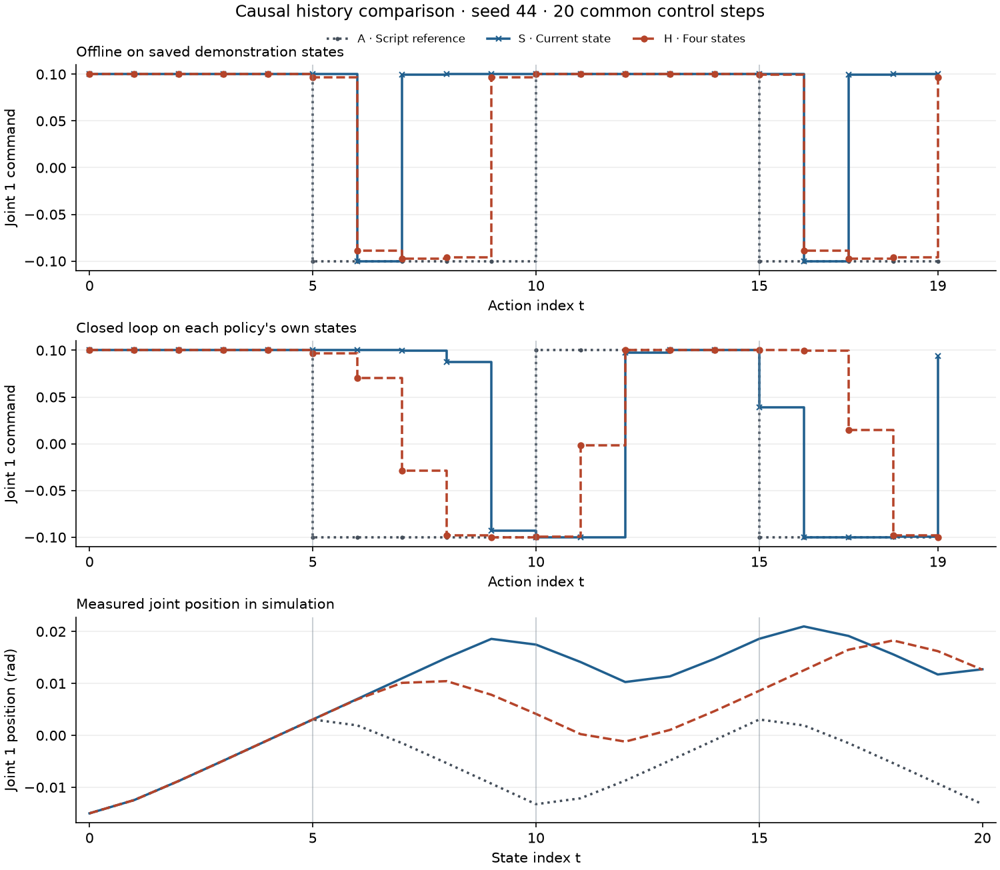
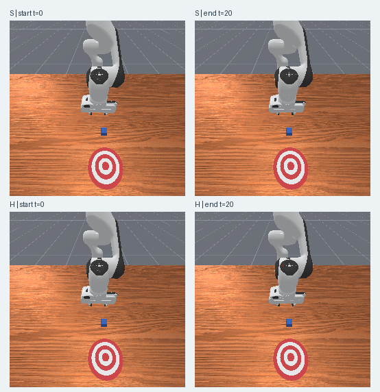

# 只看过去和现在：用短历史预测机器人动作

[下载离线评估包](../assets/experiments/11-causal-history-policy/causal-history-files.zip) · [运行说明](../assets/experiments/11-causal-history-policy/README.md) · [解压复现验收](../assets/experiments/11-causal-history-policy/portable-validation.json)

公开包包含真实数值记录、原尺寸相机帧、冻结统计和已保存权重，解压后可在 CPU 上复算指令与指标。

[第十篇](first-closed-loop-rollout.html)把行为克隆模型接进了仿真。第一次换向时，模型继续沿原方向发指令。下一步，它已经在读取自己走出的状态。本篇给模型看最近四份关节状态，观察离线指令预测和闭环轨迹分别有什么变化。

## 窗口在当前状态结束

记 `x[t]` 为当前 `qpos` 与 `qvel` 拼成的 18 维状态，使用第八篇的冻结统计逐维变换。当前动作标签是 `actions[t,0]`。H 组按从旧到新的顺序取 `x[t-3]` 到 `x[t]`，控制频率为 20 Hz，最早和最晚的样本相隔 0.15 秒。第六篇的离线窗口包含随后状态，可用于保存序列。把整个窗口直接交给此处的策略会让它看到尚未发生的观测。

```python
history_index = [max(0, t - lag) for lag in (3, 2, 1, 0)]
history_input = torch.cat([states[i] for i in history_index])
current_input = states[t].repeat(4)
target = actions[t, :1]  # 第 t 个动作的第一维
```

当 `t=1`，索引是 `[0,0,0,1]`。用本条轨迹的初始状态填充左侧，重置时新建缓存。`t=19` 的索引为 `[16,17,18,19]`，最后保存的状态 20 没有动作标签。闭环只在收到新观测后把它压入缓存，因此离线索引和实时推理有相同含义。

## 同一个网络，两种输入

S 组把当前状态重复四次，H 组使用上述四份历史。两者都是 72→32→32→1 的 MLP，中间使用 ReLU，输出 `0.1 × tanh(logit)`。模型只接收关节状态。相机、时间索引、物体真值和历史动作保留在资料中供核对。

训练使用 seed42 和 seed43 共 40 条样本，seed44 的 20 条样本在训练结束后才用于评估。两个模型的初始参数和实际样本顺序逐项一致。固定随机种子 2027，使用 Adam、学习率 `1e-3`、批次大小 8 和 MSE 损失，各完成 100 轮和 500 次更新。第九篇的 18 维模型提供历史背景，本篇用 S 和 H 直接比较。 [PyTorch 2.14 Adam 文档](https://docs.pytorch.org/docs/2.14/generated/torch.optim.Adam.html)

## 离线误差下降，换向仍出错

| 组别 | MSE | RMSE | MAE | 三个换向点 MAE |
| --- | ---: | ---: | ---: | ---: |
| S 当前状态 | 0.015986 | 0.126437 | 0.079966 | 0.133333 |
| H 四状态历史 | 0.007798 | 0.088305 | 0.041164 | 0.132108 |

整体 MAE 接近减半，三个换向点的 MAE 只从 0.13333 变为 0.13211。H 在 `t=5` 和 `t=15` 仍预测正向指令，脚本标签在这两步均为负向。

| 动作索引 | 脚本标签 | S 离线预测 | S 绝对误差 | H 离线预测 | H 绝对误差 |
| ---: | ---: | ---: | ---: | ---: | ---: |
| 5 | −0.10000 | +0.10000 | 0.20000 | +0.09693 | 0.19693 |
| 10 | +0.10000 | +0.10000 | 0.00000 | +0.10000 | 0.00000 |
| 15 | −0.10000 | +0.10000 | 0.20000 | +0.09939 | 0.19939 |

## 放回仿真后

两组从同一个 seed44 初始状态各运行 20 步。对照使用第十篇保存的脚本轨迹。每一步只用当时已有的关节状态输出动作第一维，第 2～7 维固定为 0，第 8 维固定为 1。对比图的前两栏分别使用历史演示状态和策略实际遇到的状态，最后一栏画仿真测得的第一关节角度。

<figure class="experiment-figure"><figcaption><a href="../assets/experiments/11-causal-history-policy/comparison.png">下载原尺寸图</a></figcaption></figure>

以 `1e-6 rad` 为阈值，两组都在状态 `t=6` 首次偏离脚本。共同的 20 步里，S 相对参考的最大角度偏差为 0.03072 rad，H 为 0.02589 rad。到了 `t=10`，两组离线都给出约 +0.1，闭环却分别给出 −0.10000 和 −0.09963。当状态已不同，脚本只能提供同一时刻的对照，无法为这些新状态提供正确动作标签。

<figure class="experiment-figure"><figcaption><a href="../assets/experiments/11-causal-history-policy/rollout-frames.png">下载原尺寸图</a></figcaption></figure>

两组的方块位姿轨迹都与脚本参考重合，终点位移约 0.79 微米，成功步数均为零。两次运行各覆盖 1.00 秒，到步数预算后停止，末步的 `terminated` 和 `truncated` 都为 `false`。

## 如何复核

按[运行说明](../assets/experiments/11-causal-history-policy/README.md)可在 CPU 上重读数值权重与运行文件。验收独立核对了全部 60 条状态—动作配对，检查了改变未来观测不影响当前输入，也检查了切换轨迹时的缓存隔离。闭环验收用保存状态重建 40 个实际输入，与记录逐项一致。重算指令的最大绝对差小于 `4.5×10⁻⁸`，42 张 PNG 与保存的 RGB 数组逐像素一致。 [指标](../assets/experiments/11-causal-history-policy/metrics.json) · [独立验收](../assets/experiments/11-causal-history-policy/validation.json)

三条源轨迹共用同一换向脚本，历史里的运动趋势和开头的重复状态都可能提供阶段线索。seed44 也已用于第九篇离线验证和第十篇闭环对照。本篇结果限于这批数据和同一起点。短历史在这次对照里降低了整体离线误差和最大关节偏差，两次离线错向以及闭环的换向偏差仍然存在。
