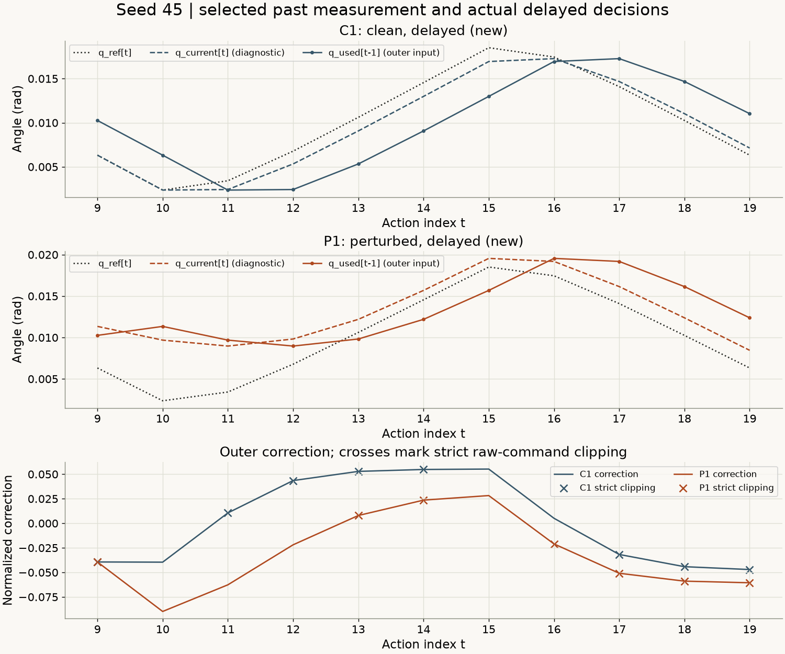
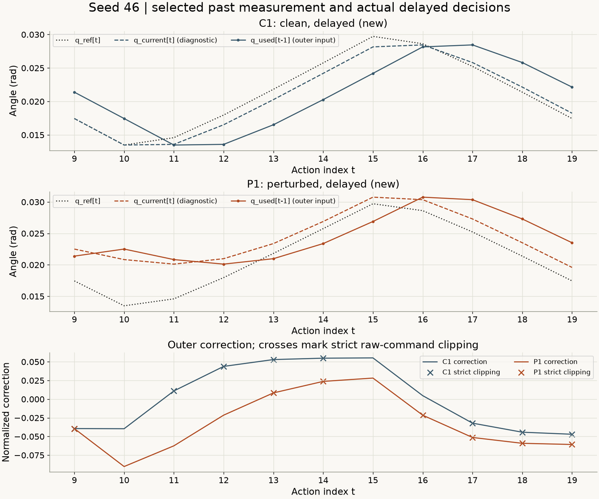
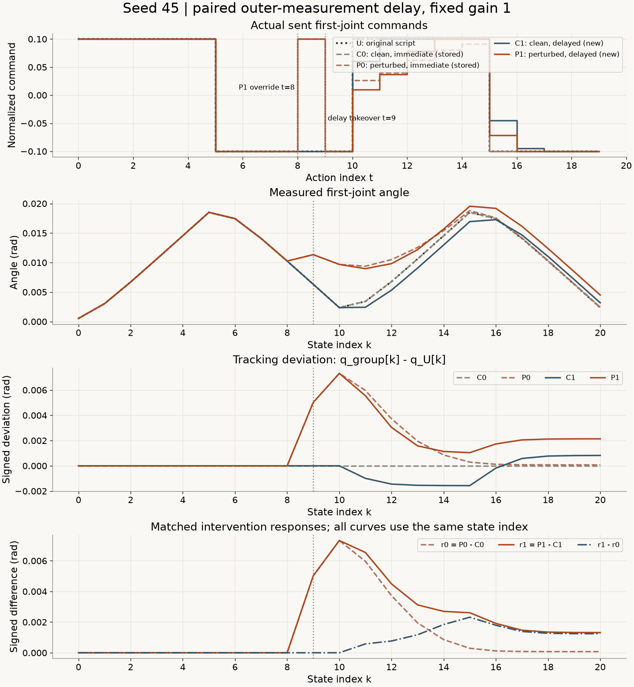
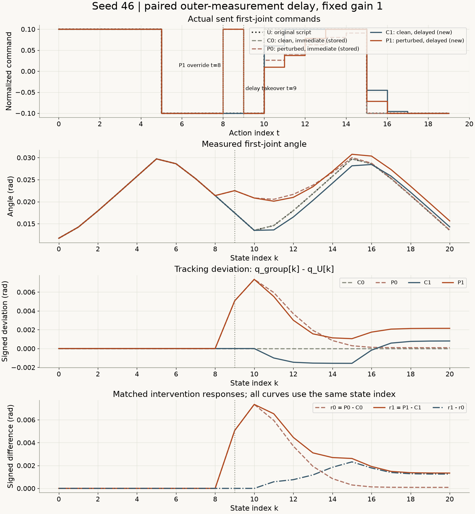
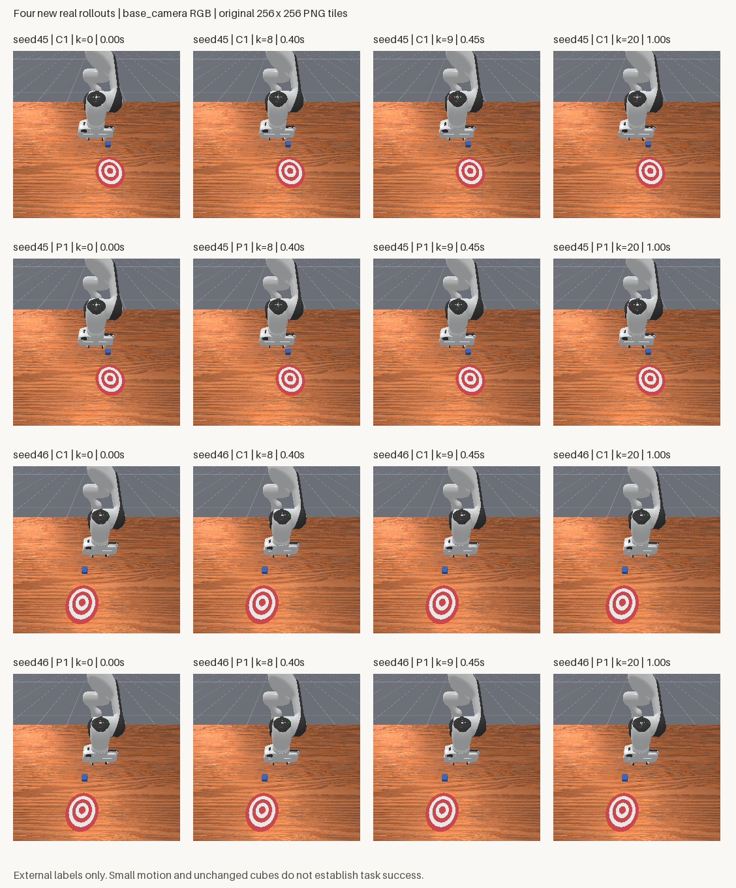

# 反馈晚到一步会怎样：观测延迟的配对评估

[下载完整离线复核包，约43 MB](../assets/experiments/18-delayed-feedback-evaluation/delayed-feedback-files.zip) · [运行说明](../assets/experiments/18-delayed-feedback-evaluation/README.md) · [独立解压验收](../assets/experiments/18-delayed-feedback-evaluation/portable-validation.json)

[第17篇](feedback-gain-comparison.html)只改变外层反馈增益。这一篇把gain固定为1，只让外层测量晚到一步：动作时刻t仍使用当前参考，但修正项读取本条实际运行的obs[t-1]。

实测有一个不能省略的对照：**没有动作干预，延迟反馈也会偏离原参考。** 两个seed的无干预延迟组都从状态11起超过1e-6rad检测阈值。因此不能只看“有干预延迟组减原参考”，就把全部变化归因于干预。下面同时报告五条来源、四个反馈条件及各自的配对差值。

本次四条新增运行均20步，合计80次step尝试，没有补跑；每条仿真1秒，全部任务success=false。它们是两个已知起点上的短时受控演示，不代表推物能力、普遍稳定性或真实机器人网络时延。

## 先列清楚，哪些组是新采集

每个seed使用相同参考U，比较四个gain=1条件：

| 名称 | t=8是否覆盖 | 外层测量 | 来源 | 本次新增 |
| --- | --- | --- | --- | --- |
| U | 否 | 没有外层参考修正 | 第13篇无干预A-script | 否，参考 |
| C0 | 否 | 当前obs[t] | 第16篇E即时反馈 | 否 |
| P0 | 是，固定+0.1 | 当前obs[t] | 第15篇D即时反馈 | 否 |
| C1 | 否 | 实际obs[t-1] | 本篇延迟无干预 | 是 |
| P1 | 是，固定+0.1 | 实际obs[t-1] | 本篇延迟有干预 | 是 |

两个seed共10条来源：6条历史复用含U，4条新增。执行顺序事先固定为seed45 C1、seed45 P1、seed46 C1、seed46 P1。没有重采U、C0或P0，也没有加入第17篇其他增益。

来源编号0～9在[来源清单](../assets/experiments/18-delayed-feedback-evaluation/dataset_manifest.json)中稳定映射，文件SHA与完整数值指纹分别核对。C0和P0保留原来的反馈审计字段；没有将旧结果改写成新实验。

## 一步是0.05秒，延迟的只有外层测量

复用现有Python3.11.9、NumPy2.4.6、PyTorch2.14.1+cpu、Pillow13.0.0、ManiSkill3.0.1、SAPIEN3.0.3和Gymnasium1.4.0，没有安装或升级依赖。

任务仍为PushCube-v1、Panda、单环境、pd_joint_delta_pos；观测为RGB，base_camera为256×256、minimal着色。控制频率20Hz，物理频率100Hz：每次step推进0.05秒，包含5个0.01秒物理子步。本篇一步测量延迟是一个控制周期，不是一个物理子步。[ManiSkill3.0.1仿真与控制时钟实现](https://github.com/mani-skill/ManiSkill/blob/v3.0.1/mani_skill/envs/sapien_env.py)

物理为CPU后端，外层计算和图像复制在CPU。渲染后端接口、渲染设备返回值与图像传输分别记录在[环境配置](../assets/experiments/18-delayed-feedback-evaluation/environment.json)，没有从CPU张量推断完全不使用GPU渲染，也未测量GPU利用率。

在动作时刻t，三个量的索引是：

| 变量 | 来自哪里 | 是否延迟 |
| --- | --- | --- |
| q_ref | 第13篇同seed参考obs[t]第一关节 | 否 |
| u_ff | 同一参考actions[t,0] | 否 |
| q_used | 本条实际运行obs[t-1]第一关节 | 是 |
| q_current | 本条实际运行obs[t]第一关节 | 仅诊断，不进外层修正 |

固定公式是：

```python
error_used_rad = np.float64(q_ref) - np.float64(q_used)
correction = error_used_rad / np.float64(0.1)  # gain固定1
u_raw = np.float64(u_ff) + correction
limit = np.float64(np.float32(0.1))
u_sent = np.float32(np.clip(u_raw, -limit, limit))
```

误差与尺度都用rad，修正项成为无量纲归一化动作。限幅精确沿用0.10000000149011612，即原float32接口边界的float64表示。was_clipped表示未限幅值严格超界；sent_at_bound表示最终float32发送值触边。触边不自动意味着发生截断。[NumPy2.4 clip](https://numpy.org/doc/2.4/reference/generated/numpy.clip.html)

这不是动作执行延迟：没有sleep、动作队列、延迟发送、改变控制频率或同时向前移动参考时钟。底层PD始终工作，use_target=false仍用**当前**关节位置生成目标。归一化机械臂输入[-1,1]映射到约[-0.1,0.1]rad目标增量，因此演示指令0.1对应约0.01rad目标增量；实际运动另由PD和动力学决定。夹爪输入1维持原打开目标。[ManiSkill3.0.1关节控制器](https://github.com/mani-skill/ManiSkill/blob/v3.0.1/mani_skill/agents/controllers/pd_joint_pos.py)

## 缓存从初始化保留到结束

沿用第15篇标量反馈函数，文件逐字节相同。新增包装层只负责选中旧测量，并把旧函数的q_actual/error_rad字段明确改名为q_used/error_used_rad。当前状态诊断在发送值算出后才加入，避免意外进入外层修正。

缓存存储本次运行实际收到的独立标量，从初始状态0开始，每次step后追加一份。切换seed或运行就创建新缓存，t=9接管时继续保留已有历史。

```python
cache = MeasurementCache(run_id)
cache.append(run_id, 0, 0.0, initial_qpos[0, 0])
# 每次收到新的实际观测后，按状态索引追加；不从参考轨迹填充
cache.append(run_id, state_index, time_s, actual_qpos[0, 0])

# 动作时刻t>=9：参考仍在t，测量选择t-1
result = decide(cache, run_id, t, q_ref_t, u_ff_t, reference_time_s,
                delay_steps=1)
```

对应关系固定为：action[9]读取实际obs[8]；action[10]读取实际obs[9]；action[19]读取实际obs[18]。最后obs[20]保存下来，不生成额外动作或查询。已有前缀足够，不补零、不重复初始状态、不用历史参考替换实际观测。

启动仿真前，先以delay=0复算C0/P0共44条历史审计，实际发送值逐项相同。私有数值测试进一步确认：改变obs[t]及未来状态时，delay=1的q_used、误差、修正和u_raw不变；改变obs[t-1]时，选择确实改变。非有限输入、跨运行缓存、缺失历史和错误时钟会报错。只比较限幅后的动作不够，因为clip可能掩盖错误索引。人工用例没有替代真实数据或实验图片。

## 正式运行只新增四次

所有组在t=0～7执行原脚本；t=8只有P1覆盖为+0.1，C1保持原脚本-0.1；t=9～19读取延迟测量计算反馈。其余机械臂输入0，夹爪1。

每组新建单环境，显式reset到指定seed一次，构造器初始化另外记录。每次step调用前先持久化预算账本，异常尝试也占预算。上限每组20次、总计80次，没有热身、重试或补步。采集已经完成，默认复现命令只做离线验收。

初始化、前缀及接管前按原容差比较：qpos为1e-6，qvel为1e-5，方块位姿为1e-6；机械臂和手指单位分别记录。C1状态0～9与C0/U、P1状态0～9与P0、两新增组状态0～8均逐项相同，既满足容差，也实际达到完全相同。

## 第一次延迟查询究竟看到了什么

以下角度单位rad。t/测量索引明确分开，q_current只是诊断；完整精度见审计CSV。

| seed | 条件 | t / 测量索引 | q_ref[t] | q_used[t-1] | q_current[t] | u_raw | u_sent |
| --- | --- | --- | --- | --- | --- | --- | --- |
| 45 | C1 | 9 / 8 | +0.006321799476 | +0.010259009898 | +0.006321799476 | -0.139372105710 | -0.100000001490 |
| 45 | C1 | 10 / 9 | +0.002363598673 | +0.006321799476 | +0.002363598673 | +0.060417993460 | +0.060417994857 |
| 45 | P1 | 9 / 8 | +0.006321799476 | +0.010259009898 | +0.011341047473 | -0.139372105710 | -0.100000001490 |
| 45 | P1 | 10 / 9 | +0.002363598673 | +0.011341047473 | +0.009684479795 | +0.010225513484 | +0.010225513950 |
| 46 | C1 | 9 / 8 | +0.017450524494 | +0.021390257403 | +0.017450524494 | -0.139397330582 | -0.100000001490 |
| 46 | C1 | 10 / 9 | +0.013491761871 | +0.017450524494 | +0.013491761871 | +0.060412375256 | +0.060412377119 |
| 46 | P1 | 9 / 8 | +0.017450524494 | +0.021390257403 | +0.022513585165 | -0.139397330582 | -0.100000001490 |
| 46 | P1 | 10 / 9 | +0.013491761871 | +0.022513585165 | +0.020839450881 | +0.009781768546 | +0.009781768546 |

t=9时，C1和P1都读取干预前共同状态8，所以同seed的q_used、error_used、correction、u_raw完全相同；但P1当前状态9已经受到动作8覆盖影响。两组的测量年龄都为0.05秒，浮点显示0.04999999999999999，按预先固定的1e-12秒容差检查。

直到t=10读取状态9，两组的延迟测量才首次不同。这是旧测量进入外层反馈的索引事实，不代表此时才发生物理影响。t=9实际发送值也恰好因限幅相同，因此不能仅凭发送指令相同就推断测量正确或当前状态相同。

<figure class="experiment-figure"><figcaption>同一动作索引t的q_ref[t]、q_current[t]与q_used[t-1]分别标出；叉号是严格截断。 <a href="../assets/experiments/18-delayed-feedback-evaluation/seed-0045-measurement.png" download>下载原尺寸图 ↗</a></figcaption></figure>

<figure class="experiment-figure"><figcaption>seed46按相同冻结索引运行，当前状态诊断不参与延迟外层修正。 <a href="../assets/experiments/18-delayed-feedback-evaluation/seed-0046-measurement.png" download>下载原尺寸图 ↗</a></figcaption></figure>

## 跟踪偏差：先承认C1也会偏离

定义tracking_g[k]=q_g[k]−q_U[k]，k是**状态索引**。所有组完整覆盖，统一比较状态9～20，共12份状态，时间0.45～1.00秒。表格同时保留峰值、按状态汇总RMSE、末端有符号和绝对偏差，单位均rad。

| seed | 条件 | 最大绝对偏差 | 角度RMSE | k=20有符号偏差 | k=20绝对偏差 |
| --- | --- | --- | --- | --- | --- |
| 45 | U | 0.000000000000 | 0.000000000000 | +0.000000000000 | 0.000000000000 |
| 45 | C0 | 0.000000000000 | 0.000000000000 | +0.000000000000 | 0.000000000000 |
| 45 | P0 | 0.007320881123 | 0.003327613387 | +0.000073932577 | 0.000073932577 |
| 45 | C1 | 0.001567836851 | 0.001027570076 | +0.000820209971 | 0.000820209971 |
| 45 | P1 | 0.007320881123 | 0.003470155594 | +0.002136250492 | 0.002136250492 |
| 46 | U | 0.000000000000 | 0.000000000000 | +0.000000000000 | 0.000000000000 |
| 46 | C0 | 0.000000000000 | 0.000000000000 | +0.000000000000 | 0.000000000000 |
| 46 | P0 | 0.007347689010 | 0.003332763891 | +0.000087905675 | 0.000087905675 |
| 46 | C1 | 0.001568127424 | 0.001026124177 | +0.000803562813 | 0.000803562813 |
| 46 | P1 | 0.007347689010 | 0.003476870827 | +0.002144956030 | 0.002144956030 |

C0在此次保存数据中与U相同。C1的发送指令从动作10起不同于U，角度从状态11起超过1e-6rad检测阈值；两个seed峰值都约0.001568rad。因此延迟无干预条件不能直接沿用即时条件C0=U的结论。

P1相对U的末端偏差约0.00214rad，既包含延迟条件本身的变化，也包含同条件下干预的响应，不能直接把这一个数全叫作干预效果。

<figure class="experiment-figure"><figcaption>动作8只有P1覆盖，动作9延迟反馈接管；角度横轴为状态k。C0/P0是历史复用，C1/P1新增。 <a href="../assets/experiments/18-delayed-feedback-evaluation/seed-0045-comparison.png" download>下载原尺寸图 ↗</a></figcaption></figure>

<figure class="experiment-figure"><figcaption>统一状态9～20计算指标，同时保留无干预延迟条件和两种配对差值。 <a href="../assets/experiments/18-delayed-feedback-evaluation/seed-0046-comparison.png" download>下载原尺寸图 ↗</a></figcaption></figure>

## 配对响应：在相同延迟条件内做差

固定同一状态索引k：

```text
r0[k] = q_P0[k] - q_C0[k]   # 即时反馈条件内的干预差值
r1[k] = q_P1[k] - q_C1[k]   # 延迟反馈条件内的干预差值
r1_minus_r0[k] = r1[k] - r0[k]
```

另外报告C1−C0与P1−P0，分别观察无干预和有干预条件下的延迟差值。下面仍统一使用状态9～20，单位rad。

| seed | 序列 | 最大绝对值 | 角度RMSE | k=20有符号值 | k=20绝对值 |
| --- | --- | --- | --- | --- | --- |
| 45 | r0 | 0.007320881123 | 0.003327613387 | +0.000073932577 | 0.000073932577 |
| 45 | r1 | 0.007320881123 | 0.003837455711 | +0.001316040521 | 0.001316040521 |
| 45 | r1_minus_r0 | 0.002319477499 | 0.001320954311 | +0.001242107945 | 0.001242107945 |
| 45 | C1_minus_C0 | 0.001567836851 | 0.001027570076 | +0.000820209971 | 0.000820209971 |
| 45 | P1_minus_P0 | 0.002062317915 | 0.001309093500 | +0.002062317915 | 0.002062317915 |
| 46 | r0 | 0.007347689010 | 0.003332763891 | +0.000087905675 | 0.000087905675 |
| 46 | r1 | 0.007347689010 | 0.003843895253 | +0.001341393217 | 0.001341393217 |
| 46 | r1_minus_r0 | 0.002320311964 | 0.001323327155 | +0.001253487542 | 0.001253487542 |
| 46 | C1_minus_C0 | 0.001568127424 | 0.001026124177 | +0.000803562813 | 0.000803562813 |
| 46 | P1_minus_P0 | 0.002057050355 | 0.001308117340 | +0.002057050355 | 0.002057050355 |

两个seed的r1角度RMSE分别为0.003837455711、0.003843895253rad，均高于r0的0.003327613387、0.003332763891rad；但两者峰值在各seed相同。r1−r0末端约+0.00125rad。峰值、RMSE、末端衡量不同方面，全部保留，不只选一个支持某种叙述的指标。

这些是固定条件下的有限差值。历史组与新组不是随机化试验，也没有不同干预强度或更多起点，不能据此估计普遍因果效应或宣布延迟必然导致某种表现。

## 方块、reward与成功标志另报

| seed | 条件 | 实际步数 / 仿真秒 | 真实反馈数 / 严格截断数 | 方块净位移m | reward总和 | 任一步success |
| --- | --- | --- | --- | --- | --- | --- |
| 45 | U | 20 / 1.00 | 0 / 不适用 | 7.91621997073e-07 | 1.365849584 | false |
| 45 | C0 | 20 / 1.00 | 11 / 0 | 7.91621997073e-07 | 1.365849584 | false |
| 45 | P0 | 20 / 1.00 | 11 / 6 | 7.91621997073e-07 | 1.370473698 | false |
| 45 | C1 | 20 / 1.00 | 11 / 8 | 7.91621997073e-07 | 1.365037203 | false |
| 45 | P1 | 20 / 1.00 | 11 / 7 | 7.91621997073e-07 | 1.372055665 | false |
| 46 | U | 20 / 1.00 | 0 / 不适用 | 8.33992995526e-07 | 1.528464839 | false |
| 46 | C0 | 20 / 1.00 | 11 / 0 | 8.33992995526e-07 | 1.528464839 | false |
| 46 | P0 | 20 / 1.00 | 11 / 6 | 8.33992995526e-07 | 1.521865904 | false |
| 46 | C1 | 20 / 1.00 | 11 / 8 | 8.33992995526e-07 | 1.529646054 | false |
| 46 | P1 | 20 / 1.00 | 11 / 7 | 8.33992995526e-07 | 1.519598663 | false |

所有组因20步采集预算结束，原terminated/truncated均为false，没有为预算结束改写回合标志。方块变化约微米量级，任务success始终false。角度跟踪、配对角度差、reward与任务成功含义不同，不能互相代替。

<figure class="experiment-figure"><figcaption>16块真实base_camera PNG，原尺寸256×256；标签在图外，可下载原尺寸拼图或ZIP中的全部原始帧。 <a href="../assets/experiments/18-delayed-feedback-evaluation/delayed-feedback-frames.png" download>下载原尺寸图 ↗</a></figcaption></figure>

## 保存文件与只读复核

每条实际运行保存20个动作、21份独立观测及原始PNG、20份reward/回合标志/info。obs[t]→actions[t]→obs[t+1]逐项核对。

qpos/qvel形状为(21,1,9)，前7维分别用rad、rad/s，后2维用m、m/s；环境轴显式选择0。RGB为(21,1,256,256,3)uint8、HWC、0～255，来自策略观测base_camera。动作是(20,8)float32归一化控制指令。方块真值、success和控制器目标单列诊断。

每条新增feedback_audit.npz只含11次真实反馈决策，保存t、参考/实际/测量索引、测量年龄、q_ref/q_current/q_used、两种误差、u_ff/修正/u_raw/限幅值/实际发送值、严格截断/触边及实际控制器目标。不为前缀填NaN，也不把P1动作8覆盖记成反馈输出。

公开包已经解压到独立目录，在同一兼容环境实际运行：

```text
python -B evaluate.py --output-dir result-r001
```

输出目录需不存在。它不依赖作者本机路径，不创建环境，不调用reset/step，不训练或拟合。启动先检查files.json SHA，然后以allow_pickle=False读取数值，独立复算延迟公式和指标；没有调用采集函数、缓存决策函数或原标量反馈函数来“自证”。[NumPy2.4 load](https://numpy.org/doc/2.4/reference/generated/numpy.load.html)

验收结果为：10条来源、210张原始PNG逐像素一致；四条新增84张PNG、44次反馈查询；测量索引、0.05秒年龄、当前参考时钟、底层当前状态锚点、N/N+1和回合标志均通过。指标JSON与两个comparison.npz逐项复现。作者项目另核对80次持久化尝试账本、4129个旧文件哈希与依赖版本，公开包只复算数值证据，不访问私人账本。

16张首末及状态8、9图块重新打开，机器人、桌面、方块可辨，标签放在图块外，图块没有修改像素。可选Pinocchio未安装的启动提示被保留在私人日志，相关功能没有使用，未为消除提示安装依赖。

## 完整逐步数据与常见错误

全部20步动作、21份状态与每条真实反馈审计都在ZIP中。单独下载：

- seed45：[状态与各差值CSV](../assets/experiments/18-delayed-feedback-evaluation/seed-0045-states.csv)、[全部动作CSV](../assets/experiments/18-delayed-feedback-evaluation/seed-0045-actions.csv)、[C1审计](../assets/experiments/18-delayed-feedback-evaluation/seed-0045-C1-feedback.csv)、[P1审计](../assets/experiments/18-delayed-feedback-evaluation/seed-0045-P1-feedback.csv)、[纯数值对照NPZ](../assets/experiments/18-delayed-feedback-evaluation/seed-0045-comparison.npz)。
- seed46：[状态与各差值CSV](../assets/experiments/18-delayed-feedback-evaluation/seed-0046-states.csv)、[全部动作CSV](../assets/experiments/18-delayed-feedback-evaluation/seed-0046-actions.csv)、[C1审计](../assets/experiments/18-delayed-feedback-evaluation/seed-0046-C1-feedback.csv)、[P1审计](../assets/experiments/18-delayed-feedback-evaluation/seed-0046-P1-feedback.csv)、[纯数值对照NPZ](../assets/experiments/18-delayed-feedback-evaluation/seed-0046-comparison.npz)。
- [完整指标](../assets/experiments/18-delayed-feedback-evaluation/metrics.json)、[字段说明](../assets/experiments/18-delayed-feedback-evaluation/schema.json)、[冻结配置](../assets/experiments/18-delayed-feedback-evaluation/config.json)、[验收报告](../assets/experiments/18-delayed-feedback-evaluation/validation.json)、[源码与来源校验](../assets/experiments/18-delayed-feedback-evaluation/provenance.json)。

常见错误包括：把q_ref也改为t−1；t=9清空缓存后拿参考或重复值补齐；把q_current误传进延迟外层修正；把0.01秒物理子步当成测量年龄；把全部控制系统称为没有及时反馈；把限幅后的相同指令当成相同输入的证据；将P1−U全部归因于干预；把预算结束改写成truncated=true。这些分别用索引、缓存因果测试、底层目标、配对条件和原始标志检查。

两个seed已在此前教程使用，参考轨迹与时钟完整已知，每组只有1秒。数据不进入训练，参数不按结果调整，未做统计独立、普遍稳定、恢复能力或实机时延结论。本篇提供的是固定测量延迟下可追溯、可离线复算的一组观察。

## 官方资料

- [ManiSkill3.0.1关节控制器源码](https://github.com/mani-skill/ManiSkill/blob/v3.0.1/mani_skill/agents/controllers/pd_joint_pos.py)：与已安装源码哈希一起核对use_delta、use_target、动作归一化和目标锚点。
- [ManiSkill3.0.1仿真环境源码](https://github.com/mani-skill/ManiSkill/blob/v3.0.1/mani_skill/envs/sapien_env.py)：核对控制周期、物理子步与step接口。
- [NumPy2.4 clip](https://numpy.org/doc/2.4/reference/generated/numpy.clip.html)：区间限幅。
- [NumPy2.4 load](https://numpy.org/doc/2.4/reference/generated/numpy.load.html)：allow_pickle=False读取数值归档。
