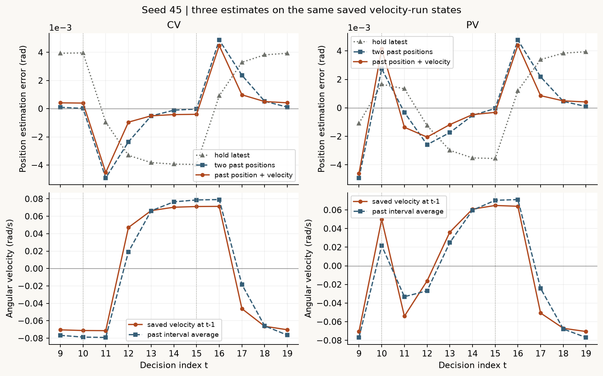
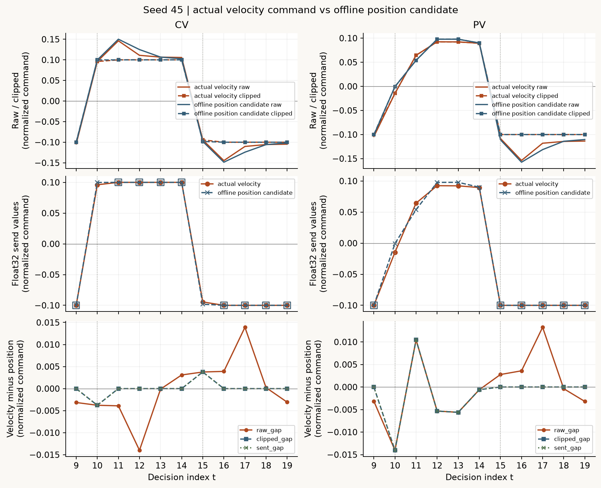
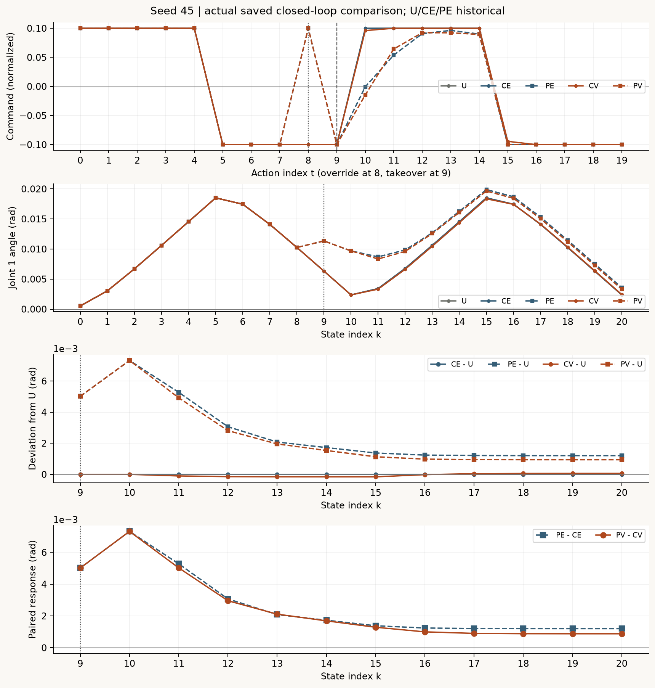
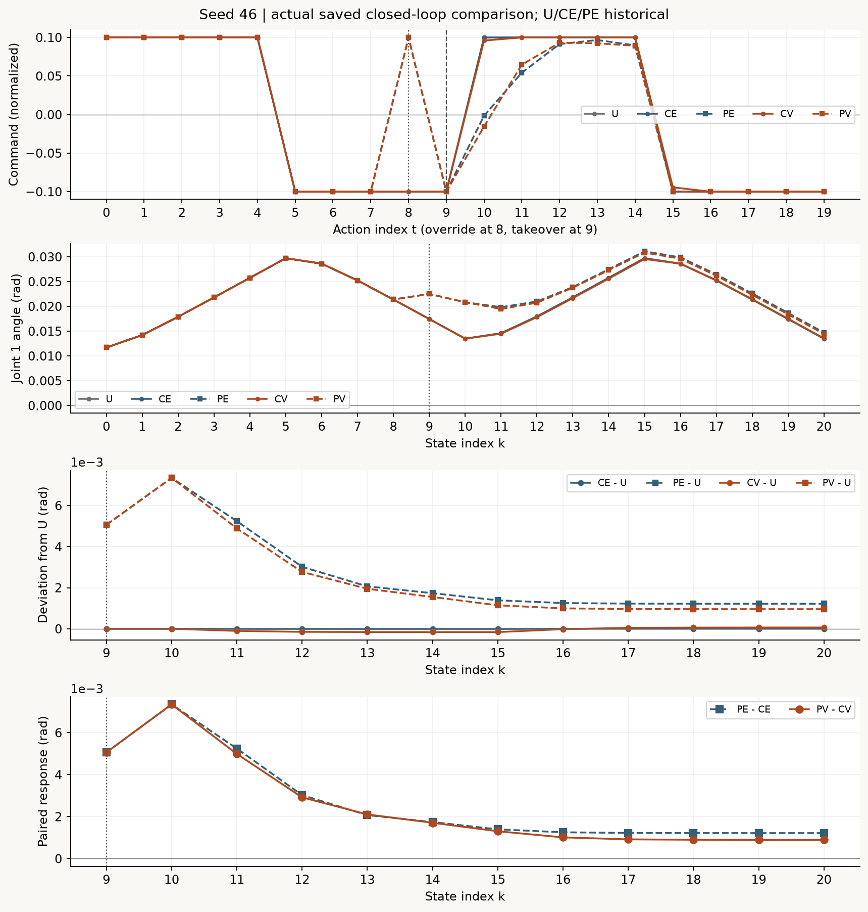
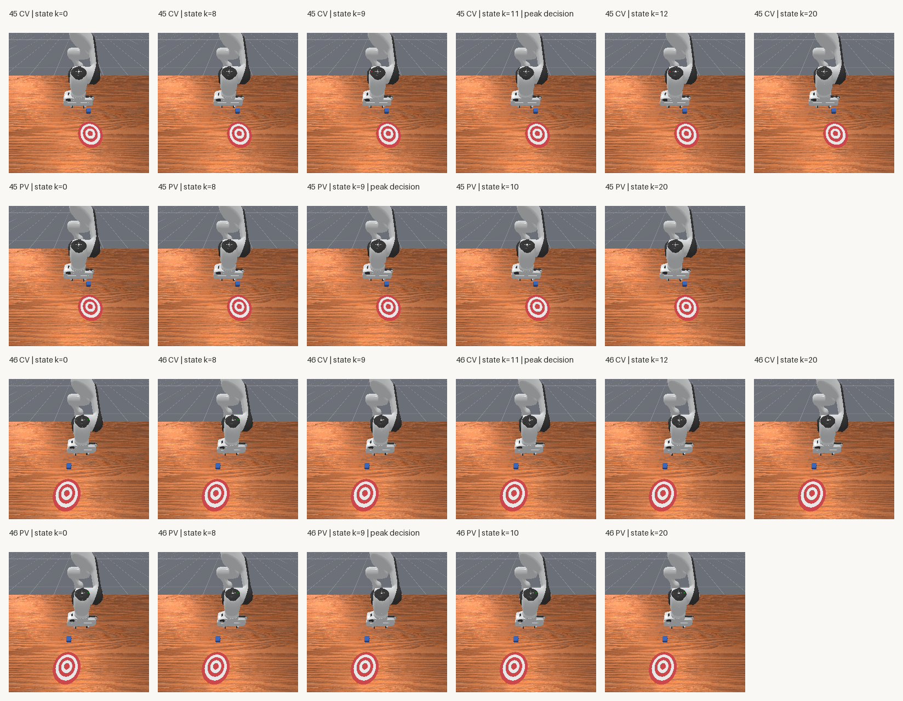

# 位置之外再看速度：一步延迟的状态预测

[下载完整离线复核包，约44 MB](../assets/experiments/21-delayed-velocity-prediction/delayed-velocity-files.zip) · [运行说明](../assets/experiments/21-delayed-velocity-prediction/README.md) · [独立解压验收](../assets/experiments/21-delayed-velocity-prediction/portable-validation.json)

[第19篇](causal-delay-compensation.html)用两次过去的位置外推当前。[第20篇](estimation-error-and-clipping.html)又发现，即使位置误差改变了修正，限幅也可能把两条指令映射到同一个发送值。这次保留一步观测延迟，改用同一份旧观测里的位置和关节速度：沿着当时的速度，再走一个控制周期。

结果分成两层：在同一条新轨迹的保存状态上，四组速度预测的估计RMSE都更低；在真实闭环里，无干预CV比历史CE更偏离参考，有干预PV的跟踪RMSE则略低于历史PE。估计更准，并没有在这批运行里带来一致的跟踪改善。

## 1. 哪些是历史资料，哪些是新运行

每个seed45、46各有五条来源。两种预测使用的信息不同：旧规则使用两份位置，新规则额外读取延迟的关节速度。对照固定了参考、干预、底层控制、增益、限幅和时间安排，但不是输入信息完全相同的纯算法比较。

| 条件 | t=8动作覆盖 | 外层输入 | 来源 |
| --- | --- | --- | --- |
| U | 无 | 无外层修正，原脚本 | 第13篇历史参考 |
| CE | 无 | 本条qpos[t−2]与qpos[t−1] | 第19篇历史位置外推 |
| PE | 有 | 本条qpos[t−2]与qpos[t−1] | 第19篇历史位置外推 |
| CV | 无 | 本条qpos[t−1]与qvel[t−1] | 本篇新增 |
| PV | 有 | 本条qpos[t−1]与qvel[t−1] | 本篇新增 |

共六条历史、四条新增，原始来源清单保留稳定编号、SHA与数值指纹。先离线复算第19篇44次实际补偿审计、126张原始PNG及第20篇诊断，再冻结本篇代码和时间要求。旧轨迹上的速度公式只用于检查字段、索引、有限值和运算，没有执行动作。

实际采集顺序为45-CV、45-PV、46-CV、46-PV。每组一个环境、一次显式seeded reset，构造器初始化另计。四组各20步，80次调用全部返回，44次真实预测查询，84张新图；没有热身、重试或重新采集历史组。

沿用PushCube-v1、panda、单环境、pd_joint_delta_pos、base_camera 256×256 minimal。控制20Hz，物理100Hz，每次step包含5个物理子步。实际记录接口为physx_cpu / sapien_cpu，预测在CPU，图像复制到CPU NumPy；逻辑渲染设备标签不能替代物理GPU利用率测量。[运行环境](../assets/experiments/21-delayed-velocity-prediction/environment.json) · [ManiSkill v3.0.1环境实现](https://github.com/mani-skill/ManiSkill/blob/v3.0.1/mani_skill/envs/sapien_env.py)

## 2. 速度乘以时间，才是预测的位置变化

原始qpos、qvel都具有（状态，环境，关节）轴。这里显式取环境0的第一转动关节，位置用rad，速度用rad/s。最后两个夹爪字段用m与m/s，不参与这个标量公式。[ManiSkill v3.0.1本体观测实现](https://github.com/mani-skill/ManiSkill/blob/v3.0.1/mani_skill/agents/base_agent.py)

```python
q_latest = np.float64(qpos[t - 1, 0, 0])
v_latest = np.float64(qvel[t - 1, 0, 0])
age_s = np.float64(time_s[t, 0] - time_s[t - 1, 0])
predicted_increment = v_latest * age_s
q_pred_velocity = q_latest + predicted_increment
```

乘法结果是rad，才能加回原位置。这里使用仿真控制时钟的实际时间差，逐条核对为0.05秒附近的浮点表示，容差1e-12秒。不能拿GIF播放速度或程序墙钟来算。

qvel是该保存时刻的仿真关节速度；(qpos[t−1]−qpos[t−2])除以过去时间间隔是区间平均位置变化率。即便同一关节、同样单位，两者也未必相等。预测只假设在下一小段时间里延续旧速度，没有拟合动力学，也没有加入加速度项或滤波。

## 3. 因果边界与实际发送动作

当前时钟与参考仍可用：取U的qpos[t,0,0]和actions[t,0]。实际传入预测器的测量只有本条t−1位置、速度与时间；当前角度在完整命令算完后才用于诊断，当前速度不用于预测。私有测试改变当前及未来观测，预测、修正与未限幅值均未改变。

```python
error_rad = q_ref - q_pred_velocity
correction = gain * error_rad / joint_delta_scale_rad
u_raw = u_ff + correction
u_clipped = np.clip(u_raw, -limit, limit)
u_sent = np.float32(u_clipped)
```

gain固定1，物理尺度0.1rad；限幅保留原float32边界的float64精确表示0.10000000149011612。[NumPy 2.4 clip](https://numpy.org/doc/2.4/reference/generated/numpy.clip.html) 底层PD的目标仍从当前真实qpos出发。归一化输入0.1约对应0.01rad目标增量，实际运动另由物理演化决定。[ManiSkill v3.0.1关节控制器](https://github.com/mani-skill/ManiSkill/blob/v3.0.1/mani_skill/agents/controllers/pd_joint_pos.py)

t=0～7走原脚本；t=8只有PV从−0.1覆盖为+0.1；t=9开始速度预测。其他机械臂输入0、夹爪输入1。CV状态0～9与历史CE，PV状态0～9与历史PE，以及新CV/PV状态0～8分别核对，qpos、qvel、方块位姿在这些比较中逐项相同。

第一次查询t=9读取状态8。下表位置与增量用rad，速度用rad/s，发送值为归一化指令。每个seed的CV/PV读取相同旧测量，得到相同预测；动作8的覆盖已经改变PV的实际状态9，预测器此时尚未读到这次变化。

| 运行 | q[8] rad | v[8] rad/s | 预测增量 rad | 预测q[9] rad | 实际q[9] rad | 实际发送值 |
| --- | --- | --- | --- | --- | --- | --- |
| 45-CV | +0.0102590099 | -0.0704293028 | -0.0035214651 | +0.0067375448 | +0.0063217995 | -0.1000000015 |
| 45-PV | +0.0102590099 | -0.0704293028 | -0.0035214651 | +0.0067375448 | +0.0113410475 | -0.1000000015 |
| 46-CV | +0.0213902574 | -0.0704198256 | -0.0035209913 | +0.0178692661 | +0.0174505245 | -0.1000000015 |
| 46-PV | +0.0213902574 | -0.0704198256 | -0.0035209913 | +0.0178692661 | +0.0225135852 | -0.1000000015 |

## 4. 同一份实际状态，比较三种估计

对每条CV/PV的真实决策9～19，用同一份实际当前角度作比较。保持旧位置和位置差分在这些新运行里只事后计算；只有速度预测产生了实际动作。位置差分仍是q[t−1]+(q[t−1]−q[t−2])，不改第19篇公式。

在等间隔0.05秒条件下，速度预测与位置差分的角度差，等于0.05乘以“保存状态速度−过去区间平均变化率”，逐条在float64容差内核对。这个关系解释了两种预测数值为何不同，不能单独确定速度差的动力学成因。

| 运行 | 估计方法 | 决策数 | 最大绝对误差 rad | RMSE rad | 有符号均值 rad | 峰值动作t |
| --- | --- | --- | --- | --- | --- | --- |
| 45-CV | 保持旧位置 | 11 | 0.003958200803 | 0.003446116343 | +0.0003523025238 | 10 |
| 45-CV | 两次位置差分 | 11 | 0.004914787598 | 0.002329501828 | +8.867757226e-06 | 11 |
| 45-CV | 延迟位置＋速度 | 11 | 0.004524003016 | 0.001995715994 | +3.716595979e-05 | 11 |
| 45-PV | 保持旧位置 | 11 | 0.003938590642 | 0.002769589793 | +0.0002723555927 | 19 |
| 45-PV | 两次位置差分 | 11 | 0.004918914288 | 0.002512447697 | +9.246720848e-06 | 9 |
| 45-PV | 延迟位置＋速度 | 11 | 0.004603502713 | 0.00246157797 | +2.930871296e-05 | 9 |
| 46-CV | 保持旧位置 | 11 | 0.003958762623 | 0.003455699271 | +0.0003524668176 | 10 |
| 46-CV | 两次位置差分 | 11 | 0.004957156256 | 0.002342093716 | +8.283521641e-06 | 11 |
| 46-CV | 延迟位置＋速度 | 11 | 0.004561189748 | 0.002010524246 | +3.742309795e-05 | 11 |
| 46-PV | 保持旧位置 | 11 | 0.003940980881 | 0.00278671634 | +0.000271121548 | 19 |
| 46-PV | 两次位置差分 | 11 | 0.004969304428 | 0.002537901106 | +8.636746894e-06 | 9 |
| 46-PV | 延迟位置＋速度 | 11 | 0.004644319043 | 0.002485328643 | +2.932063389e-05 | 9 |

四组速度预测RMSE均低于两种对照，最大误差也小于同状态的位置差分。不过，四组速度预测的最大误差仍高于保持旧位置。平均水平和最差时刻是两种证据；尤其PV在t=9的大误差提醒我们，过去速度不能预知尚未进入测量的动作覆盖。

<figure class="experiment-figure"><figcaption>上排角度估计误差，单位rad；下排旧关节速度与过去区间平均变化率，单位rad/s。 <a href="../assets/experiments/21-delayed-velocity-prediction/seed-0045-estimation.png" download>下载原尺寸图 ↗</a></figcaption></figure>

<figure class="experiment-figure"><figcaption>上排角度估计误差，单位rad；下排旧关节速度与过去区间平均变化率，单位rad/s。 <a href="../assets/experiments/21-delayed-velocity-prediction/seed-0046-estimation.png" download>下载原尺寸图 ↗</a></figcaption></figure>

## 5. 估计差经过限幅，还剩多少指令差

对同一实际状态，用同一个q_ref、u_ff和边界分别重算速度分支与位置差分候选。下表的差值均为“实际速度分支−离线位置候选”，单位是归一化指令。位置候选没有发送，不能赋予reward、下一状态或任务成功。

沿用第20篇精确数值分类：A是raw相同；B是raw不同但float64限幅值相同；C是限幅值不同但float32发送值相同；D是float32发送值不同。严格超界才算截断；发送值等于边界只算触边。两者分别记录。

| 运行 | raw差最大绝对值 / RMSE | clipped差最大绝对值 / RMSE | sent差最大绝对值 / RMSE | A/B/C/D | 位置候选截断 / 触边 |
| --- | --- | --- | --- | --- | --- |
| 45-CV | 0.01398980757 / 0.006586135514 | 0.003777439706 / 0.001608118384 | 0.003777436912 / 0.001608118977 | 0/9/0/2 | 9 / 9 |
| 45-PV | 0.01403670013 / 0.007283265206 | 0.01403670013 / 0.005775486698 | 0.01403669966 / 0.005775486456 | 0/6/0/5 | 6 / 6 |
| 46-CV | 0.01390762813 / 0.006579136248 | 0.003840111196 / 0.001634917096 | 0.003840111196 / 0.001634916303 | 0/9/0/2 | 9 / 9 |
| 46-PV | 0.01396756247 / 0.007280539395 | 0.01396756247 / 0.005768479924 | 0.01396756247 / 0.005768480145 | 0/6/0/5 | 6 / 6 |

44次比较中，30次属于B，14次属于D。这个统计只涉及同状态指令映射；不能用30次发送值相同推断整条历史位置外推轨迹与新轨迹相同。换向、反馈累积和不同的后续状态都会改变比较所处的状态。

<figure class="experiment-figure"><figcaption>上排raw与float64限幅，中排float32实际与候选发送值，方框标严格截断；下排差值。位置候选未实际发送。 <a href="../assets/experiments/21-delayed-velocity-prediction/seed-0045-commands.png" download>下载原尺寸图 ↗</a></figcaption></figure>

<figure class="experiment-figure"><figcaption>上排raw与float64限幅，中排float32实际与候选发送值，方框标严格截断；下排差值。位置候选未实际发送。 <a href="../assets/experiments/21-delayed-velocity-prediction/seed-0046-commands.png" download>下载原尺寸图 ↗</a></figcaption></figure>

## 6. 真实闭环：无干预和有干预分别看

下面使用各自实际执行过的U、CE、PE、CV、PV。动作t连接状态t与t+1；完整运行的诊断动作是9～19，跟踪比较用共同状态k=9～20，共12个点。每组轨迹用自身关节角减同seed的U参考。

| seed | 组别 | 最大绝对偏差 rad | 角度RMSE rad | 共同末状态有符号偏差 rad | 末状态绝对偏差 rad |
| --- | --- | --- | --- | --- | --- |
| 45 | U | 0 | 0 | +0 | 0 |
| 45 | CE | 8.316710591e-06 | 5.244588867e-06 | +3.308290616e-06 | 3.308290616e-06 |
| 45 | PE | 0.007320881123 | 0.003323452218 | +0.001204714645 | 0.001204714645 |
| 45 | CV | 0.0001579467207 | 9.956753309e-05 | +6.257975474e-05 | 6.257975474e-05 |
| 45 | PV | 0.007320881123 | 0.003200600591 | +0.0009411233477 | 0.0009411233477 |
| 46 | U | 0 | 0 | +0 | 0 |
| 46 | CE | 7.534399629e-06 | 4.764341613e-06 | +3.02772969e-06 | 3.02772969e-06 |
| 46 | PE | 0.00734768901 | 0.003328606586 | +0.00122012198 | 0.00122012198 |
| 46 | CV | 0.0001596361399 | 0.0001008400988 | +6.331130862e-05 | 6.331130862e-05 |
| 46 | PV | 0.00734768901 | 0.003206449596 | +0.0009573120624 | 0.0009573120624 |

两个无干预CV的跟踪RMSE约1.0×10⁻⁴ rad，均大于历史CE约5×10⁻⁶ rad。有干预PV约3.20×10⁻³ rad，略低于历史PE约3.32×10⁻³ rad。这些结果只描述这两组已知起点和固定干预，不能概括成速度预测总会改善闭环。

再比较每种方法自己的配对响应：PE−CE、PV−CV。同样使用共同状态9～20。这样可以把有干预与无干预的真实轨迹放在同一参考时钟下读，但仍是小规模配对观察，没有做随机化干预统计或显著性检验。

| seed | 配对差 | 最大绝对值 rad | RMSE rad | 末状态有符号差 rad | 末状态绝对差 rad |
| --- | --- | --- | --- | --- | --- |
| 45 | PE−CE | 0.007320881123 | 0.003325476823 | +0.001201406354 | 0.001201406354 |
| 45 | PV−CV | 0.007320881123 | 0.00323913017 | +0.000878543593 | 0.000878543593 |
| 46 | PE−CE | 0.00734768901 | 0.003330424548 | +0.00121709425 | 0.00121709425 |
| 46 | PV−CV | 0.00734768901 | 0.003245184645 | +0.0008940007538 | 0.0008940007538 |

<figure class="experiment-figure"><figcaption>上方动作索引t；下面用状态索引k。第三排相对U，第四排有干预减无干预，均使用真实运行。 <a href="../assets/experiments/21-delayed-velocity-prediction/seed-0045-comparison.png" download>下载原尺寸图 ↗</a></figcaption></figure>

<figure class="experiment-figure"><figcaption>上方动作索引t；下面用状态索引k。第三排相对U，第四排有干预减无干预，均使用真实运行。 <a href="../assets/experiments/21-delayed-velocity-prediction/seed-0046-comparison.png" download>下载原尺寸图 ↗</a></figcaption></figure>

## 7. 实际步数、图像与任务结果

全部新组和历史对照均为20步、1秒，原始terminated/truncated保持false。由于采集预算结束才停止。下表中的截断/触边只统计各组真实执行的反馈查询；U没有该审计。

| seed | 条件 | 步数 / 秒 | 真实反馈次数 | 截断 / 触边 | 方块净位移 m | 累计reward | success |
| --- | --- | --- | --- | --- | --- | --- | --- |
| 45 | U | 20 / 1.00 | 0 | — | 7.916219971e-07 | 1.3658495843 | false |
| 45 | CE | 20 / 1.00 | 11 | 9 / 9 | 7.916219971e-07 | 1.3658450246 | false |
| 45 | PE | 20 / 1.00 | 11 | 6 / 6 | 7.916219971e-07 | 1.3715654463 | false |
| 45 | CV | 20 / 1.00 | 11 | 9 / 9 | 7.916219971e-07 | 1.3657568097 | false |
| 45 | PV | 20 / 1.00 | 11 | 6 / 6 | 7.916219971e-07 | 1.3711350560 | false |
| 46 | U | 20 / 1.00 | 0 | — | 8.339929955e-07 | 1.5284648389 | false |
| 46 | CE | 20 / 1.00 | 11 | 9 / 9 | 8.339929955e-07 | 1.5284712315 | false |
| 46 | PE | 20 / 1.00 | 11 | 6 / 6 | 8.339929955e-07 | 1.5202905238 | false |
| 46 | CV | 20 / 1.00 | 11 | 9 / 9 | 8.339929955e-07 | 1.5286003500 | false |
| 46 | PV | 20 / 1.00 | 11 | 6 / 6 | 8.339929955e-07 | 1.5209065378 | false |

方块只有很小的位移，所有组success=false。估计误差衡量预测角度，跟踪偏差衡量实际关节对参考的偏离，success是环境任务标志。这三个量不能互相替代。

<figure class="experiment-figure"><figcaption>22个256×256真实图块，标签在图外；全部84张新原图及126张历史原图在下载包内。 <a href="../assets/experiments/21-delayed-velocity-prediction/velocity-frames.png" download>下载原尺寸图 ↗</a></figcaption></figure>

## 8. 全部44次实际预测决策

下表保留全部t=9～19，四组各11条。三个估计误差都用rad，速度用rad/s，发送候选用归一化值；小数显示经过舍入，类别仍以完整精度判定。[完整预定时刻与峰值](../assets/experiments/21-delayed-velocity-prediction/case_summary.json)包含t=9、10、11、15、16、19及三种误差各自的全部峰值并列。

| 运行 | t | 保存速度 rad/s | 区间平均 rad/s | 保持误差 rad | 位置误差 rad | 速度误差 rad | 实际速度发送 | 位置候选未发送 | 类别 |
| --- | --- | --- | --- | --- | --- | --- | --- | --- | --- |
| 45-CV | 9 | -0.070429303 | -0.076737534 | +0.003937210 | +0.000100334 | +0.000415745 | -0.100000001 | -0.100000001 | B |
| 45-CV | 10 | -0.071189329 | -0.078744208 | +0.003958201 | +0.000020990 | +0.000398734 | +0.096012659 | +0.099790096 | D |
| 45-CV | 11 | -0.071348324 | -0.079164016 | -0.000956587 | -0.004914788 | -0.004524003 | +0.100000001 | +0.100000001 | B |
| 45-CV | 12 | +0.047111351 | +0.019131736 | -0.003311424 | -0.002354837 | -0.000955856 | +0.100000001 | +0.100000001 | B |
| 45-CV | 13 | +0.066453002 | +0.066228472 | -0.003827303 | -0.000515879 | -0.000504653 | +0.100000001 | +0.100000001 | B |
| 45-CV | 14 | +0.070356309 | +0.076546054 | -0.003935187 | -0.000107884 | -0.000417372 | +0.100000001 | +0.100000001 | B |
| 45-CV | 15 | +0.071173154 | +0.078703742 | -0.003957761 | -0.000022574 | -0.000399104 | -0.094429493 | -0.098194793 | D |
| 45-CV | 16 | +0.071344413 | +0.079155229 | +0.000916954 | +0.004874716 | +0.004484175 | -0.100000001 | -0.100000001 | B |
| 45-CV | 17 | -0.046155754 | -0.018339083 | +0.003293264 | +0.002376310 | +0.000985476 | -0.100000001 | -0.100000001 | B |
| 45-CV | 18 | -0.066317163 | -0.065865275 | +0.003823538 | +0.000530275 | +0.000507680 | -0.100000001 | -0.100000001 | B |
| 45-CV | 19 | -0.070328400 | -0.076470766 | +0.003934422 | +0.000110884 | +0.000418002 | -0.100000001 | -0.100000001 | B |
| 45-PV | 9 | -0.070429303 | -0.076737534 | -0.001082038 | -0.004918914 | -0.004603503 | -0.100000001 | -0.100000001 | B |
| 45-PV | 10 | +0.049714152 | +0.021640752 | +0.001656568 | +0.002738605 | +0.004142275 | -0.014631562 | -0.000594862 | D |
| 45-PV | 11 | -0.054066069 | -0.033131354 | +0.001340450 | -0.000316118 | -0.001362854 | +0.064390749 | +0.053923391 | D |
| 45-PV | 12 | -0.016141385 | -0.026808996 | -0.001244851 | -0.002585301 | -0.002051921 | +0.092406042 | +0.097739846 | D |
| 45-PV | 13 | +0.036125932 | +0.024897028 | -0.002982521 | -0.001737670 | -0.001176225 | +0.092192568 | +0.097807020 | D |
| 45-PV | 14 | +0.060838077 | +0.059650429 | -0.003515321 | -0.000532799 | -0.000473417 | +0.089383207 | +0.089977033 | D |
| 45-PV | 15 | +0.064763412 | +0.070306417 | -0.003554689 | -0.000039368 | -0.000316518 | -0.100000001 | -0.100000001 | B |
| 45-PV | 16 | +0.063897580 | +0.071093775 | +0.001207449 | +0.004762137 | +0.004402328 | -0.100000001 | -0.100000001 | B |
| 45-PV | 17 | -0.050656747 | -0.024148971 | +0.003388798 | +0.002181349 | +0.000855961 | -0.100000001 | -0.100000001 | B |
| 45-PV | 18 | -0.067036591 | -0.067775957 | +0.003843477 | +0.000454679 | +0.000491647 | -0.100000001 | -0.100000001 | B |
| 45-PV | 19 | -0.070479371 | -0.076869540 | +0.003938591 | +0.000095114 | +0.000414622 | -0.100000001 | -0.100000001 | B |
| 46-CV | 9 | -0.070419826 | -0.076919533 | +0.003939733 | +0.000093756 | +0.000418742 | -0.100000001 | -0.100000001 | B |
| 46-CV | 10 | -0.071114436 | -0.078794658 | +0.003958763 | +0.000019030 | +0.000403041 | +0.095969595 | +0.099809706 | D |
| 46-CV | 11 | -0.071255922 | -0.079175252 | -0.000998394 | -0.004957156 | -0.004561190 | +0.100000001 | +0.100000001 | B |
| 46-CV | 12 | +0.047783129 | +0.019967873 | -0.003338158 | -0.002339764 | -0.000949002 | +0.100000001 | +0.100000001 | B |
| 46-CV | 13 | +0.066659190 | +0.066763163 | -0.003836645 | -0.000498487 | -0.000503685 | +0.100000001 | +0.100000001 | B |
| 46-CV | 14 | +0.070349693 | +0.076732896 | -0.003937811 | -0.000101166 | -0.000420326 | +0.100000001 | +0.100000001 | B |
| 46-CV | 15 | +0.071099572 | +0.078756213 | -0.003958354 | -0.000020543 | -0.000403375 | -0.094369888 | -0.098198205 | D |
| 46-CV | 16 | +0.071251780 | +0.079167075 | +0.000957966 | +0.004916320 | +0.004520555 | -0.100000001 | -0.100000001 | B |
| 46-CV | 17 | -0.046812754 | -0.019159317 | +0.003319958 | +0.002361992 | +0.000979321 | -0.100000001 | -0.100000001 | B |
| 46-CV | 18 | -0.066526376 | -0.066399164 | +0.003832981 | +0.000513023 | +0.000506662 | -0.100000001 | -0.100000001 | B |
| 46-CV | 19 | -0.070323668 | -0.076659620 | +0.003937095 | +0.000104114 | +0.000420912 | -0.100000001 | -0.100000001 | B |
| 46-PV | 9 | -0.070419826 | -0.076919533 | -0.001123328 | -0.004969304 | -0.004644319 | -0.100000001 | -0.100000001 | B |
| 46-PV | 10 | +0.050401680 | +0.022466555 | +0.001674134 | +0.002797462 | +0.004194218 | -0.015419072 | -0.001451509 | D |
| 46-PV | 11 | -0.054485179 | -0.033482686 | +0.001359560 | -0.000314575 | -0.001364699 | +0.064769901 | +0.054268654 | D |
| 46-PV | 12 | -0.016470825 | -0.027191192 | -0.001267714 | -0.002627274 | -0.002091256 | +0.093200311 | +0.098560497 | D |
| 46-PV | 13 | +0.036609031 | +0.025354289 | -0.003023859 | -0.001756145 | -0.001193408 | +0.092442706 | +0.098070078 | D |
| 46-PV | 14 | +0.061499152 | +0.060477182 | -0.003539097 | -0.000515237 | -0.000464139 | +0.089156009 | +0.089666992 | D |
| 46-PV | 15 | +0.064976238 | +0.070781931 | -0.003555464 | -0.000016367 | -0.000306652 | -0.100000001 | -0.100000001 | B |
| 46-PV | 16 | +0.063717954 | +0.071109273 | +0.001250373 | +0.004805837 | +0.004436271 | -0.100000001 | -0.100000001 | B |
| 46-PV | 17 | -0.051335588 | -0.025007464 | +0.003414595 | +0.002164222 | +0.000847816 | -0.100000001 | -0.100000001 | B |
| 46-PV | 18 | -0.067223214 | -0.068291910 | +0.003852155 | +0.000437560 | +0.000490994 | -0.100000001 | -0.100000001 | B |
| 46-PV | 19 | -0.070465624 | -0.077043101 | +0.003940981 | +0.000088826 | +0.000417700 | -0.100000001 | -0.100000001 | B |

- seed45：[CV逐步诊断](../assets/experiments/21-delayed-velocity-prediction/seed-0045-CV-diagnostics.csv)、[PV逐步诊断](../assets/experiments/21-delayed-velocity-prediction/seed-0045-PV-diagnostics.csv)、[实际动作](../assets/experiments/21-delayed-velocity-prediction/seed-0045-actions.csv)、[实际状态](../assets/experiments/21-delayed-velocity-prediction/seed-0045-states.csv)。
- seed46：[CV逐步诊断](../assets/experiments/21-delayed-velocity-prediction/seed-0046-CV-diagnostics.csv)、[PV逐步诊断](../assets/experiments/21-delayed-velocity-prediction/seed-0046-PV-diagnostics.csv)、[实际动作](../assets/experiments/21-delayed-velocity-prediction/seed-0046-actions.csv)、[实际状态](../assets/experiments/21-delayed-velocity-prediction/seed-0046-states.csv)。

## 9. 解压后只读复核

进入下载包README所在目录，用已有兼容Python执行：

```text
python -B inspect_velocity_prediction.py --output-dir result-r001
```

输出目录必须不存在。默认不导入仿真或采集模块。实际使用Python3.11.9、NumPy2.4.6与Pillow13.0.0完成独立目录解压复核，图表用Matplotlib3.11.2生成。采集使用既有ManiSkill3.0.1、SAPIEN3.0.3、PyTorch2.14.1 CPU环境与Gymnasium1.4.0，没有安装或升级依赖。

独立验收不调用采集时的预测函数，从原始状态重算时间差、位置、速度、反馈、限幅和发送位模式，核对实际控制器目标与N/N+1。10条真实来源、210张原始PNG、22个原像素图块全部通过；独立解压复现8份逐步CSV、6份数值导出和3份指标/案例JSON。作者项目核对6806个旧文件、196个引用文件及采集调用账本，未重跑仿真。纯数值NPZ使用allow_pickle=False。[NumPy 2.4 load](https://numpy.org/doc/2.4/reference/generated/numpy.load.html)

常见错误包括读成qvel[t]、错用程序墙钟、把rad/s直接加到rad、将位置候选当作已发送动作、把状态20补成第12个决策，或将触边当作严格截断。先核对索引、单位、时间和位模式，再解释轨迹。

[来源清单](../assets/experiments/21-delayed-velocity-prediction/source_manifest.json) · [冻结配置](../assets/experiments/21-delayed-velocity-prediction/config.json) · [字段说明](../assets/experiments/21-delayed-velocity-prediction/schema.json) · [估计指标](../assets/experiments/21-delayed-velocity-prediction/estimation_metrics.json) · [真实闭环指标](../assets/experiments/21-delayed-velocity-prediction/metrics.json) · [数值验收](../assets/experiments/21-delayed-velocity-prediction/validation.json)

两个seed、参考轨迹和参考时钟都已使用，每组只有1秒。本篇没有训练动力学模型，也没有测试实机噪声、普遍稳定性、泛化、扰动恢复或推物能力。

## 官方资料

- [ManiSkill v3.0.1本体观测](https://github.com/mani-skill/ManiSkill/blob/v3.0.1/mani_skill/agents/base_agent.py)、[关节PD控制器](https://github.com/mani-skill/ManiSkill/blob/v3.0.1/mani_skill/agents/controllers/pd_joint_pos.py)和[环境时间实现](https://github.com/mani-skill/ManiSkill/blob/v3.0.1/mani_skill/envs/sapien_env.py)：对照本地字段、目标锚点与控制周期。
- [NumPy 2.4 clip](https://numpy.org/doc/2.4/reference/generated/numpy.clip.html)与[load](https://numpy.org/doc/2.4/reference/generated/numpy.load.html)：核对固定区间裁剪和纯数值归档读取。
- [Pillow 13.0.0](https://pillow.readthedocs.io/en/stable/releasenotes/13.0.0.html)与[Matplotlib 3.11.2](https://matplotlib.org/3.11.2/api/_as_gen/matplotlib.pyplot.subplots.html)：对应PNG复核和多面板静态图工具版本。
