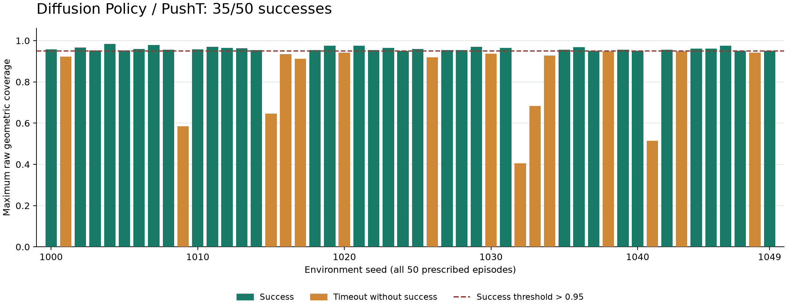
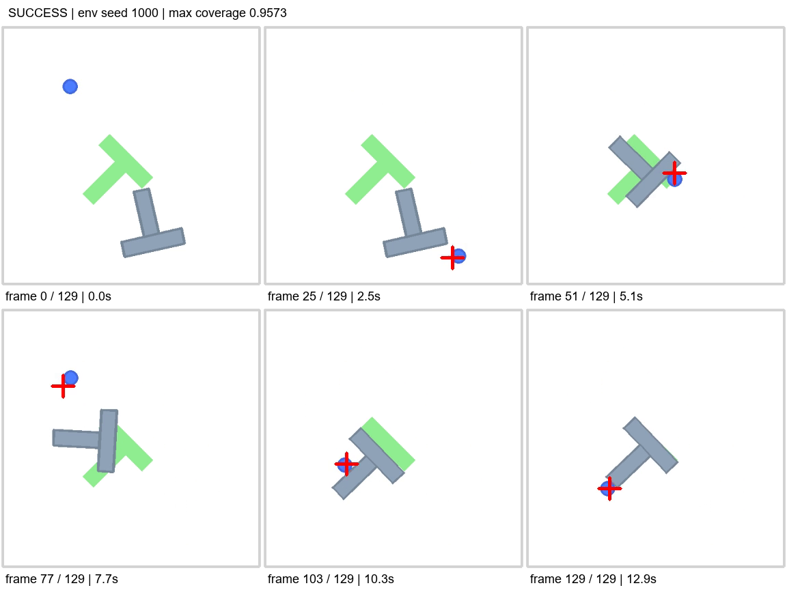
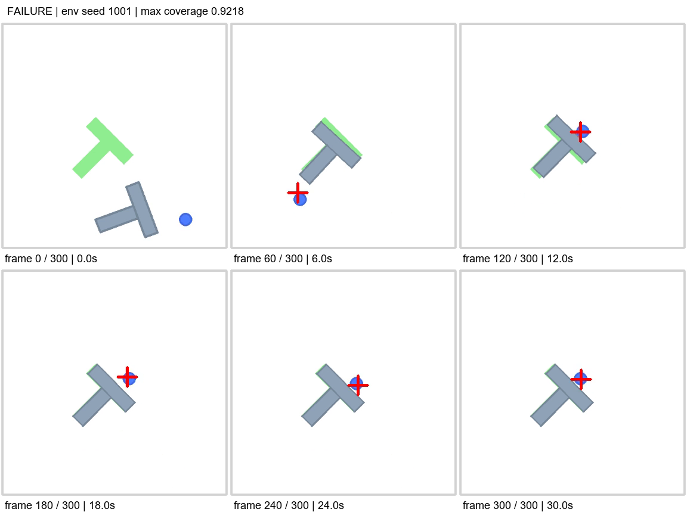

# Diffusion Policy 复现：PushT 的 50 次闭环评测

[下载公开评测资料](../assets/reproductions/diffusion-policy-pusht/pusht-evaluation-results.zip) · [配置与资料说明](../assets/reproductions/diffusion-policy-pusht/README.md) · [只读验收摘要](../assets/reproductions/diffusion-policy-pusht/validation.json)

这一项复现从一个已有模型开始：使用 LeRobot 公开的 Diffusion Policy 权重，在 PushT 仿真任务里运行闭环，并逐次检查结果。

50 个正式回合全部正常完成，**35 次成功，成功率 70%**；另外两个程序检查回合单独记录，不计入正式结果。成功与未达标的回合都保留，没有为取得更好的数字而更换 seed、调整阈值或挑选录像。

这是一项**预训练策略的推理与小规模评测复现**，没有重新训练或微调，也没有覆盖原论文的全部实验。它验证的是：固定代码、权重和任务设置后，模型如何实际执行，以及结果与参考记录有什么关系。

## 先认识 PushT：把 T 形物体推入目标

PushT 是一个二维接触操作任务。画面中的蓝色圆点是推动器，灰色 T 形物体是被操作的对象，绿色区域是目标位置与姿态。策略输出推动器的二维目标位置，环境中的控制器执行动作，物体在接触中移动和旋转。

成功需要同时处理位置和朝向：物体看起来已经很接近目标，也可能因为仍有一部分没有覆盖而未达标。它适合检查一个完整的“观察—选择动作—执行—再次观察”闭环，但不能据此推断真实机械臂上的表现。

## Diffusion Policy 怎样选择动作

Diffusion Policy 的核心做法是通过迭代去噪生成一段动作序列，而不是只预测下一个动作。本次权重使用最近两帧图像和推动器位置作为条件，预测长度为 16 的动作序列，每轮执行其中 8 步，再根据新观察重新预测。

模型保留 100 次 DDPM 去噪，没有为加快运行缩短采样步数。观察图像是 96×96 RGB，录像则使用独立的 384×384 渲染；录像更清楚，不意味着把更大尺寸图像直接输入模型。评测模式沿用模型中的 84×84 中心裁剪和权重内保存的归一化统计。

原方法和实现来源分别见 [Diffusion Policy 原作者仓库](https://github.com/real-stanford/diffusion_policy)、[本次固定版本的 LeRobot](https://github.com/huggingface/lerobot/tree/b883328e6c95681ca90a18b102e4ae5e1f91e2bf) 与 [固定 revision 的模型权重](https://huggingface.co/lerobot/diffusion_pusht/tree/84a7c23178445c6bbf7e1a884ff497017910f653)。本次评测使用的是 LeRobot 实现。

## 固定版本，再固定评测协议

| 项目 | 本次设置 |
| --- | --- |
| LeRobot | v0.3.3，commit `b883328e6c95681ca90a18b102e4ae5e1f91e2bf` |
| 权重 | `lerobot/diffusion_pusht` |
| 权重 revision | `84a7c23178445c6bbf7e1a884ff497017910f653` |
| 环境 | gym-pusht 0.1.5；gymnasium 0.29.1；pymunk 6.11.1 |
| 执行方式 | 单环境，batch=1，每回合最多 300 步 |
| 正式环境 seed | 1000—1049，共 50 个 |
| 程序检查 seed | 9000、9001，不计入正式结果 |
| 策略随机数 | 每回合按 `20261106 + 环境 seed` 重置 Python、NumPy、torch 与 CUDA 随机数 |
| 计算条件 | RTX 4060 Ti 8GB；torch 2.7.1+cu128；FP32 参数，关闭 AMP，允许 TF32 |

先完成观察尺寸、动作预测和两个测试回合检查，再写入正式协议及其哈希，之后运行预先规定的 50 个回合。每回合重置策略历史和动作队列，首次成功或达到步数上限即结束。

需要核对完整字段时，可以下载[评测配置公开节选](../assets/reproductions/diffusion-policy-pusht/protocol.json)与[参考比较口径澄清](../assets/reproductions/diffusion-policy-pusht/protocol-clarifications.md)。代码版本、权重 revision 和模型文件 SHA256 也列在资料说明中。

## 35/50 成功，具体代表什么

| 指标 | 本次结果 |
| --- | --- |
| 正式回合 | 50 |
| 任务成功 | 35 |
| 超时未达标 | 15 |
| 程序异常 | 0 |
| 成功率 | 70% |
| 平均最大原始覆盖率 | 0.916032 |
| 平均最大归一化奖励 | 0.956204 |
| 正式回合循环总耗时 | 约 46.9 分钟 |

“35 次成功”表示这 35 个回合在步数上限之前，达到了环境的原始成功条件；其余 15 个回合按正常任务失败计入分母。这与程序报错、录像缺失或数据损坏不同。

<figure class="experiment-figure"><figcaption>全部 50 个预先规定的环境 seed。成功条件为原始覆盖率严格大于 0.95；接近阈值的失败回合也完整保留。</figcaption></figure>

[逐回合结果 CSV](../assets/reproductions/diffusion-policy-pusht/results.csv) · [汇总 JSON](../assets/reproductions/diffusion-policy-pusht/summary.json) · [覆盖率图 SVG](../assets/reproductions/diffusion-policy-pusht/images/coverage-by-seed.svg)

运行时长包含回合中的观察处理、推理、物理步进和录像帧写入，不是纯模型推理延迟。录像按 10 FPS 的仿真时间轴播放，也不能据此声称模型能实时控制机器人。

## 覆盖率、奖励与成功率不能互相代替

在这个固定版本的环境中，原始覆盖率是物体与目标重合面积占目标面积的比例，成功判定为：

```python
is_success = coverage > 0.95
reward = clip(coverage / 0.95, 0.0, 1.0)
```

因此，一个覆盖率为 0.94 的回合，归一化奖励可以接近 0.99，但仍然没有成功。平均最大归一化奖励为 0.956204，也不能写成“95.6% 的成功率”或“95.6% 的原始覆盖率”。

本次逐步核对了覆盖率、奖励和成功标记，并分别导出两个最大值指标。来源的实际计算可见 [gym-pusht 0.1.5](https://pypi.org/project/gym-pusht/0.1.5/)。

## 同时看一个成功和一个失败案例

下面按环境 seed 升序，选取首个成功和首个失败回合。它们用于解释过程；总体结果仍以全部 50 个回合为准。公开资料提供这两段代表录像，完整的 52 段运行录像保留在本地实验记录中。

### 成功案例：seed 1000

该回合在 129 步后结束，最大原始覆盖率约为 0.9573。物体经历移动和旋转，最终与绿色目标基本重合，超过了环境阈值。

<figure class="experiment-figure"><video controls playsinline preload="metadata" width="384" height="384" poster="../assets/reproductions/diffusion-policy-pusht/images/seed-1000-poster.png" aria-label="seed1000成功回合的完整PushT仿真录像"><source src="../assets/reproductions/diffusion-policy-pusht/videos/seed-1000.mp4" type="video/mp4"><a href="../assets/reproductions/diffusion-policy-pusht/videos/seed-1000.mp4">下载成功案例录像</a></video><figcaption>成功回合的完整录像，由读者主动播放。</figcaption></figure>

<figure class="experiment-figure"><figcaption>从初始状态到成功时刻的六帧抽查。</figcaption></figure>

### 失败案例：seed 1001

该回合运行到 300 步上限，最大原始覆盖率约为 0.9218。物体已经接近目标，但仍有位置或姿态偏差，最终没有跨过 0.95 阈值。录像帮助观察现象，不能仅凭画面确认模型失败的根因。

<figure class="experiment-figure"><video controls playsinline preload="metadata" width="384" height="384" poster="../assets/reproductions/diffusion-policy-pusht/images/seed-1001-poster.png" aria-label="seed1001超时未达标回合的完整PushT仿真录像"><source src="../assets/reproductions/diffusion-policy-pusht/videos/seed-1001.mp4" type="video/mp4"><a href="../assets/reproductions/diffusion-policy-pusht/videos/seed-1001.mp4">下载失败案例录像</a></video><figcaption>超时未达标回合的完整录像，仍计入 50 次正式评测。</figcaption></figure>

<figure class="experiment-figure"><figcaption>直到第 300 步仍存在偏差，最大覆盖率低于成功阈值。</figcaption></figure>

## 与官方参考结果怎样对照

| 对照范围 | 成功数与成功率 | 平均最大归一化奖励 |
| --- | --- | --- |
| 本次正式评测 | 35/50，70% | 0.956204 |
| 官方记录中相同环境 seed 的 50 回合 | 37/50，74% | 0.961408 |
| 官方完整 500 回合记录 | 65.4% | 0.955132 |

固定模型 revision 中的参考记录使用环境 seed 1000—1499；本次 1000—1049 是其中的前 50 个。匹配子集的数值由公开参考记录重新汇总，见[对照数据](../assets/reproductions/diffusion-policy-pusht/reference-comparison.json)及[官方原始评测记录](https://huggingface.co/lerobot/diffusion_pusht/blob/84a7c23178445c6bbf7e1a884ff497017910f653/eval_info.json)。

本次成功总数比匹配参考少 2 次，相差 4 个百分点。环境 seed 标签一致，但策略随机数的设置与消耗、batch 大小、软件依赖和 GPU 数值设置不同，不能要求逐帧轨迹相同，也不能仅凭这个小样本认定性能等价或算法优劣。

## 这次复现处理了哪些兼容问题

既有研究环境使用 CPU 版 PyTorch，与候选 LeRobot 的版本范围不匹配，因此本次采用独立环境，保留原环境依赖。Windows 下，固定历史版本的通用配置加载路径还遇到了临时文件锁定问题。

处理方式是使用同一 draccus 解码器在内存中解析原始模型 JSON，再向模型加载器显式传入配置；原始配置、权重和上游源码没有修改，加载时严格核对模型键。PyAV 和 pyarrow 也固定到本机可用且满足依赖要求的版本。

这些是固定历史版本的复现经验，尚未确认最新版是否存在同一问题，也没有向上游提交 Issue 或 PR。相关安装失败与测试中断记录保留在本地，未被计入正式 50 回合。

## 验收通过到了哪一步

本地评测结束后，完成了独立的只读检查：重新核算每步奖励与成功标记、重建逐回合及汇总指标，完整解码 52 段录像，核对尺寸、FPS 和“帧数等于步数加一”，并验证协议、模型及源码哈希。发布前又对密封结果完成了一次只读数值和视频验收，没有重新运行仿真。

成功与失败代表案例完成了抽帧目视检查，全部 50 回合的覆盖率图也完成了版面检查。环境重建步骤已整理，重建脚本完成语法检查，但尚未在第二个空白环境中重新安装并评测。

现在可以报告“预训练策略推理与小规模闭环评测复现完成”。发布不要求达到 50/50；更重要的是准确说明测试条件、成功标准、失败结果和验证范围。若以后改变模型、推理设置或训练过程，再作为新的实验与这条基线分别报告。

## 从基础实验继续到开源模型

[基础实验](../learn.html)逐步建立对观测、动作、数据和闭环的理解；这一板块把这些检查方法用于已有模型。后续复现继续采用固定版本、明确协议和完整结果记录的方式，在每个项目中写清楚实际验证到了哪一步。

原方法、模型和 LeRobot 代码归属各自作者与贡献者。本次新增内容为运行与评测整理、固定协议、兼容性记录及结果核验；资料来源与版本见文中的官方链接。
