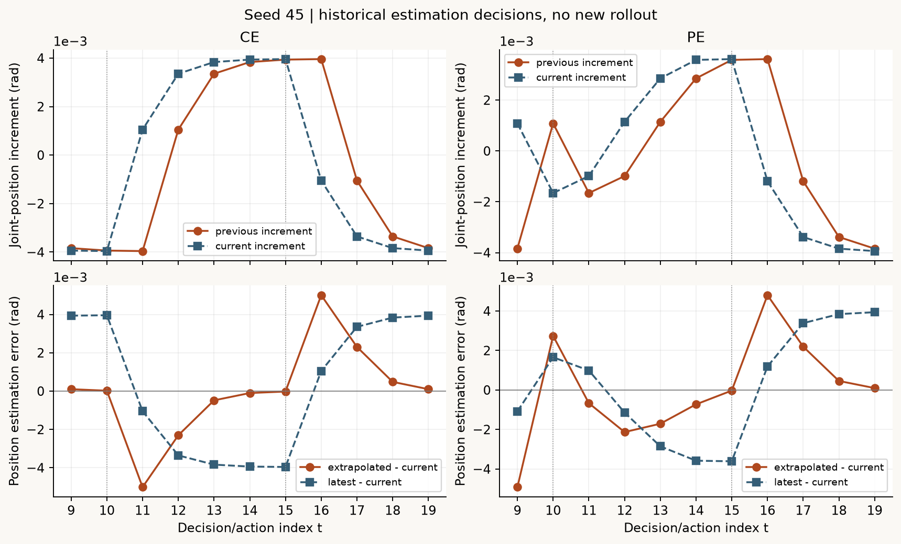
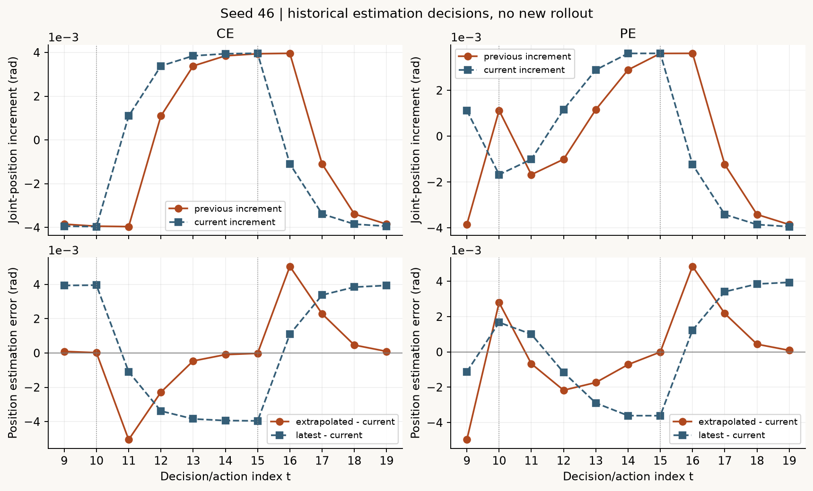
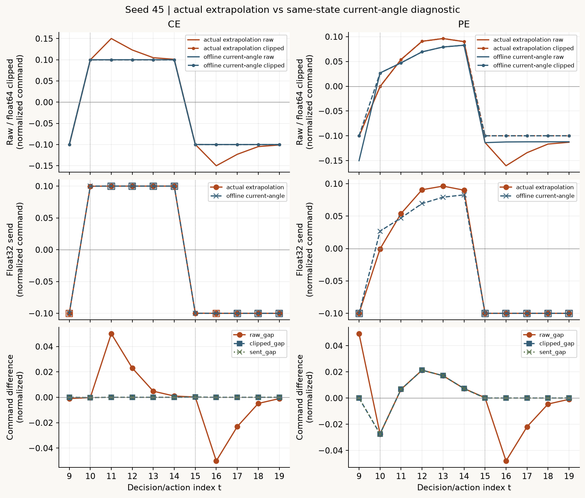
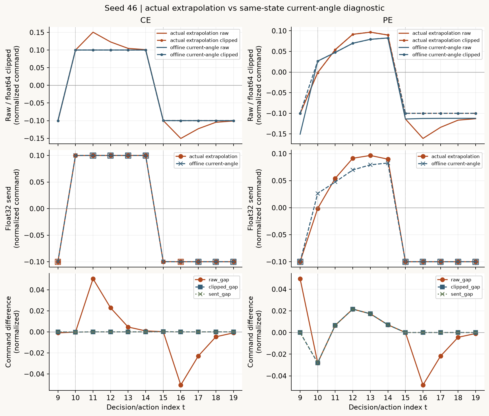
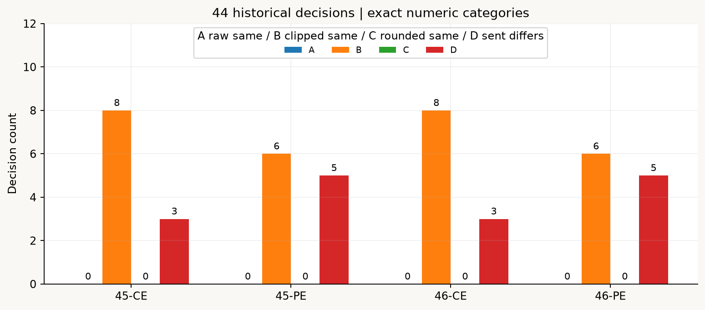
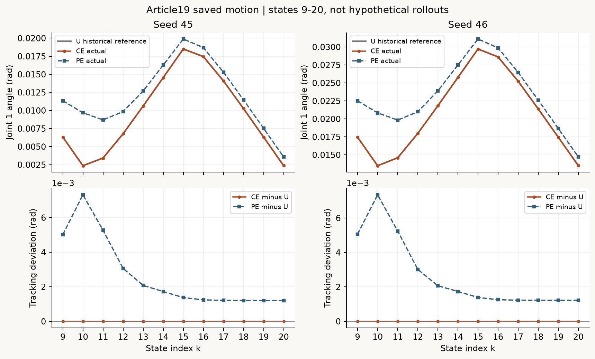
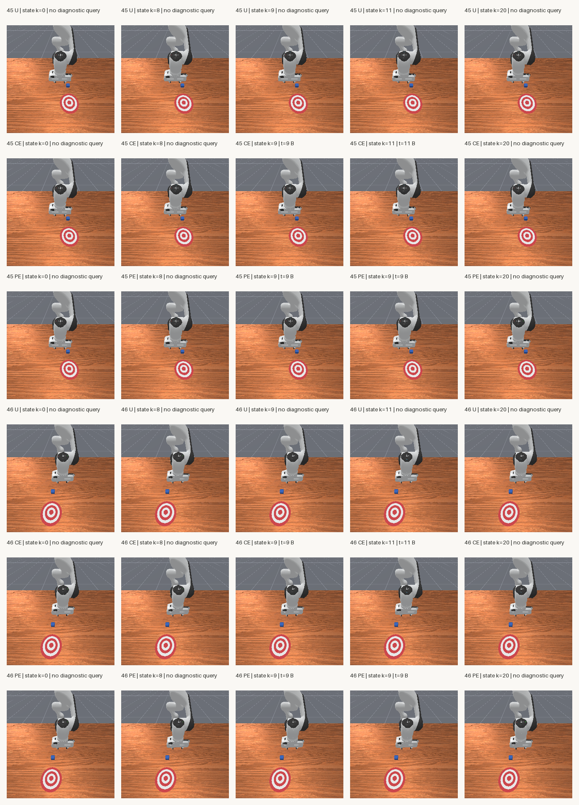

# 从估计误差到动作指令：拆解延迟补偿与限幅

[下载完整只读复核包，约27 MB](../assets/experiments/20-estimation-action-diagnostics/estimation-action-files.zip) · [运行说明](../assets/experiments/20-estimation-action-diagnostics/README.md) · [独立解压验收](../assets/experiments/20-estimation-action-diagnostics/portable-validation.json)

[第19篇](causal-delay-compensation.html)发现：线性外推降低了估计RMSE，却放大了一些时刻的峰值误差。这一篇沿着保存数据继续往下查：位置估计误差变成了多少反馈修正差？经过限幅和float32转换后，实际发送值还差多少？

真实结果是44次历史补偿决策中，28次未限幅指令不同，但限幅后发送值相同；16次发送值不同。没有原始指令完全相同的记录，也没有仅靠float32舍入才相同的记录。这个结果解释的是这些时刻的数值映射，不能代替新的闭环对照。

## 1. 六条历史来源，零次新增仿真

复用seed45、46各自的U参考与CE/PE。U来自第13篇无干预脚本，CE/PE来自第19篇无干预/有干预外推反馈。来源编号在本篇重新稳定映射，同时保留第19篇编号。

| 本篇source_id | seed | 条件 | 第19篇source_id | 原采集来源 | 实际动作数 |
| --- | --- | --- | --- | --- | --- |
| 0 | 45 | U | 0 | 第13篇历史采集 | 20 |
| 1 | 45 | CE | 5 | 第19篇历史采集 | 20 |
| 2 | 45 | PE | 6 | 第19篇历史采集 | 20 |
| 3 | 46 | U | 7 | 第13篇历史采集 | 20 |
| 4 | 46 | CE | 12 | 第19篇历史采集 | 20 |
| 5 | 46 | PE | 13 | 第19篇历史采集 | 20 |

四条CE/PE各20个动作、21份观测、11次实际补偿查询，查询动作索引t=9～19，共44条。六条完整来源共126张原始PNG，全部是历史复用，复制资料与生成诊断文件都不算新增机器人采集。

本篇全程离线CPU：仿真初始化、reset、step、采集、训练、权重更新、统计拟合和参数调整均为0。计算从原始位置读取独立副本，未执行任何采集脚本。

实际复用Python3.11.9、NumPy2.4.6、Pillow13.0.0、Matplotlib3.11.2，没有安装或升级依赖。历史任务仍为PushCube-v1、Panda、pd_joint_delta_pos、base_camera256×256/minimal，控制20Hz、物理100Hz。环境记录分别保留CPU物理、外层计算、图像传输和渲染接口，不能从CPU张量推断没有GPU渲染；本篇没有初始化渲染器。[环境记录](../assets/experiments/20-estimation-action-diagnostics/environment.json)

## 2. 先把t−2、t−1、t、t+1分清

qpos来源形状为(21,1,9)，轴依次是状态、环境、关节。第一关节显式取qpos[t,0,0]，不使用无条件squeeze。actions形状是(20,8)，这里没有环境轴，第一维动作是actions[t,0]。

```python
q_previous = np.float64(qpos[t - 2, 0, 0])
q_latest = np.float64(qpos[t - 1, 0, 0])
q_current = np.float64(qpos[t, 0, 0])

delta_previous = q_latest - q_previous
delta_current = q_current - q_latest
q_estimated = q_latest + delta_previous
estimate_error = q_estimated - q_current
hold_error = q_latest - q_current
```

固定顺序计算后，逐条核对：

```text
estimate_error = delta_previous - delta_current
hold_error = -delta_current
```

这说明外推假设下一段位置增量接近上一段；增量发生变化时就产生估计误差。以上都是位置或位置增量，单位rad。相邻增量之差不能直接叫真实加速度，也不是rad/s²。

动作t连接obs[t]→actions[t]→obs[t+1]。例如决策9读取状态7、8估计状态9，动作后状态为10；决策19读取17、18估计19，动作后状态为20。最后状态20没有对应补偿查询。本篇保存了四个状态索引及各自时间，避免把11次决策和12份跟踪状态混用。

q_current是本次事后诊断读到的真值，不是第19篇外层控制器当时可见的输入。这里只诊断已见数据，不是新的盲测或独立测试。

<figure class="experiment-figure"><figcaption>上排对照相邻两段位置增量，下排对照外推误差与保持旧测量误差；虚线为脚本换向动作10、15。 <a href="../assets/experiments/20-estimation-action-diagnostics/seed-0045-estimation.png" download>下载原尺寸图 ↗</a></figcaption></figure>

<figure class="experiment-figure"><figcaption>seed46按相同口径显示，保留换向附近的峰值。 <a href="../assets/experiments/20-estimation-action-diagnostics/seed-0046-estimation.png" download>下载原尺寸图 ↗</a></figcaption></figure>

## 3. 在同一个实际状态上重算两种指令

从同seed的U独立读取q_ref=U.obs[t]第一关节、u_ff=U.actions[t,0]，参考索引始终是t。gain固定1，joint_delta_scale_rad固定0.1；限幅边界保留原float32接口值的float64精确表示0.10000000149011612，不能重新换成十进制0.1。

```python
error_est = q_ref - q_estimated
correction_est = gain * error_est / joint_delta_scale_rad
raw_est = u_ff + correction_est
clipped_est = np.clip(raw_est, -limit, limit)
sent_est = np.float32(clipped_est)

error_current = q_ref - q_current
correction_current = gain * error_current / joint_delta_scale_rad
raw_current = u_ff + correction_current
clipped_current = np.clip(raw_current, -limit, limit)
sent_current = np.float32(clipped_current)
```

sent_est已经与原始actions及实际反馈审计按float32位模式核对一致。sent_current只是同条实际状态上的即时测量离线重算：没有发送，不是已知正确或最优标签，也没有新reward、下一状态或成功标志。不能拿另一条C0/P0运行的动作替代它。

两种计算共用本条状态、同一参考、前馈和边界，只替换外层反馈使用的角度。底层PD仍及时读取当前状态，以当前qpos作为增量目标锚点；归一化输入0.1约映射0.01rad目标增量，不能写成实际关节转了0.1rad。动作、目标和实际运动分别保存。[ManiSkill3.0.1关节控制器](https://github.com/mani-skill/ManiSkill/blob/v3.0.1/mani_skill/agents/controllers/pd_joint_pos.py)

位置误差除以0.1rad后才成为归一化修正项。没有使用第8篇的状态标准化替代物理单位换算。

## 4. 三层指令差，分别保存

```python
raw_gap = raw_est - raw_current
clipped_gap = clipped_est - clipped_current
sent_gap = np.float64(sent_est) - np.float64(sent_current)
rounding_residual = sent_gap - clipped_gap
```

独立核对raw_gap≈−gain×estimate_error/0.1。raw_gap、clipped_gap、sent_gap和rounding_residual全是归一化指令量，不是rad。float64限幅还满足abs(clipped_gap)≤abs(raw_gap)，验收沿用atol=1e-12、rtol=0；float32发送差另外保存，不能忽略舍入残差后直接推广这个关系。

| 运行 | raw_gap 最大绝对值 / RMSE | clipped_gap 最大绝对值 / RMSE | sent_gap 最大绝对值 / RMSE |
| --- | --- | --- | --- |
| 45-CE | 0.0500958506018 / 0.0236035175617 | 0.000210693106055 / 8.97183536869e-05 | 0.00021068751812 / 8.97174216553e-05 |
| 45-PE | 0.0491891428828 / 0.0249064117747 | 0.027386052534 / 0.0120388170398 | 0.0273860529996 / 0.0120388173848 |
| 46-CE | 0.0505436770618 / 0.0237393775117 | 0.000191107392311 / 8.13510907675e-05 | 0.000191107392311 / 8.13506946671e-05 |
| 46-PE | 0.049693044275 / 0.0251561065716 | 0.0279746204615 / 0.0122400036996 | 0.0279746204615 / 0.0122400020211 |

| 运行 | 舍入残差最小值 | 舍入残差最大值 |
| --- | --- | --- |
| 45-CE | -5.58793544769e-09 | +3.72529029846e-09 |
| 45-PE | -1.86264514923e-09 | +1.86264514923e-09 |
| 46-CE | +0 | +1.86264514923e-09 |
| 46-PE | -7.45058059692e-09 | +0 |

这些范围很小但没有被抹掉。它们描述发送类型转换的实际差异，不能解释成新的机器人运动。完整精度保存在NPZ与CSV中，文中小数仅用于阅读。

<figure class="experiment-figure"><figcaption>上排raw与float64限幅，中排float32发送，方框分别标出两种计算的严格截断，下排三层差值；即时重算未执行。 <a href="../assets/experiments/20-estimation-action-diagnostics/seed-0045-commands.png" download>下载原尺寸图 ↗</a></figcaption></figure>

<figure class="experiment-figure"><figcaption>seed46完整11次决策，单位均为归一化指令，不能当成rad或真实运动差。 <a href="../assets/experiments/20-estimation-action-diagnostics/seed-0046-commands.png" download>下载原尺寸图 ↗</a></figcaption></figure>

## 5. 严格截断、触边与四类情况

严格截断指raw小于−limit或大于+limit；触边指最终float32发送值的绝对值等于float32(limit)。原本就在边界上也会触边，不必发生截断。

逐条采用互斥的严格数值分类，不用容差代替相等：

| 类别 | 条件 | 实际总数 |
| --- | --- | --- |
| A | raw_est与raw_current数值相同 | 0 |
| B | raw不同，float64限幅后相同 | 28 |
| C | float64限幅后不同，float32发送值相同 | 0 |
| D | float32发送值不同 | 16 |

每行只归一类，总计44。+0与−0数值相等；如果报告位模式，它们可以不同。因此另存sent_numeric_equal和sent_bits_equal，本批真实记录两者都为28，并不代表所有数据都会一致。[NumPy2.4数值相等](https://numpy.org/doc/2.4/reference/generated/numpy.array_equal.html)

| 运行 | 决策数 | 最大估计误差绝对值 rad | 估计RMSE rad | 有符号均值 rad | A/B/C/D |
| --- | --- | --- | --- | --- | --- |
| 45-CE | 11 | 0.005009585060 | 0.002360351756 | +0.000009108123 | 0/8/0/3 |
| 45-PE | 11 | 0.004918914288 | 0.002490641177 | +0.000009233682 | 0/6/0/5 |
| 46-CE | 11 | 0.005054367706 | 0.002373937751 | +0.000008511442 | 0/8/0/3 |
| 46-PE | 11 | 0.004969304428 | 0.002515610657 | +0.000008625063 | 0/6/0/5 |

| 运行 | 实际外推：截断/触边/触边未截断 | 即时重算：截断/触边/触边未截断 | 发送值数值相等/位相等 |
| --- | --- | --- | --- |
| 45-CE | 9 / 9 / 0 | 7 / 9 / 2 | 8 / 8 |
| 45-PE | 6 / 6 / 0 | 6 / 6 / 0 | 6 / 6 |
| 46-CE | 9 / 9 / 0 | 7 / 9 / 2 | 8 / 8 |
| 46-PE | 6 / 6 / 0 | 6 / 6 / 0 | 6 / 6 |

CE的即时重算各有两次触边但没有严格截断，正好说明二者应分开。实际数据没有C类，不代表这种舍入情形不存在；私有人工数值用例另外覆盖它，未冒充机器人样本。

<figure class="experiment-figure"><figcaption>每组11条。0也显式保留；不把某一类数量当作验收通过条件。 <a href="../assets/experiments/20-estimation-action-diagnostics/category-counts.png" download>下载原尺寸图 ↗</a></figcaption></figure>

## 6. 首次查询与全部峰值

t=9两种条件使用相同的状态7、8，但PE的动作8覆盖已经改变当前状态9。历史外推还没有读到这个变化，因此本条实际指令与同状态即时重算要分开看。以下位置单位rad，raw和sent为归一化指令。

| 运行 | q_previous[7] | q_latest[8] | q_current[9] | raw_est | raw_current | sent_est / sent_current |
| --- | --- | --- | --- | --- | --- | --- |
| 45-CE | +0.014095886610 | +0.010259009898 | +0.006321799476 | -0.101003338583 | -0.100000001490 | -0.100000001490 / -0.100000001490 |
| 45-PE | +0.014095886610 | +0.010259009898 | +0.011341047473 | -0.101003338583 | -0.150192481466 | -0.100000001490 / -0.100000001490 |
| 46-CE | +0.025236234069 | +0.021390257403 | +0.017450524494 | -0.100937563926 | -0.100000001490 | -0.100000001490 / -0.100000001490 |
| 46-PE | +0.025236234069 | +0.021390257403 | +0.022513585165 | -0.100937563926 | -0.150630608201 | -0.100000001490 / -0.100000001490 |

每条运行最大绝对估计误差按实际数据选出；如有精确并列会全部保留。这里各有一个峰值：CE在t=11，PE在t=9。两份过去测量、估计、当前真值与两个位置增量如下，单位均为rad。

| 运行 | t | q_previous | q_latest | q_estimated | q_current | delta_previous | delta_current |
| --- | --- | --- | --- | --- | --- | --- | --- |
| 45-CE | 11 | +0.006321799476 | +0.002363598673 | -0.001594602130 | +0.003414982930 | -0.003958200803 | +0.001051384257 |
| 45-PE | 9 | +0.014095886610 | +0.010259009898 | +0.006422133185 | +0.011341047473 | -0.003836876713 | +0.001082037576 |
| 46-CE | 11 | +0.017450524494 | +0.013491761871 | +0.009532999247 | +0.014587366953 | -0.003958762623 | +0.001095605083 |
| 46-PE | 9 | +0.025236234069 | +0.021390257403 | +0.017544280738 | +0.022513585165 | -0.003845976666 | +0.001123327762 |

相同峰值时刻的指令逐层对照如下，每个单元格按“实际外推 / 即时重算”排列，均为归一化指令量。

| 运行 | t | correction | raw | clipped float64 | sent float32 | 类别 |
| --- | --- | --- | --- | --- | --- | --- |
| 45-CE | 11 | +0.050148533192 / +0.000052682590 | +0.150148534682 / +0.100052684080 | +0.100000001490 / +0.100000001490 | +0.100000001490 / +0.100000001490 | B |
| 45-PE | 9 | -0.001003337093 / -0.050192479976 | -0.101003338583 / -0.150192481466 | -0.100000001490 / -0.100000001490 | -0.100000001490 / -0.100000001490 | B |
| 46-CE | 11 | +0.050591826439 / +0.000048149377 | +0.150591827929 / +0.100048150867 | +0.100000001490 / +0.100000001490 | +0.100000001490 / +0.100000001490 | B |
| 46-PE | 9 | -0.000937562436 / -0.050630606711 | -0.100937563926 / -0.150630608201 | -0.100000001490 / -0.100000001490 | -0.100000001490 / -0.100000001490 | B |

四个峰值都落在B类：较大的位置估计误差确实改变了修正与未限幅指令，但最终被同一边界映射成相同发送值。这个局部现象不能说明估计误差没有影响，也不能保证两种规则整段闭环运行相同。

## 7. 全部44条，不只挑峰值

以下保留t=9～19的完整诊断，其中包括预先指定的t=9、10、11、15、16、19。原始全精度值、两套边界标志及所有位置量可下载[位置分解CSV](../assets/experiments/20-estimation-action-diagnostics/error_decomposition.csv)、[指令分解CSV](../assets/experiments/20-estimation-action-diagnostics/command_decomposition.csv)和[完整数值NPZ](../assets/experiments/20-estimation-action-diagnostics/diagnostic_records.npz)。

| 样本ID | 来源 | t | estimate_error rad | raw_gap | clipped_gap | sent_gap | 类别 |
| --- | --- | --- | --- | --- | --- | --- | --- |
| 0 | 45-CE | 9 | +0.0001003337 | -0.0010033371 | +0.0000000000 | +0.0000000000 | B |
| 1 | 45-CE | 10 | +0.0000209904 | -0.0002099038 | -0.0002099038 | -0.0002099052 | D |
| 2 | 45-CE | 11 | -0.0050095851 | +0.0500958506 | +0.0000000000 | +0.0000000000 | B |
| 3 | 45-CE | 12 | -0.0023035149 | +0.0230351486 | +0.0000000000 | +0.0000000000 | B |
| 4 | 45-CE | 13 | -0.0004814640 | +0.0048146397 | +0.0000000000 | +0.0000000000 | B |
| 5 | 45-CE | 14 | -0.0001007249 | +0.0010072486 | +0.0000000000 | +0.0000000000 | B |
| 6 | 45-CE | 15 | -0.0000210693 | +0.0002106931 | +0.0002106931 | +0.0002106875 | D |
| 7 | 45-CE | 16 | +0.0050074561 | -0.0500745606 | -0.0000095926 | -0.0000095889 | D |
| 8 | 45-CE | 17 | +0.0023046713 | -0.0230467133 | +0.0000000000 | +0.0000000000 | B |
| 9 | 45-CE | 18 | +0.0004822183 | -0.0048221834 | +0.0000000000 | +0.0000000000 | B |
| 10 | 45-CE | 19 | +0.0001008776 | -0.0010087760 | +0.0000000000 | +0.0000000000 | B |
| 11 | 45-PE | 9 | -0.0049189143 | +0.0491891429 | +0.0000000000 | +0.0000000000 | B |
| 12 | 45-PE | 10 | +0.0027386053 | -0.0273860525 | -0.0273860525 | -0.0273860530 | D |
| 13 | 45-PE | 11 | -0.0006683851 | +0.0066838507 | +0.0066838507 | +0.0066838488 | D |
| 14 | 45-PE | 12 | -0.0021318793 | +0.0213187933 | +0.0213187933 | +0.0213187933 | D |
| 15 | 45-PE | 13 | -0.0017090915 | +0.0170909148 | +0.0170909148 | +0.0170909166 | D |
| 16 | 45-PE | 14 | -0.0007280400 | +0.0072804000 | +0.0072804000 | +0.0072804019 | D |
| 17 | 45-PE | 15 | -0.0000303341 | +0.0003033411 | +0.0000000000 | +0.0000000000 | B |
| 18 | 45-PE | 16 | +0.0048025921 | -0.0480259210 | +0.0000000000 | +0.0000000000 | B |
| 19 | 45-PE | 17 | +0.0021940293 | -0.0219402928 | +0.0000000000 | +0.0000000000 | B |
| 20 | 45-PE | 18 | +0.0004573176 | -0.0045731757 | +0.0000000000 | +0.0000000000 | B |
| 21 | 45-PE | 19 | +0.0000956706 | -0.0009567058 | +0.0000000000 | +0.0000000000 | B |
| 22 | 46-CE | 9 | +0.0000937562 | -0.0009375624 | +0.0000000000 | +0.0000000000 | B |
| 23 | 46-CE | 10 | +0.0000190297 | -0.0001902971 | -0.0001902971 | -0.0001902953 | D |
| 24 | 46-CE | 11 | -0.0050543677 | +0.0505436771 | +0.0000000000 | +0.0000000000 | B |
| 25 | 46-CE | 12 | -0.0022864221 | +0.0228642207 | +0.0000000000 | +0.0000000000 | B |
| 26 | 46-CE | 13 | -0.0004634876 | +0.0046348758 | +0.0000000000 | +0.0000000000 | B |
| 27 | 46-CE | 14 | -0.0000940878 | +0.0009408779 | +0.0000000000 | +0.0000000000 | B |
| 28 | 46-CE | 15 | -0.0000191107 | +0.0001911074 | +0.0001911074 | +0.0001911074 | D |
| 29 | 46-CE | 16 | +0.0050524026 | -0.0505240262 | -0.0000079349 | -0.0000079349 | D |
| 30 | 46-CE | 17 | +0.0022875164 | -0.0228751637 | +0.0000000000 | +0.0000000000 | B |
| 31 | 46-CE | 18 | +0.0004641693 | -0.0046416931 | +0.0000000000 | +0.0000000000 | B |
| 32 | 46-CE | 19 | +0.0000942275 | -0.0009422749 | +0.0000000000 | +0.0000000000 | B |
| 33 | 46-PE | 9 | -0.0049693044 | +0.0496930443 | +0.0000000000 | +0.0000000000 | B |
| 34 | 46-PE | 10 | +0.0027974620 | -0.0279746205 | -0.0279746205 | -0.0279746205 | D |
| 35 | 46-PE | 11 | -0.0006681662 | +0.0066816621 | +0.0066816621 | +0.0066816621 | D |
| 36 | 46-PE | 12 | -0.0021673925 | +0.0216739252 | +0.0216739252 | +0.0216739178 | D |
| 37 | 46-PE | 13 | -0.0017314125 | +0.0173141249 | +0.0173141249 | +0.0173141211 | D |
| 38 | 46-PE | 14 | -0.0007157698 | +0.0071576983 | +0.0071576983 | +0.0071576983 | D |
| 39 | 46-PE | 15 | -0.0000041518 | +0.0000415184 | +0.0000000000 | +0.0000000000 | B |
| 40 | 46-PE | 16 | +0.0048474111 | -0.0484741107 | +0.0000000000 | +0.0000000000 | B |
| 41 | 46-PE | 17 | +0.0021767542 | -0.0217675418 | +0.0000000000 | +0.0000000000 | B |
| 42 | 46-PE | 18 | +0.0004400909 | -0.0044009089 | +0.0000000000 | +0.0000000000 | B |
| 43 | 46-PE | 19 | +0.0000893548 | -0.0008935481 | +0.0000000000 | +0.0000000000 | B |

## 8. 指令映射与实际运动是两件事

下面只复用第19篇真实CE/PE轨迹及各自U。状态k=9～20共12份，指令诊断是t=9～19共11次。没有为sent_current生成假想轨迹。

| 运行 | 实际比较状态 | 对U最大角度偏差 rad | 角度RMSE rad | 共同末状态有符号偏差 rad |
| --- | --- | --- | --- | --- |
| 45-CE | 9～20 | 0.000008316711 | 0.000005244589 | +0.000003308291 |
| 45-PE | 9～20 | 0.007320881123 | 0.003323452218 | +0.001204714645 |
| 46-CE | 9～20 | 0.000007534400 | 0.000004764342 | +0.000003027730 |
| 46-PE | 9～20 | 0.007347689010 | 0.003328606586 | +0.001220121980 |

<figure class="experiment-figure"><figcaption>上排真实角度，下排相对U偏差，单位rad；共同状态9～20，没有假想即时控制器轨迹。 <a href="../assets/experiments/20-estimation-action-diagnostics/historical-motion.png" download>下载原尺寸图 ↗</a></figcaption></figure>

四组历史CE/PE均实际运行20步、1秒，因采集预算停止；原terminated、truncated和success保持false。方块只有微小数值变化，第19篇reward和物体真值未被修改。本篇不根据角度、reward或部分指令相同宣布推物成功。

<figure class="experiment-figure"><figcaption>126张原始PNG均在ZIP；此处30个未缩放真实图块，外部标签标明来源、状态与对应诊断类别。 <a href="../assets/experiments/20-estimation-action-diagnostics/case_frames.png" download>下载原尺寸图 ↗</a></figcaption></figure>

这些是保存的真实base_camera RGB：机器人、桌面、蓝色方块可辨。30个图块按256×256原尺寸保留，标签在图外；PE的状态9也是该组峰值，因此拼图中有意重复展示同一个实际状态。

## 9. 可运行的只读复核

下载ZIP并解压，在README所在目录使用已有兼容环境执行：

```text
python -B inspect_diagnostics.py --output-dir result-r001
```

输出目录必须不存在。默认只读CPU验收，不导入仿真器、不需要重新采集，也不要求安装PyTorch或机器人仿真库。NumPy显式allow_pickle=False读取纯数值数组，Pillow重开原始PNG。包内六条完整轨迹、四份原始反馈审计、126张原始PNG及相对路径配置均齐备。[NumPy2.4 load](https://numpy.org/doc/2.4/reference/generated/numpy.load.html)

若要在另一个新目录生成诊断副本：

```text
python -B diagnose_estimation_action.py --output-dir recomputed-r001
```

独立验收使用原始qpos逐条标量重算，限幅用min/max，并没有调用生成脚本的核心decompose函数来验证自己。它核对索引、两套指令、发送值位模式、恒等式、严格截断、触边、四类互斥、全部指标、重读CSV、126张PNG和30块拼图原像素。

作者已实际解压到独立目录执行以上两条离线命令：逐步数组按位相同、分类与指标相同、CSV相同，仿真与训练仍为0。原始6335个旧文件、181个实际引用输入及依赖版本未变。数值保护沿用float64 atol=1e-12、rtol=0，控制器目标容差1e-6rad，没有看到结果后放宽。

私有人工测试另检零误差、正负误差、同边界饱和、一侧触边另一侧超界、边界内差异、float32舍入、符号零和非有限输入拒绝。人工夹具和运行日志没有进入公开包。

[来源清单](../assets/experiments/20-estimation-action-diagnostics/source_manifest.json) · [样本索引](../assets/experiments/20-estimation-action-diagnostics/sample_index.json) · [完整峰值与预定案例](../assets/experiments/20-estimation-action-diagnostics/case_summary.json) · [统计指标](../assets/experiments/20-estimation-action-diagnostics/metrics.json) · [字段/单位](../assets/experiments/20-estimation-action-diagnostics/schema.json) · [数值验收](../assets/experiments/20-estimation-action-diagnostics/validation.json) · [冻结配置](../assets/experiments/20-estimation-action-diagnostics/config.json)

## 10. 常见错误与解释边界

常见错位是把q_ref取成obs[t+1]、把过去测量换成t−1/t、给状态20补造一次决策，或用C0/P0另一条轨迹的动作充当本条即时重算。检查来源、环境轴和状态索引比只看最后一张图更可靠。

常见数值错误是把名义0.1替换原float32边界，把触边算作严格截断，用allclose把接近写成相同，把正负零的位模式与数值比较混为一谈，或忽略float32发送残差。四类判定始终按精确数值关系，容差只用于恒等式与审计检查。

本篇能够定位的是：保存数据中的位置增量变化怎样产生估计误差，误差怎样进入参考修正，限幅和类型转换怎样改变指令差。它不能回答执行即时重算会产生什么轨迹、去掉限幅后怎样运动，也不能证明限幅解释了全部跟踪偏差。

两个seed、这些轨迹和参考时钟都已使用过，原运行各约1秒。这是对已有结果的离线诊断，没有训练或参数选择，不证明新的控制能力、普遍稳定性、扰动恢复或推物能力。

## 官方资料

- [NumPy2.4 clip](https://numpy.org/doc/2.4/reference/generated/numpy.clip.html)：按给定区间截取数值；本文额外逐条记录是否严格超界。
- [NumPy2.4标量类型](https://numpy.org/doc/2.4/reference/arrays.scalars.html)：区分float64计算与float32发送。
- [NumPy2.4 array_equal](https://numpy.org/doc/2.4/reference/generated/numpy.array_equal.html)：数值相等与allclose口径不同，位模式另行比较。
- [NumPy2.4 load](https://numpy.org/doc/2.4/reference/generated/numpy.load.html)：allow_pickle=False读取数值归档。
- [Pillow13.0.0](https://pillow.readthedocs.io/en/stable/releasenotes/13.0.0.html)：本次原图重开与未缩放图块拼接版本。
- [Matplotlib3.11.2 subplots](https://matplotlib.org/3.11.2/api/_as_gen/matplotlib.pyplot.subplots.html)：单位分开的多面板静态图。
- [ManiSkill3.0.1本地对应控制器](https://github.com/mani-skill/ManiSkill/blob/v3.0.1/mani_skill/agents/controllers/pd_joint_pos.py)：核对当前状态锚点与目标增量，未在本篇初始化环境。
