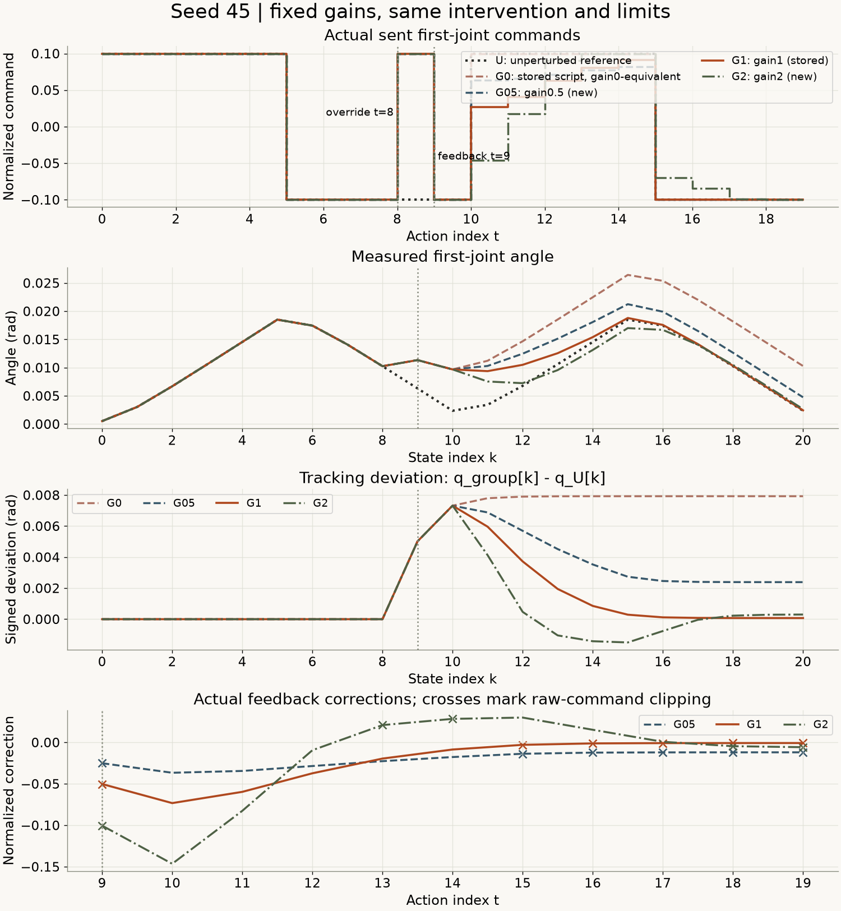
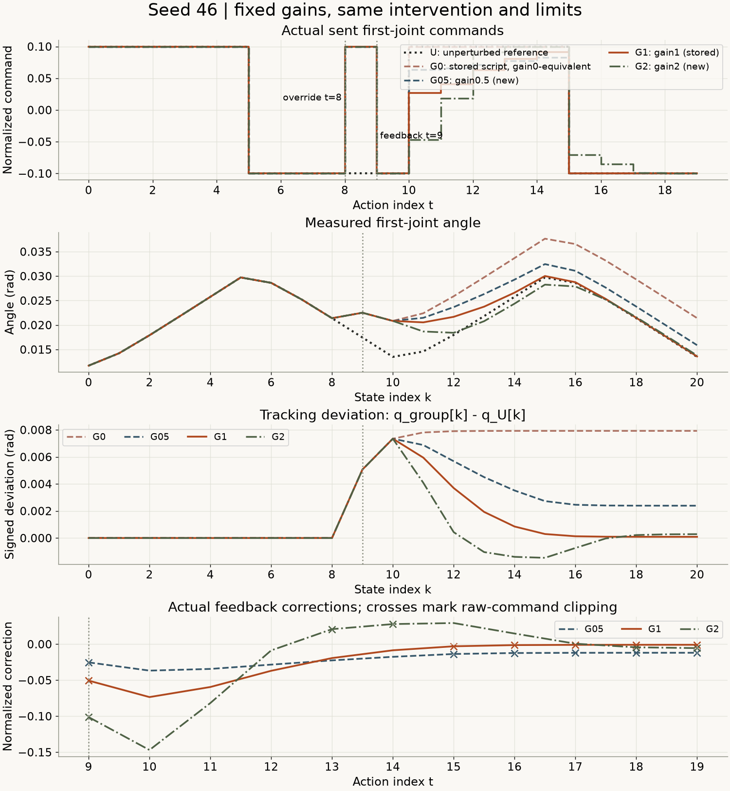
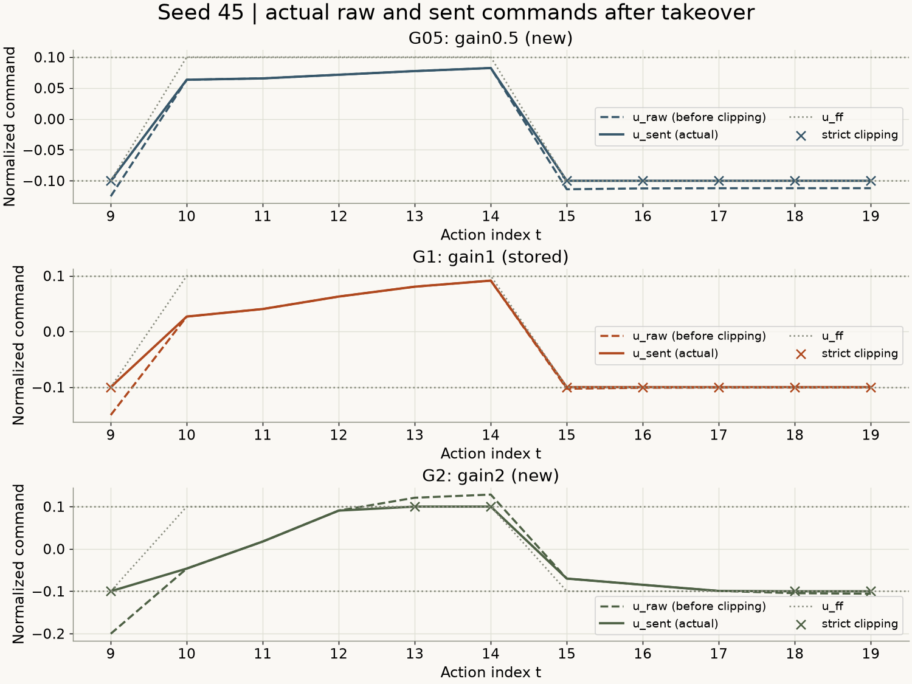
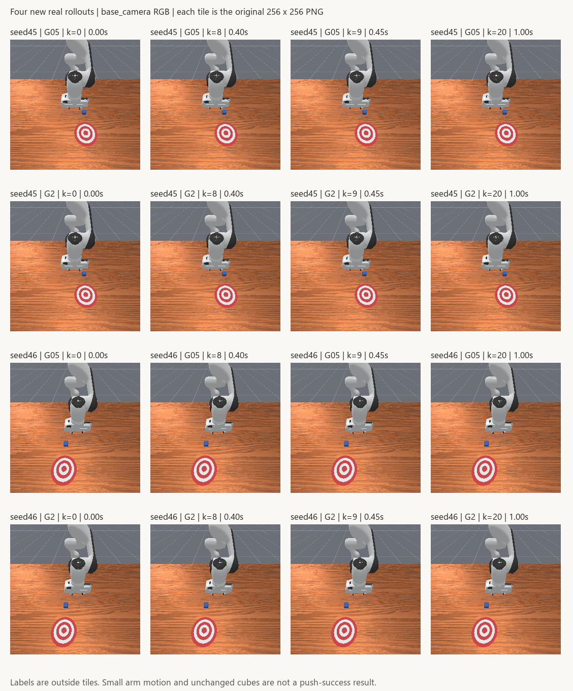

# 增益改了会怎样：参考反馈的固定参数对照

[下载完整离线复核包](../assets/experiments/17-feedback-gain-comparison/gain-comparison-files.zip) · [运行说明](../assets/experiments/17-feedback-gain-comparison/README.md) · [独立解压验收](../assets/experiments/17-feedback-gain-comparison/portable-validation.json)

[第十六篇](paired-feedback-evaluation.html)补齐了无干预反馈对照：gain=1时，E与原脚本U完全相同。本篇保持任务、覆盖动作、接管位置和限幅不变，只新增gain=0.5与2.0两档，观察增益变化后的真实闭环运动。

两个seed都出现了一个值得分别看指标的结果：gain=2的角度RMSE低于gain=1，但末端绝对偏差更大。三个实际反馈档的峰值在各自seed内相同。所有增益条件的任务success仍为false，因此本篇完整报告结果，不挑选一个“最佳增益”，也不把角度跟踪改善写成推物成功。

## 四档增益，不是四档都重新采集

| 名称 | gain | 实际来源 | 本次是否新增 | 实际外层反馈查询 |
| --- | --- | --- | --- | --- |
| G0 | 0 | 第14篇有干预脚本续写A | 否 | 没有，只验证动作等价 |
| G05 | 0.5 | 本篇新运行 | 是 | 有 |
| G1 | 1 | 第15篇D-reference-feedback | 否 | 有，保留原始审计 |
| G2 | 2 | 本篇新运行 | 是 | 有 |

U仍是第13篇同seed无干预脚本参考。每个seed包含U加四档来源，两个seed共10条数值轨迹，其中6条历史复用含参考，4条新增。没有重采U、G0、G1。

G0的严谨说法是“gain=0的动作等价对照”。它历史上实际执行脚本，没有查询外层参考反馈。离线将gain设为0，确实能复现接管区间的脚本发送动作，但不能因此补造一份实际反馈审计。底层PD控制器仍一直工作，“无外层反馈”不代表系统完全没有反馈。

本篇只新增两档增益的有干预运行，没有新增gain0.5、2.0的无干预条件。第16篇gain1时E=U的实测结论，不能直接推广到这些新增益。

## 环境与物理尺度保持不变

实际复用Python3.11.9、NumPy2.4.6、PyTorch2.14.1+cpu、Pillow13.0.0、ManiSkill3.0.1、SAPIEN3.0.3、Gymnasium1.4.0。依赖版本与第16篇一致，没有安装或升级。

任务仍为PushCube-v1、Panda、单环境、pd_joint_delta_pos、RGB、base_camera256×256、minimal着色配置。控制20Hz、物理100Hz，每次step推进0.05秒、5个物理子步。反馈计算及物理在CPU；图像传输、渲染后端接口和实际设备记录分别保留，未用CPU张量推断全过程没有GPU渲染，也未测GPU实际利用率。

本地控制器实现与原哈希一致，use_delta=true、use_target=false、normalize_action=true。机械臂输入[-1,1]约映射到[-0.1,0.1]rad目标增量，并以当前关节位置为锚点。因此演示输入0.1对应约0.01rad目标增量，实际下一时刻角度仍由PD和动力学决定，不能直接写成0.1rad运动。夹爪输入1维持0.04m打开目标。[ManiSkill3.0.1控制器实现](https://github.com/mani-skill/ManiSkill/blob/v3.0.1/mani_skill/agents/controllers/pd_joint_pos.py)

## 唯一改变的是外层增益

新控制器显式接收gain，旧第15、16篇文件没有修改：

```python
error_rad = np.float64(q_ref) - np.float64(q_actual)
correction = np.float64(gain) * error_rad / np.float64(0.1)
u_raw = np.float64(u_ff) + correction
limit = np.float64(np.float32(0.1))
u_sent = np.float32(np.clip(u_raw, -limit, limit))
```

q_ref来自同seed参考obs[t]第一关节，q_actual来自当步实际obs[t]，u_ff来自参考actions[t,0]。没有误用obs[t+1]。误差与尺度都用rad，gain无量纲，修正项成为归一化动作量；不使用状态统计标准化来代替单位换算。

实际限幅边界继续是0.10000000149011612，即既有float32接口边界的float64精确值。was_clipped只在u_raw严格超界时为true；sent_at_bound表示实际发送值触边，二者分别记录。[NumPy2.4 clip](https://numpy.org/doc/2.4/reference/generated/numpy.clip.html)

没有改变频率、尺度、限幅或底层控制器，没有速度项、积分项、滤波、死区和按结果增加的停止规则。模型、训练统计和最近邻候选都没有更新。本篇是固定参数对照，不是根据验证结果寻找增益。

## 先证明代码能复算旧记录

启动环境前，用新函数gain=1复算第15篇两条D组共22次真实反馈，标量审计与两个边界标志一致，实际float32发送动作逐项相同。gain=0另外核对第14篇共22条脚本动作等价，实际反馈查询数仍为0。

私有人工数值用例检查零误差、正负误差、截断、触边与12种非有限输入拒绝。在同一个误差输入上，gain2的修正是gain0.5的4倍；这是固定输入的数值检查，不是对实际闭环轨迹的结论。人工数据没有替换真实轨迹，也不作为仿真图片公开。

初始化和前缀容差继承已有逐字段配置，qpos为1e-6、qvel为1e-5、cube_pose为1e-6，按各字段物理单位分别核对。反馈float64审计沿用atol=1e-12、rtol=0，控制器目标容差1e-6rad。没有看到结果后放宽。

## 四次新增运行与80次预算

执行顺序固定为seed45的G05、G2，再seed46的G05、G2。每次只创建一个环境、显式带seed reset一次，并单独记录构造器内部初始化。

所有新增组共用以下计划：

```text
t=0..7  原脚本
t=8     第一维+0.1，覆盖原脚本的-0.1
t=9..19 用本组固定gain参考反馈
其余机械臂维度0，夹爪维度1
```

obs[8]经覆盖动作action[8]得到obs[9]；读取obs[9]后才发送首个反馈action[9]。状态9是0.45秒，不能把动作8、状态9和接管动作9混为同一条记录。

四组初始化与历史U、G0、G1可比；发送t=9前，状态0～9与有干预G0、G1逐项相同，状态0～8与无干预参考U逐项相同。每组20步、21份观测、11次反馈，共80次step尝试、84张新增PNG。账本在每次调用前持久化。没有额外热身、补步、重试或重采旧组。

四组均因20步预算结束，末步terminated与truncated保持false；没有为了结束采集把回合标志改成true。

## 峰值、RMSE和末端一起报告

固定跟踪偏差为q_group[k]-q_U[k]，其中k是状态索引。共同比较区间实际为状态9～20，共12份状态，时间0.45～1.00秒。全部角度指标单位rad；RMSE按这些状态计算，不是动作预测误差。

| seed | 档位 | gain | 最大绝对偏差rad | 角度RMSE rad | 末端有符号偏差rad | 末端绝对偏差rad |
| --- | --- | --- | --- | --- | --- | --- |
| 45 | G0 | 0 | 0.007927501108 | 0.007663299179 | +0.007927501108 | 0.007927501108 |
| 45 | G05 | 0.5 | 0.007320881123 | 0.004358416499 | +0.002388615627 | 0.002388615627 |
| 45 | G1 | 1 | 0.007320881123 | 0.003327613387 | +0.000073932577 | 0.000073932577 |
| 45 | G2 | 2 | 0.007320881123 | 0.002918374100 | +0.000300678657 | 0.000300678657 |
| 46 | G0 | 0 | 0.007927241735 | 0.007668698368 | +0.007927241735 | 0.007927241735 |
| 46 | G05 | 0.5 | 0.007347689010 | 0.004362549440 | +0.002391778864 | 0.002391778864 |
| 46 | G1 | 1 | 0.007347689010 | 0.003332763891 | +0.000087905675 | 0.000087905675 |
| 46 | G2 | 2 | 0.007347689010 | 0.002921980445 | +0.000285881571 | 0.000285881571 |

G2在两个seed中的RMSE都较G1小，但末端绝对偏差较G1大。G05的RMSE及末端偏差又呈现不同数值。不能只留下支持某种判断的那一列，也没有依据这些值更改本次参数或再增加一档。

<figure class="experiment-figure"><figcaption>seed45：动作8覆盖、动作9接管；角度横轴是状态k，反馈横轴是动作t。U为无干预参考，不是G0。 <a href="../assets/experiments/17-feedback-gain-comparison/seed-0045-comparison.png" download>下载原尺寸图 ↗</a></figcaption></figure>

<figure class="experiment-figure"><figcaption>seed46使用相同规则与比较状态9～20，没有按结果改变统计范围。 <a href="../assets/experiments/17-feedback-gain-comparison/seed-0046-comparison.png" download>下载原尺寸图 ↗</a></figcaption></figure>

## 限幅会改变实际发送的修正

首个反馈动作t=9，三个真实反馈档u_raw不同，但发送值都落在同一个负边界：

| seed | 档位 | t=9的u_raw | t=9实际u_sent | 严格截断 |
| --- | --- | --- | --- | --- |
| 45 | G05 | -0.125096241478 | -0.100000001490 | true |
| 45 | G1 | -0.150192481466 | -0.100000001490 | true |
| 45 | G2 | -0.200384961441 | -0.100000001490 | true |
| 46 | G05 | -0.125315304846 | -0.100000001490 | true |
| 46 | G1 | -0.150630608201 | -0.100000001490 | true |
| 46 | G2 | -0.201261214912 | -0.100000001490 | true |

这也是为什么不能把gain的比例直接当成实际动作或实际运动的比例。后续各组运行到不同状态，误差也随之不同；实际correction不需要始终保持4倍或2倍关系。比例测试只适用于相同误差输入。

| seed | 档位 | 真实反馈次数 | 最大绝对修正 | 严格截断次数 | 触边次数 | 截断动作索引 |
| --- | --- | --- | --- | --- | --- | --- |
| 45 | G0 | 0 | 不适用 | 不适用 | 不适用 | 不适用 |
| 45 | G05 | 11 | 0.036604405614 | 6 | 6 | 9, 15, 16, 17, 18, 19 |
| 45 | G1 | 11 | 0.073208811227 | 6 | 6 | 9, 15, 16, 17, 18, 19 |
| 45 | G2 | 11 | 0.146417622454 | 5 | 5 | 9, 13, 14, 18, 19 |
| 46 | G0 | 0 | 不适用 | 不适用 | 不适用 | 不适用 |
| 46 | G05 | 11 | 0.036738445051 | 6 | 6 | 9, 15, 16, 17, 18, 19 |
| 46 | G1 | 11 | 0.073476890102 | 6 | 6 | 9, 15, 16, 17, 18, 19 |
| 46 | G2 | 11 | 0.146953780204 | 5 | 5 | 9, 13, 14, 18, 19 |

G05、G1每组6次截断，G2每组5次。G2的实际曲线也出现了修正方向变化，但不能凭1秒曲线证明一般稳定性或不稳定性。边界、频率均未提高，结果没有因动作接近或变化很小而被替换。

G0的反馈统计为不适用。它在接管时段的真实脚本动作触边次数可以从动作数组另算，但不能冒充反馈查询或截断审计。

<figure class="experiment-figure"><figcaption>只画实际执行过反馈的G05、G1、G2；叉号表示严格截断，G0没有伪造审计。 <a href="../assets/experiments/17-feedback-gain-comparison/seed-0045-limits.png" download>下载原尺寸图 ↗</a></figcaption></figure>

<figure class="experiment-figure"><figcaption>相同指令边界下，u_raw与u_sent分别保存；闭环误差不同，不能套用固定比例。 <a href="../assets/experiments/17-feedback-gain-comparison/seed-0046-limits.png" download>下载原尺寸图 ↗</a></figcaption></figure>

## 真实画面与任务结果

<figure class="experiment-figure"><figcaption>16张原始base_camera图块，标签在外；图片没有缩放写回原始PNG。 <a href="../assets/experiments/17-feedback-gain-comparison/new-gain-frames.png" download>下载原尺寸图 ↗</a></figcaption></figure>

拼图覆盖四条新增运行的状态0、8、9和末状态20，共16个真实图块。每块256×256原始RGB不变，标签放在图外，重新打开后逐像素核对。机器人、木质桌面和蓝色方块可辨认。

| seed | 档位 | 动作数 | 仿真时长s | 方块净位移m | reward之和 | success曾为true |
| --- | --- | --- | --- | --- | --- | --- |
| 45 | G0 | 20 | 1.00 | 7.91621997073e-07 | 1.381884143 | false |
| 45 | G05 | 20 | 1.00 | 7.91621997073e-07 | 1.374353066 | false |
| 45 | G1 | 20 | 1.00 | 7.91621997073e-07 | 1.370473698 | false |
| 45 | G2 | 20 | 1.00 | 7.91621997073e-07 | 1.368207559 | false |
| 46 | G0 | 20 | 1.00 | 8.33992995526e-07 | 1.505321085 | false |
| 46 | G05 | 20 | 1.00 | 8.33992995526e-07 | 1.516286701 | false |
| 46 | G1 | 20 | 1.00 | 8.33992995526e-07 | 1.521865904 | false |
| 46 | G2 | 20 | 1.00 | 8.33992995526e-07 | 1.525129363 | false |

所有增益条件success始终为false，方块净位移在约8×10⁻⁷m量级。关节偏差、reward和任务成功分别报告，没有将小幅连续运动写成推物成功。

## 下载后只读复算

公开包约43.1MB，包含10份完整数值来源、210张原始PNG、真实反馈审计、相对路径来源清单及字段配置。G0保留原始脚本数据，没有feedback_audit.npz。

解压后在README所在目录，使用已有兼容Python环境执行：

```text
python -B evaluate.py --output-dir result-r001
```

输出目录必须不存在。程序只执行CPU离线验收，不导入或创建仿真环境、不reset、不step、不训练或拟合。正式发布包已在独立目录解压运行，210张PNG通过，指标与逐步数组和本地原结果一致。files.json的包内SHA-256也在入口核对。

```python
with np.load("seed-0045-comparison.npz", allow_pickle=False) as saved:
    k = saved["comparison_state_indices"]
    delta = saved["G2/joint1_qpos_rad"][k].astype(np.float64)
    delta -= saved["U/joint1_qpos_rad"][k].astype(np.float64)
    rmse = np.sqrt(np.mean(delta * delta, dtype=np.float64))
```

qpos/qvel为(21,1,9)，RGB为(21,1,256,256,3)，动作(20,8)，reward和回合标志各(20,1)。环境轴显式取0。每份观测先独立复制，所有NPZ是纯数值数组，读取禁用pickle，来源字符串映射放JSON。

新反馈审计只有t=9～19实际发生的11行，包括gain、尺度、参考与实际索引、误差、修正、未截断值、发送值、边界标志和实际目标。前缀与t=8覆盖不算反馈输出，没有用NaN填充。方块真值、控制器目标和success单列为诊断，不参与反馈公式。

[完整指标](../assets/experiments/17-feedback-gain-comparison/metrics.json) · [字段与单位](../assets/experiments/17-feedback-gain-comparison/schema.json) · [验收记录](../assets/experiments/17-feedback-gain-comparison/validation.json)

[seed45逐步状态](../assets/experiments/17-feedback-gain-comparison/seed-0045-states.csv) · [seed46逐步状态](../assets/experiments/17-feedback-gain-comparison/seed-0046-states.csv) · [seed45动作](../assets/experiments/17-feedback-gain-comparison/seed-0045-actions.csv) · [seed46动作](../assets/experiments/17-feedback-gain-comparison/seed-0046-actions.csv)

## 验收与限制

独立验收只读取保存文件，核对10份来源的N/N+1、类型、有限值、时间、回合标志及210张PNG。用独立标量运算与min/max重算反馈和发送值，并区分控制器目标与实际运动。重新打开数值导出后计算指标，RMSE也用逐项平方求和交叉核对。

3216个既有文件、引用源码和依赖版本保持不变，私有账本确认四次新增运行、80次尝试、4次显式seeded reset，历史组重采为0。没有参数搜索、模型更新、统计拟合或候选扩充。原始日志保留可选Pinocchio缺失警告，现用关节控制及验收正常，没有为此安装依赖。

两个seed已经使用过，完整参考轨迹与时钟已知，每组只有1秒；未新增两档增益的无干预对照，也未做显著性检验。本篇不能证明最优增益、普遍稳定性、恢复能力或推物能力。私人日志、调用账本、设备原始枚举、人工用例与维护工具不在公开包中。

## 官方资料

- [ManiSkill3.0.1关节位置控制器](https://github.com/mani-skill/ManiSkill/blob/v3.0.1/mani_skill/agents/controllers/pd_joint_pos.py)：与本地源码哈希及use_delta/use_target配置一起核对目标生成。
- [ManiSkill控制器与动作空间](https://maniskill.readthedocs.io/en/latest/user_guide/concepts/controllers.html)：区分用户动作与底层控制接口。
- [NumPy2.4 clip](https://numpy.org/doc/2.4/reference/generated/numpy.clip.html)：固定区间限幅；触边标记由本篇另外核对。
- [NumPy2.4 load](https://numpy.org/doc/2.4/reference/generated/numpy.load.html)：纯数值NPZ读取。
- [Pillow13.0 Image](https://pillow.readthedocs.io/en/stable/reference/Image.html)：原始PNG读取与拼图，原像素一致性由数组比较验证。
