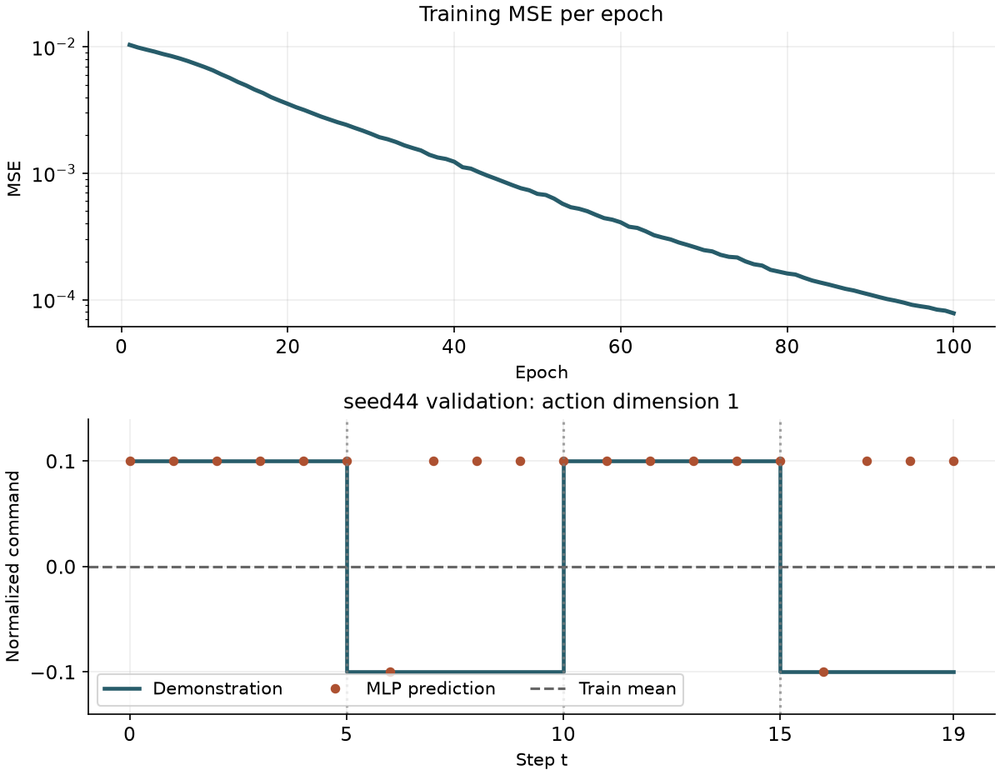

# 用 PyTorch 训练第一个行为克隆基线

[第八篇](train-only-normalization.html)只用训练轨迹拟合状态统计。本篇把这份冻结统计接到一个小模型上。给定当前关节位置和速度，模型预测同一时刻演示里的动作。这个监督学习问题就是行为克隆的起点。

本次在 CPU 上训练了 100 轮，共 500 次优化器更新。固定的验证轨迹上，MLP 的平均绝对误差从 `0.10000` 降到 `0.08001`，均方误差却从 `0.01000` 升到 `0.01600`。看完逐步预测，就能看到两个指标为何给出了不同判断。

[下载完整离线示例](../assets/experiments/09-first-behavior-cloning/behavior-cloning-files.zip) · [运行说明](../assets/experiments/09-first-behavior-cloning/README.md) · [独立验收](../assets/experiments/09-first-behavior-cloning/validation.json)

## 把当前状态配给当前动作

[第七篇](multi-trajectory-splits.html)给出了按来源固定的划分。每条轨迹有 21 份观测和 20 个动作。`t` 从 0 开始，观测 `t=0…19` 分别配 `actions[0…19]`，`t=20` 是最后一次动作后的状态。直接遍历动作索引可以给每个 `(trajectory_id, t)` 恰好一次训练或评估机会。

| 集合 | 轨迹来源 | 状态—动作对 |
| --- | --- | ---: |
| 训练 | seed42、seed43 | 40 |
| 验证 | seed44 | 20 |

从环境 0 取出当前 `qpos[t]` 和 `qvel[t]`，分别用第八篇冻结的均值和尺度标准化。每项各 9 维，按位置在前、速度在后的顺序拼接。标签来自原始动作数组的第 1 维，索引为 `0`，量纲仍是归一化控制指令。轨迹 ID 和 `t` 随结果保存，供定位误差。输入张量只包含这 18 个状态数值。

```python
n = len(actions)
x = torch.cat([
    normalizer.transform("qpos", qpos[:n, 0, :]),
    normalizer.transform("qvel", qvel[:n, 0, :]),
], dim=1)                                  # [N, 18]
y = torch.from_numpy(actions[:, :1].copy()) # [N, 1]
```

三条轨迹都每五步切换一次第 1 维的符号，指令在 `+0.1` 与 `−0.1` 之间交替。实测动作第 2–7 维恒为 `0`，第 8 维恒为 `1`。本篇聚焦有变化的第 1 维，按这一维计算误差，便于观察换向时的预测。

## 用一个常数和一个小模型做对照

均值基线从 40 个训练标签计算平均值。正负指令各占一半，算出的常数是 `0`，对每个验证状态都给出这个预测。

MLP 有两层各 32 单元的隐藏层，激活函数为 ReLU。最后一层输出一个标量，先取 `tanh` 再乘 `0.1`，映射到本例的演示幅度。标签和预测都保持为 `[B, 1]`，`MSELoss` 对逐样本的平方误差取平均。可复现配置和曲线数据随实验提供。[PyTorch MSELoss](https://docs.pytorch.org/docs/2.14/generated/torch.nn.MSELoss.html) · [PyTorch Adam](https://docs.pytorch.org/docs/2.14/generated/torch.optim.Adam.html) · [运行配置](../assets/experiments/09-first-behavior-cloning/run/config.json)

```python
network = nn.Sequential(
    nn.Linear(18, 32), nn.ReLU(),
    nn.Linear(32, 32), nn.ReLU(),
    nn.Linear(32, 1),
)
prediction = 0.1 * torch.tanh(network(batch_x))
loss = nn.MSELoss()(prediction, batch_y)
```

使用 CPU、随机种子 `2027`、批大小 `8` 和 Adam 学习率 `0.001`。每轮按固定随机序列打乱 40 个样本，共 5 个批次，100 轮正好是 500 次更新。每轮训练 MSE 按样本汇总，使用各批更新前算出的损失。第 1 轮约为 `0.0103564`，第 100 轮约为 `0.0000779747`。固定轮数结束后，用最终权重评估 seed44。[训练曲线数据](../assets/experiments/09-first-behavior-cloning/run/training_curve.csv) · [数值权重](../assets/experiments/09-first-behavior-cloning/run/model_weights.npz)

## 查看验证误差和换向位置

下表的两组指标使用 seed44 的同一批 20 个动作。MAE 对绝对误差取平均。MSE 先平方再平均，对较大的误差更敏感，RMSE 是 MSE 的平方根。[完整评估指标](../assets/experiments/09-first-behavior-cloning/evaluation/metrics.json)

| 方法 | MSE | RMSE | MAE |
| --- | ---: | ---: | ---: |
| 训练均值基线 | 0.010000 | 0.100000 | 0.100000 |
| MLP | 0.015999 | 0.126487 | 0.080007 |

<figure class="experiment-figure"><figcaption>上图是 100 轮训练 MSE，纵轴为对数刻度。下图是 seed44 的逐步预测，竖线标记三次换向。</figcaption></figure>

| 换向 t | 真实指令 | MLP 预测 | MLP 绝对误差 | 均值基线绝对误差 |
| ---: | ---: | ---: | ---: | ---: |
| 5 | −0.100 | +0.100 | 0.200 | 0.100 |
| 10 | +0.100 | +0.100 | 0.000 | 0.100 |
| 15 | −0.100 | +0.100 | 0.200 | 0.100 |

MLP 在 20 步中有 12 步的绝对误差小于 `0.001`，另外 8 步的误差接近 `0.2`。接近零的误差拉低了 MAE，反向满幅的预测在平方后贡献约 `0.04`，把 MSE 推高到了均值基线之上。换向处出现明显误差，其他时刻也有误判。逐步结果保留了这些细节。[逐步预测 CSV](../assets/experiments/09-first-behavior-cloning/evaluation/predictions.csv) · [数值预测 NPZ](../assets/experiments/09-first-behavior-cloning/evaluation/predictions.npz)

## 从保存的权重复现评估

解压公开包，用兼容的 CPU Python 环境在解压目录运行。实测使用 Python `3.11.9`、PyTorch `2.14.1+cpu` 和 NumPy `2.4.6`。评估脚本用 `eval()` 和 `inference_mode()` 读取最终数值权重，输出到一个新目录。

```powershell
python -B evaluate_bc.py --input-dir input --run-dir run --output-dir reproduced-evaluation
```

独立验收覆盖全部 60 对状态和动作、首末训练批次、验证末批的 4 个样本、参数变化和权重重载。预测文件的指标也单独重算。公开 ZIP 在新目录解压后实跑了上述命令，预测数组、CSV 和指标均与原结果一致。权重和预测都是数值 NPZ，可用 `np.load(..., allow_pickle=False)` 读取。[源数据校验](../assets/experiments/09-first-behavior-cloning/input-provenance.json)

三条轨迹共享相同的五步换向脚本，验证轨迹只有 20 个动作。本次结果衡量这个脚本下的离线拟合误差。模型输入为当前位置和速度，脚本的换向相位未显式提供，现有数据也不足以定位误判的唯一原因。实际控制时的误差积累和闭环表现需要单独实验。
