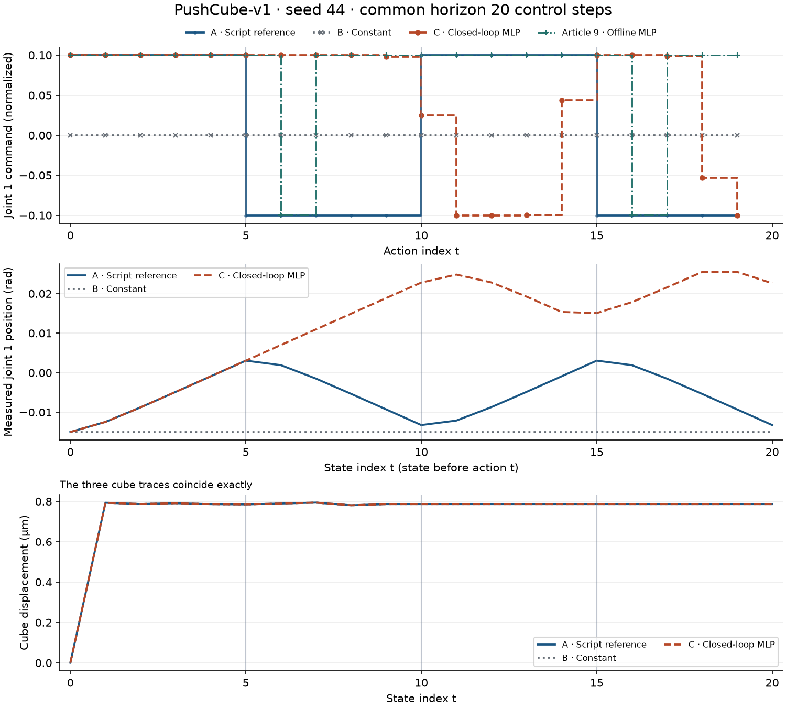
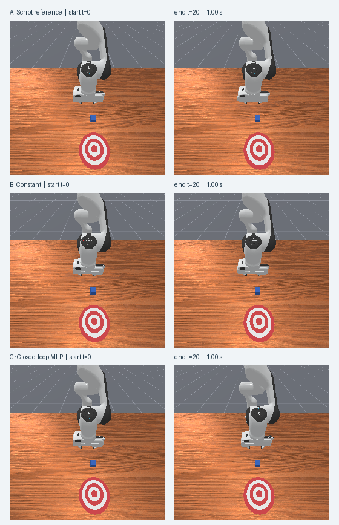

# 把模型放回仿真：第一次闭环行为克隆评估

[下载离线评估包](../assets/experiments/10-first-closed-loop-rollout/closed-loop-files.zip) · [运行说明](../assets/experiments/10-first-closed-loop-rollout/README.md) · [解压复现验收](../assets/experiments/10-first-closed-loop-rollout/portable-validation.json)

公开包包含真实数值记录、原尺寸相机帧、冻结统计和已保存权重，解压后可在 CPU 上复算指令与指标。

[第九篇](first-behavior-cloning.html)在保存的关节状态上评估了一个小型行为克隆模型。在两次换向位置，模型给出了与脚本相反的第一关节指令。如果真的把指令发给仿真器，下一步模型看到的关节状态会变成什么？

这次仍使用 `PushCube-v1` 的 seed44。第一次换向发生在动作 `t=5`，脚本发出约 −0.1，模型发出约 +0.1。到了状态 `t=6`，两组第一关节已经相差约 0.00510 rad。在这一时刻，第九篇的模型读到脚本状态后输出约 −0.09990，同一份权重读到自己走出的状态后却继续输出约 +0.10000。

## 同一起点，三种指令

三组依次创建单个 Panda 环境，并显式调用一次 `reset(seed=44)`。A 按顺序执行第七篇保存的 20 个动作，用来复查仿真参考轨迹。B 的第一维固定为训练集动作均值 0。C 每一步用当前关节状态生成第一维。三组动作的第 2～7 维均为 0，第 8 维均为 1，保持相同的夹爪打开目标。

每组开始前都检查了初始 `qpos`、`qvel` 和方块位姿，实测差异为零。A 组的关节状态、控制器目标、方块位姿、奖励、回合标志及 RGB 都复现了相应历史记录。三个环境采用相同的 `pd_joint_delta_pos` 配置，控制频率为 20 Hz，物理频率为 100 Hz。

## 让下一次推理读取刚得到的状态

离线评估依次读取磁盘上的 `obs[0]`、`obs[1]`。模型在 `obs[0]` 的输出不会影响文件中的 `obs[1]`。闭环执行里，当前动作经过控制器和物理仿真产生新观测，下一次推理就读这份观测。

下面是 C 组每一步的关键操作。这里的 `qpos`、`qvel` 来自当前观测的独立副本，各为 `(1,9)`。第八篇冻结统计完成逐维变换后，输入为 `(1,18)`。单个输出写入 8 维接口的第一维。

```python
x = torch.cat(
    (
        normalizer.transform("qpos", qpos[0:1, :]),
        normalizer.transform("qvel", qvel[0:1, :]),
    ),
    dim=1,
)
with torch.inference_mode():
    u1 = model(x).item()  # model 已加载第九篇权重并调用 eval()

action = np.zeros(8, dtype=np.float32)
action[0] = u1
action[7] = 1
# 正式脚本先验证动作边界，再持久化一次 step 调用的账本。
obs, reward, terminated, truncated, info = env.step(action)
```

脚本先保存初始观测，再保存每次调用返回的观测。`obs[t]`、`action[t]` 和 `obs[t+1]` 因此能一一对齐。20 个动作对应 21 个状态，最后一份状态没有下一条动作。相机记录供人观察。物体位姿和控制器目标单独存放在诊断字段，策略只接收关节状态。

归一化指令的 `+0.1` 在本控制器中对应约 `+0.01 rad` 的第一关节目标增量。实际角度由仿真器积分得到，可以从 `qpos` 读取。指令、目标和实际角度各自有自己的量纲和时间位置。 [ManiSkill 3.0.1 控制器文档](https://maniskill.readthedocs.io/en/latest/user_guide/concepts/controllers.html)

## 换向之后发生了什么

<figure class="experiment-figure"><figcaption><a href="../assets/experiments/10-first-closed-loop-rollout/comparison.png">下载原尺寸图</a></figcaption></figure>

| 动作索引 | 仿真时间（s） | A 脚本指令 | 第九篇离线 MLP | C 闭环 MLP |
| ---: | ---: | ---: | ---: | ---: |
| 5 | 0.25 | −0.10000 | +0.10000 | +0.10000 |
| 10 | 0.50 | +0.10000 | +0.10000 | +0.02474 |
| 15 | 0.75 | −0.10000 | +0.10000 | +0.10000 |

动作索引从 0 开始。在动作 `t=5` 发出前，A 和 C 的第一关节角度都是约 0.003046 rad。执行该动作后，两组在状态 `t=6` 分别变为 0.001910 rad 和 0.007009 rad。使用 `1e-6 rad` 阈值，这是第一关节首次可检出的偏离。同一时刻，闭环预测与离线预测也首次相差超过 `1e-6`。此时两个预测使用的是不同状态。脚本动作可以对照同一时刻的指令，无法给出偏离参考轨迹后的状态应执行什么动作。

| 组别 | 运行步数 | 第一关节净变化（rad） | 方块终点位移（µm） | 累计 reward | 成功步数 |
| --- | ---: | ---: | ---: | ---: | ---: |
| A 脚本 | 20 | +0.001758 | 0.7864 | 2.10997 | 0 |
| B 常数 | 20 | 0.000000 | 0.7864 | 2.08218 | 0 |
| C MLP | 20 | +0.037642 | 0.7864 | 2.14800 | 0 |

<figure class="experiment-figure"><figcaption><a href="../assets/experiments/10-first-closed-loop-rollout/rollout-frames.png">下载原尺寸图</a></figcaption></figure>

三组方块位姿轨迹完全重合，终点只有约 0.79 微米的位移，`success` 全程为 `false`。C 组累计奖励数值最高，记录的任务成功次数仍是零。三组各执行 1.00 秒，到达预先设定的 20 步预算时停下，最后一条记录的 `terminated` 和 `truncated` 都为 `false`。

## 如何核对实验

用 [运行说明](../assets/experiments/10-first-closed-loop-rollout/README.md)中的命令可在 CPU 上离线重读数值轨迹、63 张原始 PNG 和调用账本。验收将 C 的当前状态按冻结统计重新变换并逐项核对指令，最大绝对差为 `1.06×10⁻⁷`。全部 PNG 与保存的观测数组逐像素相同，30 项历史输入和参考代码的 SHA-256 前后一致。 [逐步数据](../assets/experiments/10-first-closed-loop-rollout/comparison.csv) · [独立验收](../assets/experiments/10-first-closed-loop-rollout/validation.json)

本次权重来自第九篇，seed44 已用于第九篇的离线验证。这个对照记录了一次固定起点下的小幅关节运动，能观察状态反馈如何改变后续指令。评估新初始条件的泛化或推方块的任务能力，需要另外设计实验。

官方参考资料 [ManiSkill 环境接口与示例](https://maniskill.readthedocs.io/en/latest/user_guide/getting_started/quickstart.html) · [PyTorch 2.14 的 inference_mode](https://docs.pytorch.org/docs/2.14/generated/torch.autograd.grad_mode.inference_mode.html)
