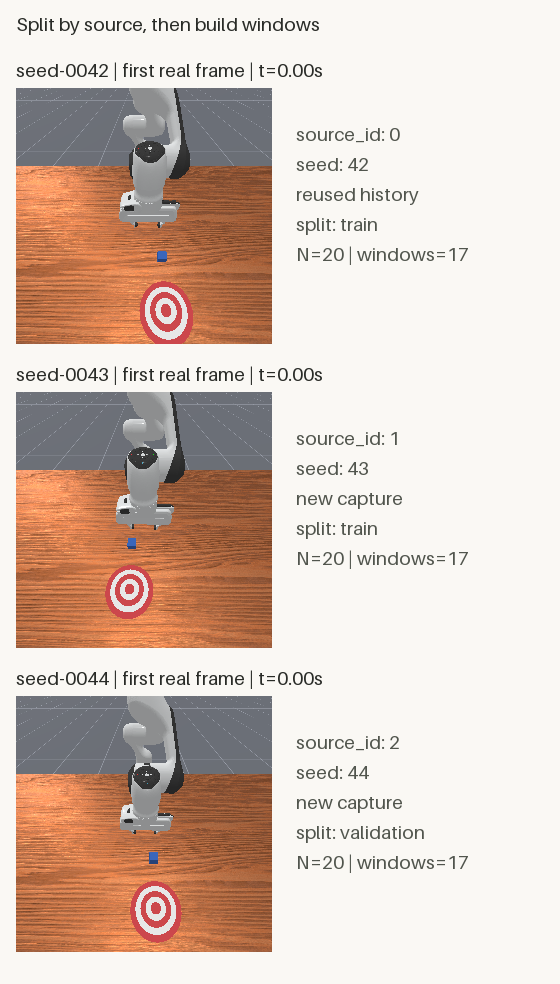

# 从一条到多条轨迹：按轨迹划分训练与验证数据

[第六篇](trajectory-time-windows.html)从一条轨迹构造了17个重叠窗口。现在有了多条来源，我们要先回答：一个窗口来自哪次采集，它应该属于哪个集合？

本篇于2026-10-26完成实际验证。复用第四篇seed42的历史结果，顺序新增seed43、44，各执行20次env.step，新增尝试合计40次。之后只读取保存文件，整理为train34个窗口、validation17个窗口。没有训练模型。

## 先看三份真实来源

<figure class="experiment-figure"><figcaption>三张256×256原图逐像素保留，整张对照图560×984。标签在图块外，用于解释来源，不输入模型。<a href="../assets/experiments/07-multi-trajectory-splits/split_preview.png" download>下载原尺寸对照图</a></figcaption></figure>

三份片段都有机器人、桌面和方块，但初始状态确实不同。这里的train与validation是数据用途名称，不代表模型已经训练或得到验证。

[下载完整公开示例](../assets/experiments/07-multi-trajectory-splits/multi-trajectory-files.zip)，含3份完整数值轨迹、63张原图与便携代码。默认复现离线整理流程，不重采数据。也可查看 [来源清单](../assets/experiments/07-multi-trajectory-splits/dataset_manifest.json)、[固定划分](../assets/experiments/07-multi-trajectory-splits/splits.json)、[全局窗口索引](../assets/experiments/07-multi-trajectory-splits/window_index.json)、[多轨迹Dataset](../assets/experiments/07-multi-trajectory-splits/multi_trajectory_dataset.py)、[离线入口](../assets/experiments/07-multi-trajectory-splits/inspect_splits.py)、[train首批](../assets/experiments/07-multi-trajectory-splits/train_batch.npz)、[validation首批](../assets/experiments/07-multi-trajectory-splits/validation_batch.npz)、[重复检查](../assets/experiments/07-multi-trajectory-splits/leakage_check.json) 和 [独立验收](../assets/experiments/07-multi-trajectory-splits/validation.json)。

## 第一步：锁定环境和新增采集范围

沿用Python3.11.9、ManiSkill3.0.1、SAPIEN3.0.3、NumPy2.4.6、PyTorch2.14.1+cpu、Pillow13.0.0、Gymnasium1.4.0。219份既有文件、82个包版本未改变，控制器/任务/后端6份源码哈希与第四篇一致。

任务仍是PushCube-v1，panda、单环境、pd_joint_delta_pos，策略观测相机base_camera256×256、minimal shader，控制20Hz、物理100Hz。运行前核对控制器，前7维归一化动作对应`0.1*a` rad目标角增量，末维夹爪绝对目标为`0.015+0.025*a` m；它们不是实测关节运动。[ManiSkill控制器说明](https://maniskill.readthedocs.io/en/latest/user_guide/concepts/controllers.html)可作为接口参考。

两条新轨迹都沿用固定计划：第一关节五步+0.1、五步-0.1，再重复一次；其他机械臂输入0，夹爪输入1。seed43完成后才启动44，每个进程只运行一个环境。

`capture_trajectories.py`在每次尝试调用前将预算写盘并fsync，随后才调用env.step。两条各20次尝试、20次返回，合计40/40，成功后没有重跑。seed42只复制既有文件和来源哈希，没有重新初始化采集。

渲染记录也要分层看：

| 记录 | 本次观察 |
| --- | --- |
| 物理后端 | physx_cpu |
| 渲染后端接口标签 | sapien_cpu |
| RGB传输 | CPU可访问uint8，复制为NumPy数组 |
| RenderSystem.device接口 | cpu；设备枚举另存在本机 |
| 物理GPU选用与利用率 | 本次未直接测量，不作全程无GPU渲染结论 |

后端标签、图像内存位置与物理图形执行是不同层次的证据。原始设备枚举留在本机；离线DataLoader不使用GPU张量。

## 第二步：把来源写进清单

[ManiSkill的随机数说明](https://maniskill.readthedocs.io/en/latest/user_guide/concepts/rng.html)介绍了reset时的seed与环境随机化。本次既保存seed，也保留真实观测和来源指纹；单凭seed不同不能证明数据内容不同或统计独立。

| source_id | trajectory_id | 来源 | 划分 | 动作/状态 | K4窗口 |
| --- | --- | --- | --- | --- | --- |
| 0 | seed-0042 | 第四篇历史复用 | train | 20/21 | 17 |
| 1 | seed-0043 | 本次新增 | train | 20/21 | 17 |
| 2 | seed-0044 | 本次新增 | validation | 20/21 | 17 |

来源共60个动作和63份状态，其中本次新增40个动作、42份状态。每条时间轴各自从0到1秒，没有拼成一条3秒轨迹，也不声称它们是三个已经结束的回合。

`dataset_manifest.json`记录来源文件相对路径、seed、实际步数、停止原因、配置、压缩文件SHA以及数值内容指纹。source_id是数值编号，trajectory_id是稳定的人类可读名称，两者有明确映射。

初始机械臂角和图像差异实际如下：

| 来源对 | 前7关节最大角差，rad | 两指最大位置差，m | 首帧变化像素数 |
| --- | --- | --- | --- |
| 42与43 | 0.041159 | 0 | 10150 |
| 42与44 | 0.062559 | 0 | 8497 |
| 43与44 | 0.046524 | 0 | 9250 |

机械臂角与手指位置分别统计，避免把混合单位的qpos差当成同一个物理量。图像差与关节差只证明本次保存内容有差异，不是独立性检验。

## 第三步：先分轨迹，再在内部切窗口

采集前固定的划分没有根据reward、success或画面变化调整：

```json
{
  "train": ["seed-0042", "seed-0043"],
  "validation": ["seed-0044"]
}
```

然后分别在每条轨迹内以K=4、stride=1取完整窗口，不填充、不跨reset、不连接不同文件的时间轴。每条20个动作对应17窗，所以train为34窗，validation为17窗。

全局索引的边界最值得检查：

```text
global 16: source 0 / seed42 / local window16 / states16..20
global 17: source 1 / seed43 / local window 0 / states 0..4
global 33: source 1 / seed43 / local window16 / states16..20
global 34: source 2 / seed44 / local window 0 / states 0..4
```

来源切换时，局部时间与索引重新从该轨迹取值。没有把seed42末尾的状态和seed43开头的状态拼成新窗口。[PyTorch提供数据集组合与子集接口](https://docs.pytorch.org/docs/2.14/data.html)，本例用显式来源—局部窗口索引表保留追踪关系。

## 第四步：修正单轨迹编号的适用范围

第六篇只有一个来源，因此模块内source_id固定为0。直接把三个实例放在一起，会让输出都带0。旧模块保持原样，本篇适配层为返回窗口写入全局映射：

```python
m["source_id"] = torch.tensor(row["source_id"], dtype=torch.int64, device="cpu")
m["trajectory_window_index"] = m.pop("window_index")
m["global_window_index"] = torch.tensor(
    row["global_window_index"], dtype=torch.int64, device="cpu"
)
m["trajectory_id"] = row["trajectory_id"]
```

这是类内部片段，完整实现随包提供。窗口仍只含qpos、qvel、RGB观测；source/split标签留在metadata。物体真值、控制器目标与success没有加入模型输入。

RGB沿用float32/CHW并除以255，关节状态和动作保留原值，没有拟合任何跨集合归一化统计。以后需要拟合统计时，只能使用训练来源。

## 第五步：实际遍历两个集合

使用已有兼容Python，在完整文件包解压目录执行：

```powershell
python -B inspect_splits.py --input-dir trajectories --output-dir result
```

这条默认复现命令只做离线处理，不导入采集模块。目录已有同名导出会被保护，重复离线运行请换成result-2。新环境安装及其他平台组合需要另行验证；本次没有升级依赖。

两边DataLoader都使用batch_size4、shuffleFalse、drop_lastFalse、num_workers0、pin_memoryFalse和CPU generator seed42。实际遍历结果为：

```text
train:      34 windows -> [4,4,4,4,4,4,4,4,2]
validation: 17 windows -> [4,4,4,4,1]
```

| 字段 | 首批，B=4 | train末批，B=2 | validation末批，B=1 |
| --- | --- | --- | --- |
| qpos/qvel | `(4,5,9)` | `(2,5,9)` | `(1,5,9)` |
| RGB | `(4,5,3,256,256)` | `(2,5,3,256,256)` | `(1,5,3,256,256)` |
| actions | `(4,4,8)` | `(2,4,8)` | `(1,4,8)` |

没有用无条件squeeze删除B=2或B=1。一个批次可以包含来自不同轨迹的完整窗口，B依然不是连续时间轴。

两个首批次NPZ各19个纯数值数组，可用`np.load(..., allow_pickle=False)`读取。trajectory_id字符串保留在Dataset/DataLoader元数据和batch_summary.json，NPZ用source_id与manifest映射对应，不创建object或Unicode数组来混装标签。

## 第六步：识别改名或重打包的副本

文件SHA检查的是压缩文件字节。ZIP成员顺序、压缩方式改变后，即使所有数值相同，文件SHA也可以不同。

本篇另外计算两类内容指纹：全部数值字段的指纹，以及qpos/qvel/RGB/actions的模型内容指纹。规则包含排序后的字段名、形状、规范字节序类型和C序数值字节，不包含文件名或ZIP压缩细节。

私有测试把历史seed42倒序写入一个无压缩NPZ，结果文件SHA不同，两个数值内容指纹均相同。改名或重打包不能把它变成新的来源。其他人工测试覆盖重叠划分、遗漏来源、重复source_id和越过来源边界的窗口，11项均通过；夹具不作为真实采集数据公开。

实际来源集合没有交集，内容指纹不重复，train与validation的原始RGB精确重复数为0。这只覆盖明确的来源/内容重复与完全相同像素，不代表已经消除所有数据泄漏，更不保证统计独立。

## 第七步：重新读取并核对结果

66项真实数据、来源、索引和批次检查通过，覆盖63张PNG与NPZ逐像素一致、51窗内255次状态取用与204条transition对应、全局边界、末批B2/B1、独立存储及首批保存后重读。新seed首末图像与三首帧对照图都已重新打开。

修改返回窗口的全部数值字段后，源缓存、重复读取、相邻窗口、其他来源和validation样本均保持不变。独立验收只读保存文件，没有重跑成功采集。

三条来源的第一关节净变化约0.00176～0.00191 rad，方块净位移约7.66e-7～8.22e-7 m，success均为false。我们没有把这些小幅变化写成推物成功。

## 常见问题与本次限制

**为什么不用随机拆分51个窗口？** 同一轨迹的相邻窗口共享观测。先随机分窗口，会让同一来源的内容进入两边。本篇先固定来源，再切窗；未来仍需要考虑同任务、相同资产、控制计划等其他相关性。

**为什么seed不同还要算指纹？** seed是生成条件之一，不能替代对真实保存内容的检查。文件复制、错误标注或重打包都可能让来源标签看似不同。

**窗口编号能代表轨迹编号吗？** 不能。轨迹内窗口编号会重复，全局窗口编号负责定位样本，source_id和trajectory_id负责追踪来源。

**train和validation是否意味着已经得到模型效果？** 没有。本次不设置测试集、不训练、不拟合归一化、不报告泛化。三条小片段只是演示来源管理与划分流程。

**能否再运行采集脚本验收？** 本次40次新增尝试已经完成。默认离线复现使用提供的真实数据；新采集属于另一个实验，不能用来替换当前成功结果或掩盖问题。

公开包只含整理后的教程数据与代码。环境/字段JSON与本机原始记录分别保留；原始日志、机器路径、GPU原始枚举、账本、人工夹具和维护工具不公开。

## 官方参考资料

- [ManiSkill 3.0.1：控制器与动作空间](https://maniskill.readthedocs.io/en/latest/user_guide/concepts/controllers.html)
- [ManiSkill 3.0.1：随机数与可复现性](https://maniskill.readthedocs.io/en/latest/user_guide/concepts/rng.html)
- [PyTorch 2.14：Dataset、组合与批量加载](https://docs.pytorch.org/docs/2.14/data.html)
- [NumPy 2.4：禁用pickle读取数值NPZ](https://numpy.org/doc/2.4/reference/generated/numpy.load.html)
- [Pillow 13.0.0：Image模块](https://pillow.readthedocs.io/en/stable/reference/Image.html)
