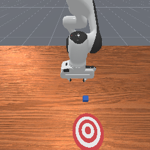
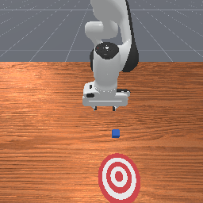

# 机器人数据长什么样：读懂一条观测与动作记录

上一篇，我们保存并打开了一张真实的机器人相机图像。这次让仿真往前走一步，保存动作前后的数据，再把它们连起来：机器人看到了什么，我们发出了什么指令，下一时刻实际发生了什么。

本篇实验已于 2026-10-26 完成。只启动一个 `PushCube-v1` 环境，固定 `seed=42`，实际只调用一次 `env.step()`。没有训练模型，也没有为了让图片变化更明显而追加动作。

## 先看这一条记录

我们要得到的是一条 transition，中文可以理解为“一次状态转移的数据记录”。本篇保存的是可见观测之间的对应关系：

```text
obs_t ── action ──> obs_tp1
动作前观测            动作后的下一份观测
```

此外，还保存 `reward`、`terminated`、`truncated` 和用于验收的辅助信息。这里的 `t` 是控制步序号，`tp1` 表示 `t+1`，不是一秒后。

<figure class="experiment-figure"><figcaption>动作前：t=0，仿真时间 0.00 秒，base_camera 的原始 RGB。</figcaption></figure>

<figure class="experiment-figure"><figcaption>一次 step 后：t=1，仿真时间 0.05 秒。同一相机、同一分辨率，图像未重绘或标注。</figcaption></figure>

两张图看起来很接近，这正是本次实际结果。完成本篇的标准，是能把数据读对、解释清楚；这次并未完成推方块任务。

[下载公开实验文件包](../assets/experiments/03-observation-action/transition-files.zip)，包含实际脚本、两张原图、NPZ 样本、字段说明、公开复现配置和验收摘要。也可以单独下载 [transition.npz](../assets/experiments/03-observation-action/transition.npz)、查看 [采集脚本](../assets/experiments/03-observation-action/capture_transition.py)、[数值摘要](../assets/experiments/03-observation-action/transition.json)、[字段与单位](../assets/experiments/03-observation-action/schema.json) 和 [验收结果](../assets/experiments/03-observation-action/validation.json)。完整原始日志留在本机，公开包提供运行问题说明。

## 第一步：复用已经验证的环境

这次复用第二篇的 Python 环境，没有升级任何依赖。主要版本和运行配置如下：

| 项目 | 本次配置 |
| --- | --- |
| 系统与 GPU | Windows 10.0.26200，RTX 4060 Ti，驱动 610.88 |
| Python | 3.11.9 |
| ManiSkill / SAPIEN | 3.0.1 / 3.0.3 |
| PyTorch / Gymnasium | 2.14.1（CPU 构建）/ 1.4.0 |
| NumPy / Pillow | 2.4.6 / 13.0.0 |
| 任务与机器人 | `PushCube-v1`，`panda`，单环境，seed=42 |
| 观测与控制 | `rgb`，`pd_joint_delta_pos` |
| 相机 | 策略观测相机 `base_camera`，256×256，`minimal` shader |
| 后端 | 请求 `cpu/cpu`，实际解析为 `physx_cpu/sapien_cpu` |

这里的 CPU 渲染配置指图像可通过 CPU 取回，SAPIEN 仍使用 GPU 的 Vulkan 渲染路径。PyTorch 的 CUDA 是否可用，不能单独证明相机渲染能否运行。

下载并解压文件包后，使用已经配置好上述依赖的 Python，在包所在目录执行：

```powershell
$env:SIM_CAMERA_CACHE = Join-Path (Get-Location) '.cache'
python -B capture_transition.py --seed 42 --output-dir result
```

`result` 应当是新的结果目录。脚本发现已有图片、NPZ 或环境报告时会拒绝覆盖。初次启动和驱动兼容性问题可先参考[第二篇教程](capture-camera-frame.html)；不必为了读这一条样本重装或升级已有环境。

## 第二步：把观测当作字典来读

`obs_mode="rgb"` 不表示观测只有一张图。按照 [ManiSkill 的观测接口](https://maniskill.readthedocs.io/en/latest/user_guide/concepts/observation.html)，视觉数据与机器人自身的测量可以一起返回。本次实际得到的结构为：

```text
obs_t
├── agent
│   ├── qpos                        (1, 9)          float32
│   └── qvel                        (1, 9)          float32
├── extra
│   └── tcp_pose                    (1, 7)          float32
├── sensor_param
│   └── base_camera
│       ├── extrinsic_cv            (1, 3, 4)       float32
│       ├── cam2world_gl             (1, 4, 4)       float32
│       └── intrinsic_cv            (1, 3, 3)       float32
└── sensor_data
    └── base_camera
        └── rgb                     (1, 256, 256, 3) uint8
```

第一维 `1` 是环境的批次维度。图片的后几维分别是高度、宽度和 RGB 通道；取 `rgb[0]` 才得到可保存成 PNG 的 `(256,256,3)` 数组。不要看到单环境就默认所有字段都没有 batch 维度。

本次原始叶子是 CPU 上的 Torch 张量；保存为 NPZ 时转换为独立 NumPy 数组，保留原始形状和数值。

| 字段 | 应该怎样理解 |
| --- | --- |
| `agent/qpos` | 前 7 个是机械臂关节角，单位 rad；后 2 个是两个夹指的位置，单位 m |
| `agent/qvel` | 与 qpos 同序；前 7 个用 rad/s，后 2 个用 m/s |
| `extra/tcp_pose` | 工具中心点在世界坐标中的位姿：前三项 xyz，单位 m；后四项是 qw,qx,qy,qz 四元数 |
| `sensor_data/.../rgb` | 原始 0..255 的 uint8 RGB，尚未归一化成浮点图像 |
| `extrinsic_cv` | 世界到 OpenCV 相机坐标的 `[R\|t]` 外参 |
| `cam2world_gl` | OpenGL/Blender 相机坐标到世界坐标的齐次变换，坐标轴约定与上项不同 |
| `intrinsic_cv` | 相机内参，包含以像素表达的焦距和主点 |

这次有两个容易忽略的细节：实际观测没有 `agent/controller` 字段；`extrinsic_cv` 实际为 `(1,3,4)`，而官方概念页示例列了另一种形状。因此，先打印和检查实际数据，再根据版本与实现解释它。

`rgb` 模式下，本次 `extra` 也没有方块位置或目标位置。脚本另外从仿真器读取的方块位姿保存在 `diagnostic/`，只用于离线验收，不能悄悄加到策略观测中。[PushCube 的任务实现](https://maniskill.readthedocs.io/en/latest/_modules/mani_skill/envs/tasks/tabletop/push_cube.html)会根据观测模式决定是否提供这些真值。

## 第三步：确认八维动作分别控制什么

这次传入 `env.step` 的 `action` 是形状 `(8,)` 的 float32 数组，各维范围均为 `[-1,1]`。它与九维 qpos 不矛盾：机械臂有七个输入，两根夹指通过一个 mimic 输入一起控制。

控制器决定动作的语义，[官方控制器说明](https://maniskill.readthedocs.io/en/latest/user_guide/concepts/controllers.html)给出整体机制；本次精确的维度、范围和开关还核对了已安装的 [Panda 配置](https://github.com/mani-skill/ManiSkill/blob/main/mani_skill/agents/robots/panda/panda.py)和运行时控制器。

| 动作维度 | 本次对应对象 | 缩放后含义 |
| --- | --- | --- |
| `a[0]` 到 `a[6]` | `panda_joint1` 到 `panda_joint7` | 关节角目标增量，`delta_q = 0.1 * a` rad |
| `a[7]` | 一个夹指控制输入，另一指跟随 | 夹指绝对目标位置，`target_m = 0.015 + 0.025 * a[7]` |

前七维使用 `use_delta=True, use_target=False`：每个目标从动作前测得的关节位置计算，而非在上一次目标上继续累加。夹爪则是绝对位置控制，`use_delta=False`。

这里的线性映射来自[动作缩放实现](https://github.com/mani-skill/ManiSkill/blob/main/mani_skill/utils/gym_utils.py)。对于夹爪，`a[7]=1` 对应每指目标 0.04 m；`0` 对应 0.015 m。因此，全零动作会改变夹爪目标，不能把它叫作整个机器人的“保持不动”。`-1` 对应 -0.01 m 的闭合驱动目标，也不表示夹爪真的具有负开口。

本次固定动作是：

```python
action = np.array([0.2, 0, 0, 0, 0, 0, 0, 1], dtype=np.float32)
```

这要求第一关节目标增加 0.02 rad，约 1.15°；其他机械臂关节目标保持在动作前测量值，夹爪继续以 0.04 m 为目标打开。它不是速度、力矩，也不是末端执行器的 xyz 位移。

## 第四步：先复制观测，再执行一次动作

保存 transition 的核心顺序很短：先取得 `obs_t`，复制数据，执行动作，再复制 `obs_tp1`。不能把可变的仿真缓存引用当作历史快照。

```python
# 观测叶子是 Torch 张量时，必须做独立拷贝。
qpos_t = obs['agent']['qpos'].detach().cpu().numpy().copy()
rgb_t = obs['sensor_data']['base_camera']['rgb'].detach().cpu().numpy().copy()

# 完整脚本会先核对控制模式、映射与动作边界。
next_obs, reward, terminated, truncated, info = env.step(action.copy())

qpos_tp1 = next_obs['agent']['qpos'].detach().cpu().numpy().copy()
rgb_tp1 = next_obs['sensor_data']['base_camera']['rgb'].detach().cpu().numpy().copy()
```

仅调用 `.numpy()` 仍可能共享内存；本篇使用 `.copy()`，并检查执行动作前后的旧快照指纹。完整脚本递归处理全部观测字段，而不是只保存这里的两个示例。

本次控制频率为 20 Hz，物理仿真频率为 100 Hz。一次 `env.step` 对应 **0.05 秒仿真时间，内部包含 5 个物理子步**。这不表示代码在现实中只运行 0.05 秒；初始化和渲染的墙钟耗时是另一件事。

脚本保存步计数 `0→1`、仿真时间 `0.00→0.05` 秒，且没有在动作后 reset。这就让两份观测和中间动作的顺序可以检查。

## 第五步：重新读取文件，比较目标与实际运动

NPZ 里使用 `obs_t/agent/qpos` 这样的路径作为数组名。字典本身不作为对象数组保存，所有 31 个数组都可以使用 [NumPy 的 `allow_pickle=False`](https://numpy.org/doc/2.4/reference/generated/numpy.load.html) 直接读取：

```python
import numpy as np

with np.load('transition.npz', allow_pickle=False) as d:
    q0 = d['obs_t/agent/qpos']
    q1 = d['obs_tp1/agent/qpos']
    action = d['action']
    target = d['diagnostic/arm_target_qpos']

    print('动作：', action)
    print('控制器目标：', target)
    print('实际关节变化：', q1 - q0)
    print('奖励：', d['reward'])
    print('终止 / 截断：', d['terminated'], d['truncated'])
```

第一关节的数据如下，表中显示值作了四舍五入，完整精度在文件中：

| 项目 | 数值 |
| --- | --- |
| 动作前实测位置 | 0.009934283 rad |
| 动作请求的目标增量 | 0.020000000 rad |
| 控制器设置的目标位置 | 0.029934283 rad |
| 一次 step 后实测位置 | 0.014882264 rad |
| 实际位置增量 | 0.004947981 rad |

**动作指令、控制器目标与实际运动是三件事。** 归一化动作先被转换成目标，PD 控制器再驱动物理系统向目标运动；0.05 秒后，它还没有到达目标。其他关节也可能因为动力学和数值过程产生小幅变化，零目标增量不保证测量值严格不变。可对照 [PD 关节位置控制器实现](https://github.com/mani-skill/ManiSkill/blob/main/mani_skill/agents/controllers/pd_joint_pos.py)理解这个过程。

本次其他输出为：

| 检查项 | 实际结果 |
| --- | --- |
| 前后图像 | 256×256 RGB，uint8，像素范围均为 34..255 |
| 变化像素 | 2,986 / 65,536，约 4.56% |
| 平均绝对像素差 | 约 0.694585，按全部 RGB 通道计算，使用原始 0..255 数值 |
| 工具中心点 y 方向变化 | 约 +0.002174 m |
| 方块真值位移范数 | 约 0.0000007665 m，不到 1 微米 |
| reward | `[0.0700626820]` |
| terminated / truncated | `[false]` / `[false]` |
| success | `[false]` |

方块没有可见位移，结果不能称为推物成功。这里也没有额外执行零动作对照，不能用这一条样本分离动作影响和物理沉降等因素。

`reward` 是任务提供的反馈，不是成功标志；这次正奖励与 `success=false` 同时出现。按照 [Gymnasium 的 step 接口](https://gymnasium.farama.org/api/env/#gymnasium.Env.step)，`terminated` 表示任务终止状态，`truncated` 表示时间上限等外部截断。两者都为 false，只表示这个返回没有结束当前回合。

## 怎样验收这一条样本

先确认下面几项，再开始写训练数据处理代码：

1. **字段对得上。** 前后观测有相同的字段路径、形状和数据类型；图片各自对应本时刻的 RGB。
2. **顺序对得上。** 步计数为 0 和 1，时间差为 0.05 秒，动作在两者之间执行。
3. **动作解释正确。** 归一化范围、关节顺序、角度/长度单位和夹爪控制方式都有依据。
4. **数值能重新读取。** 禁用 pickle 后，所有数组均能加载，浮点数据没有 NaN 或无穷值。
5. **观测与诊断分开。** 仿真器读取的方块真值和控制器目标属于 `diagnostic/`，不是策略观测的新字段。

本次独立验收实际完成了 33 项检查，并重新打开两张 PNG 目视查看。两张图与 NPZ 中对应 RGB 逐像素一致；动作前的图像 SHA256 还与第二篇原图相同。第二篇的原始文件及现有环境的依赖版本均未改变。

这一致性只说明本机这两次已验证的初始化结果相同，不保证换平台、驱动或软件版本后像素级相同。

## 常见问题

**动作有八维，为什么 qpos 有九维？**

七个机械臂关节加两根夹指，共九个测量位置；夹爪通过一个 mimic 输入控制两根夹指，因此动作只有八维。

**为什么最后一维填 1，而不是 0？**

本次夹爪是绝对位置控制，1 对应原先打开的 0.04 m 目标。填 0 会将目标改成每指 0.015 m。动作语义由控制器决定，不能套用“0 就不动”的经验。

**两张图几乎一样，是不是没执行动作？**

先看步计数、关节数据和像素差。本次都发生了实际变化，只是一次小幅动作和 0.05 秒时间带来的变化不大。无需通过重复动作来制造更显眼的结果。

**出现 Pinocchio 未安装提示，需要安装吗？**

本次日志确实出现该提示，但关节控制完成了一次 step。这里没有使用末端位姿逆运动学控制器，所以没有因该提示升级或新增依赖。若切换控制模式，需重新检查其要求，不能把本次成功推广到所有控制器。

**复制观测后，为何还要保存 schema 和环境配置？**

同样长度的数组可能表示不同的关节、单位或控制目标。`transition.json` 给出这次的结构与数值，`schema.json` 补充含义与单位，公开 `environment.json` 记录版本、后端和控制器开关；它们共同使这一条记录可以解释。

## 官方参考资料

- [ManiSkill 观测模式与字段](https://maniskill.readthedocs.io/en/latest/user_guide/concepts/observation.html)
- [ManiSkill 控制器与动作空间](https://maniskill.readthedocs.io/en/latest/user_guide/concepts/controllers.html)
- [Panda 机器人控制配置](https://github.com/mani-skill/ManiSkill/blob/main/mani_skill/agents/robots/panda/panda.py)
- [PD 关节位置控制器](https://github.com/mani-skill/ManiSkill/blob/main/mani_skill/agents/controllers/pd_joint_pos.py)
- [动作缩放函数](https://github.com/mani-skill/ManiSkill/blob/main/mani_skill/utils/gym_utils.py)
- [PushCube 任务源码](https://maniskill.readthedocs.io/en/latest/_modules/mani_skill/envs/tasks/tabletop/push_cube.html)
- [Gymnasium Env.step](https://gymnasium.farama.org/api/env/#gymnasium.Env.step)
- [NumPy 2.4 的 numpy.load](https://numpy.org/doc/2.4/reference/generated/numpy.load.html)

文档页面标注的版本为 ManiSkill 3.0.1，但 `latest` 文档与 GitHub `main` 仍可能更新。本篇精确数值与动作语义以本次已安装实现、保存的配置和源码 SHA256 为依据。
