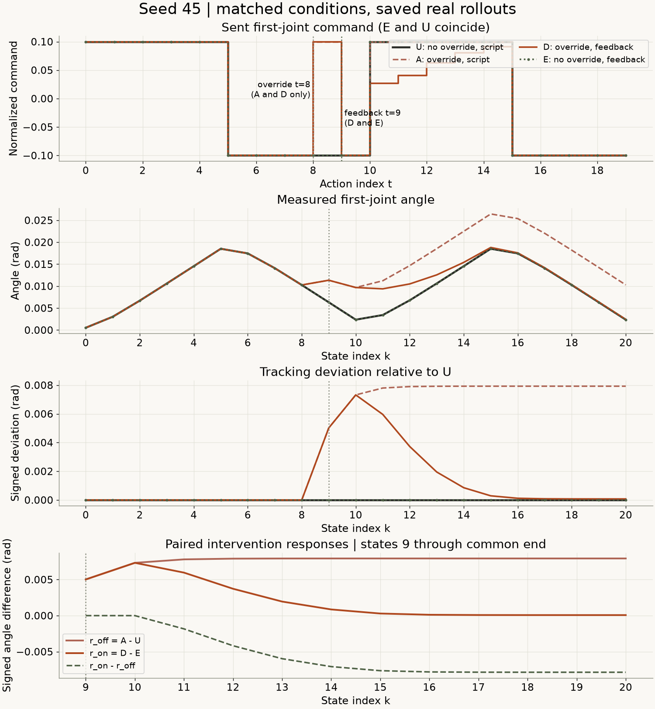
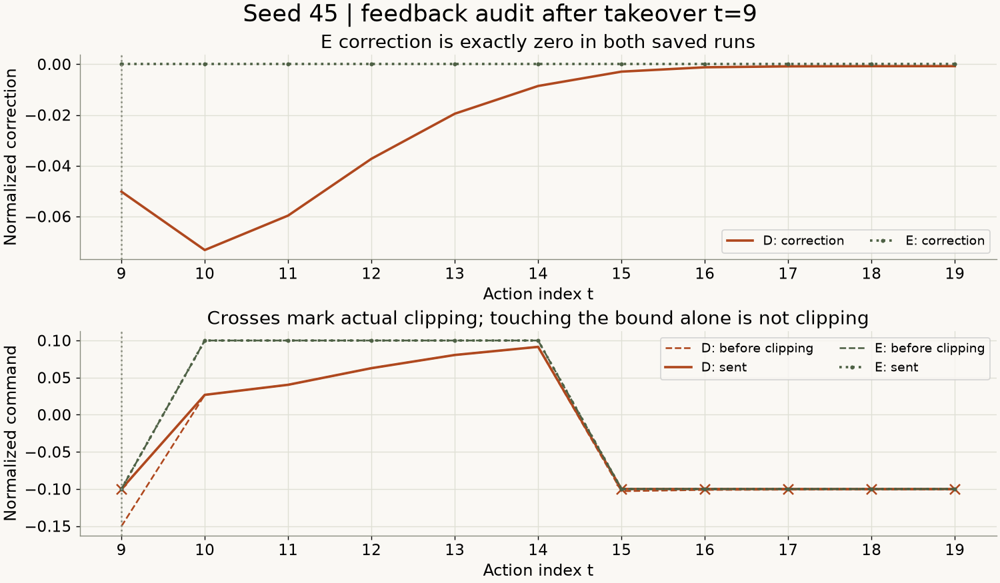
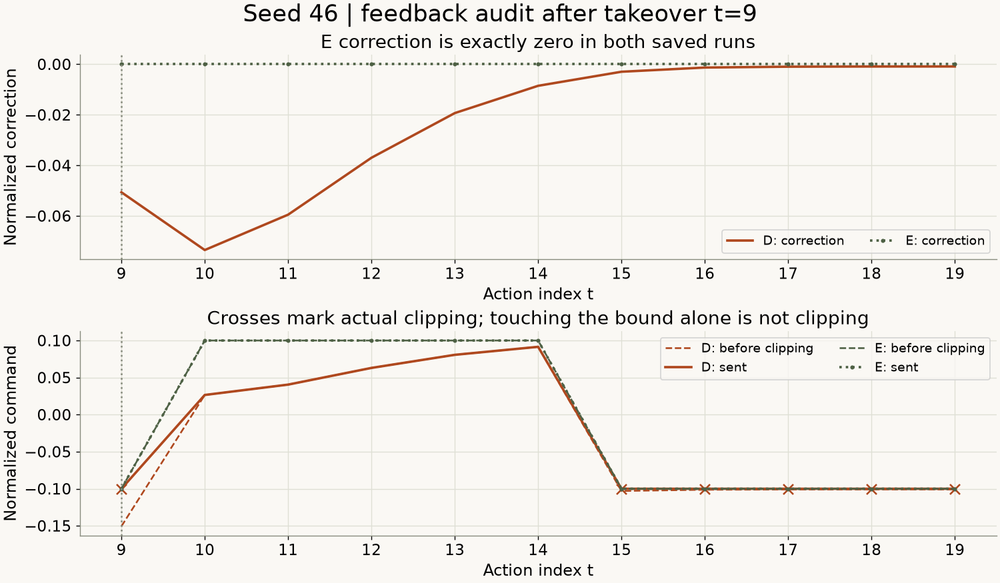
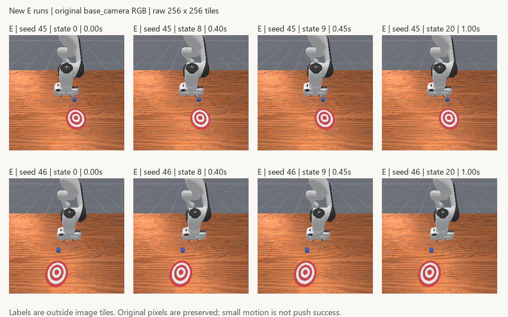

# 有干预，也要有对照：参考反馈的配对评估

[下载完整离线复核包](../assets/experiments/16-paired-feedback-evaluation/paired-feedback-files.zip) · [运行说明](../assets/experiments/16-paired-feedback-evaluation/README.md) · [独立解压验收](../assets/experiments/16-paired-feedback-evaluation/portable-validation.json)

[第十五篇](reference-feedback-baseline.html)在一次反向动作覆盖后加入参考反馈，末端关节偏差变小了。但它还缺少一个对照：如果没有那次覆盖，同一条反馈规则会怎样改变原来的运动？

本篇只补这一格。seed45、46各新增一条无干预反馈运行，其余六条轨迹全部复用。实际结果是：新增E与同seed原脚本U的动作、qpos、qvel和RGB逐项相同，11次反馈修正均为0。这个结果使我们能把“相对参考的偏差”和“同一控制规则下的干预响应”分开计算。

## 先把四种条件放在一起

| 外层参考反馈 | 无动作覆盖 | 有动作覆盖 |
| --- | --- | --- |
| 不使用 | U：第13篇原脚本 | A：第14篇脚本续写 |
| 使用 | E：本篇新增 | D：第15篇参考反馈 |

这里的“反馈”特指外层参考误差修正。四组底层一直使用关节PD控制器，U、A并不是没有任何反馈的系统。D、E都额外知道同seed完整参考轨迹和参考时钟，不与只读取关节历史的H策略做输入条件相同的优劣比较。

每个seed的U、A、D各是一条历史采集；E才是本次新增。总共8份真实来源，新增2次运行，不能写成重做了8次新实验。

## 环境与规则保持不变

实际复用Python3.11.9、NumPy2.4.6、PyTorch2.14.1+cpu、Pillow13.0.0、ManiSkill3.0.1、SAPIEN3.0.3、Gymnasium1.4.0。没有安装或升级依赖。本次没有训练、统计拟合、模型更新或最近邻候选扩充。

任务仍为PushCube-v1、Panda、单环境、pd_joint_delta_pos、RGB、base_camera256×256、minimal着色配置。控制20Hz，物理100Hz，一次step推进0.05秒，包含5个物理子步。反馈计算在CPU进行。

物理后端解析为physx_cpu，渲染后端接口记录为sapien_cpu，图像可从CPU读取。实际渲染设备接口与GPU枚举另行记录，未测量GPU利用率；不能仅从CPU张量或后端名称推断全过程没有使用GPU渲染。

本地控制器源码哈希与既有记录一致，use_delta=true、use_target=false、normalize_action=true。机械臂归一化输入约按0.1rad比例变成相对当前关节位置的目标增量，夹爪输入1保持0.04m打开目标。目标位置与下一状态的实际角度分别保存。[ManiSkill3.0.1控制器实现](https://github.com/mani-skill/ManiSkill/blob/v3.0.1/mani_skill/agents/controllers/pd_joint_pos.py)

## E组只少了一次动作覆盖

所有动作索引t从0开始，状态索引k另行标记：

| 动作位置 | U | A | D | E |
| --- | --- | --- | --- | --- |
| t=0～7 | 原脚本 | 原脚本 | 原脚本 | 原脚本 |
| t=8 | -0.1 | +0.1覆盖 | +0.1覆盖 | -0.1 |
| t=9～19 | 原脚本 | 原脚本 | 参考反馈 | 参考反馈 |

其余机械臂6维为0，第8维夹爪为1。原脚本第一维每5步在+0.1、-0.1之间切换。

```text
obs[8] -- action[8] --> obs[9] -- action[9] --> obs[10]
 0.40s                   0.45s                   0.50s
       A/D在此覆盖                 D/E在此使用反馈
       U/E保持原脚本
```

接管时读取的是obs[9]。E的状态0～9应与U可比；E与A、D只要求干预前的状态0～8可比，不能再要求干预后的状态9相同。实际检查中，这些指定前缀的qpos、qvel与方块位姿逐项相同。

初始化及前缀容差继承第15篇：qpos逐项1e-6、qvel逐项1e-5、cube_pose逐项1e-6。机械臂位置、速度分别用rad、rad/s，夹爪用m、m/s；方块xyz用m，四元数分量无量纲。容差只用于各字段对应分量，没有把不同物理单位混成误差指标。

每次只创建一个环境，显式带seed reset一次，并单独记录构造器内部初始化。先seed45，再seed46，各20次step，合计40次尝试，调用前持久化记账。没有额外热身、补步、重试或重采历史组。两组都因20步预算结束，末步terminated与truncated保持false。

## 参考公式逐字节沿用

本篇feedback_controller.py与第15篇文件SHA-256相同：

```python
error_rad = np.float64(q_ref[t]) - np.float64(q_actual[t])
correction = 1.0 * error_rad / 0.1  # 分母单位rad
u_raw = np.float64(u_ff[t]) + correction
limit = np.float64(np.float32(0.1))
u_sent = np.float32(np.clip(u_raw, -limit, limit))
```

gain仍为1，joint_delta_scale仍为0.1rad。误差与修正以float64计算，发送值转float32。参考使用obs[t]和actions[t,0]，不是obs[t+1]；不使用状态统计标准化来代替物理单位换算。

名义指令限幅0.1，沿用float32接口边界在float64中的精确值0.10000000149011612。was_clipped表示u_raw严格超界；sent_at_bound表示发送值恰好触边。限幅操作将超界值限制到指定端点，不会因为一个值已经在端点上就自动意味着它发生过截断。[NumPy2.4 clip](https://numpy.org/doc/2.4/reference/generated/numpy.clip.html)

E的11次反馈修正全部等于0，发送值延续原脚本，因而11次触边、0次截断。D的历史记录则各有6次截断、6次触边。本次没有根据这些结果调整增益、限幅或频率。

## 两种偏差回答不同问题

设q_G[k]为组G在状态k的第一关节实测角度。

参考跟踪偏差是q_G[k]-q_U[k]，回答“这条运行离已知参考有多远”。

配对干预响应则按各自控制条件计算：

```python
r_off = q_A - q_U  # 脚本条件下，有覆盖减无覆盖
r_on = q_D - q_E   # 参考反馈条件下，有覆盖减无覆盖
contrast = r_on - r_off
```

四组本次共同覆盖20个动作。比较范围预先规定为状态9～20，共12份状态，时间0.45～1.00秒。角度指标均为rad；RMSE对这些状态逐项汇总，不是动作预测误差。

| seed | 响应 | 最大绝对值rad | 角度RMSE rad | 状态20有符号值rad |
| --- | --- | --- | --- | --- |
| 45 | r_off = A − U | 0.007927501108 | 0.007663299179 | +0.007927501108 |
| 45 | r_on = D − E | 0.007320881123 | 0.003327613387 | +0.000073932577 |
| 46 | r_off = A − U | 0.007927241735 | 0.007668698368 | +0.007927241735 |
| 46 | r_on = D − E | 0.007347689010 | 0.003332763891 | +0.000087905675 |

E相对U在状态0～20的第一关节偏差为0，所有9维qpos、qvel、原始RGB和20条动作也完全一致。因此这批数据中的r_on数值恰好等于D-U，二者定义仍然不同。若另一次无干预反馈运行改变了参考运动，这个等式就不能直接沿用。

<figure class="experiment-figure"><figcaption>seed45：首图横轴为动作t，其余为状态k；虚线标记覆盖t=8与接管t=9，状态9为覆盖后的观测。E与U重合。 <a href="../assets/experiments/16-paired-feedback-evaluation/seed-0045-comparison.png" download>下载原尺寸图 ↗</a></figcaption></figure>

<figure class="experiment-figure"><figcaption>seed46采用相同指标与共同状态9～20，没有按结果更改比较范围。 <a href="../assets/experiments/16-paired-feedback-evaluation/seed-0046-comparison.png" download>下载原尺寸图 ↗</a></figcaption></figure>

两个seed的r_on角度RMSE均小于r_off，末端差值也较小；峰值差异相对有限，仍完整列出。D的末端偏差没有归零，不能写成“完全恢复”。r_on-r_off只是这两个起点、这套规则下的有符号对照曲线，不能直接升级为一般因果效应。

<figure class="experiment-figure"><figcaption>seed45：E修正为零；叉号是实际截断位置，触边与截断分别计数。 <a href="../assets/experiments/16-paired-feedback-evaluation/seed-0045-feedback.png" download>下载原尺寸图 ↗</a></figcaption></figure>

<figure class="experiment-figure"><figcaption>seed46的反馈参数与seed45完全相同，未搜索或调参。 <a href="../assets/experiments/16-paired-feedback-evaluation/seed-0046-feedback.png" download>下载原尺寸图 ↗</a></figcaption></figure>

## 真实图片与任务结果

<figure class="experiment-figure"><figcaption>新增E的8张真实相机图块，每块256×256，外部标签不修改图块。 <a href="../assets/experiments/16-paired-feedback-evaluation/new-E-frames.png" download>下载原尺寸图 ↗</a></figcaption></figure>

拼图使用新增E在状态0、8、9、20的真实PNG。每个图块保持256×256原像素，标签放在图外，重新打开拼图后逐像素核对。机器人、木质桌面和蓝色方块可辨认；画面变化小，不是失败后用示意图代替。

| seed | 条件 | 动作数 | 仿真时长s | 方块净位移m | reward之和 | success曾为true |
| --- | --- | --- | --- | --- | --- | --- |
| 45 | U | 20 | 1.00 | 7.91621997073e-07 | 1.365849584 | false |
| 45 | A | 20 | 1.00 | 7.91621997073e-07 | 1.381884143 | false |
| 45 | D | 20 | 1.00 | 7.91621997073e-07 | 1.370473698 | false |
| 45 | E | 20 | 1.00 | 7.91621997073e-07 | 1.365849584 | false |
| 46 | U | 20 | 1.00 | 8.33992995526e-07 | 1.528464839 | false |
| 46 | A | 20 | 1.00 | 8.33992995526e-07 | 1.505321085 | false |
| 46 | D | 20 | 1.00 | 8.33992995526e-07 | 1.521865904 | false |
| 46 | E | 20 | 1.00 | 8.33992995526e-07 | 1.528464839 | false |

各组success始终为false。方块净位移只在约8×10⁻⁷m量级，没有把它解释成有效推物。reward与关节偏差也不直接代替任务成功判断。

## 下载后只读复算

公开包约34.3MB，包含8份完整数值轨迹、168张原始PNG、D/E反馈审计、来源映射、配置、字段说明、数值结果及离线代码。解压后在README所在目录，用已兼容的Python环境执行：

```text
python -B evaluate.py --output-dir result-r001
```

输出目录必须不存在。程序不导入或启动仿真，不reset、不step、不训练。实际发布包已经解压到独立目录运行这个命令，168张PNG核对通过，指标与逐步对照数组和原结果一致。files.json提供包内文件SHA-256，入口也会核对这些校验值。

```python
with np.load("seed-0045-comparison.npz", allow_pickle=False) as saved:
    k = saved["state_index"]
    r_off = saved["A/joint1_qpos_rad"][k].astype(np.float64)
    r_off -= saved["U/joint1_qpos_rad"][k].astype(np.float64)
    assert np.array_equal(r_off, saved["r_off_rad"])
```

所有NPZ都是纯数值数组，来源字符串映射在JSON。读取时明确禁用pickle。[NumPy2.4 load](https://numpy.org/doc/2.4/reference/generated/numpy.load.html)

按状态、动作、环境轴区分数据：qpos/qvel为(21,1,9)，RGB为(21,1,256,256,3)，动作是(20,8)，reward与回合标志各为(20,1)。单环境动作接口原本就是8维，不能为了统一形状擅自添加或删除轴。

每个状态先独立复制。方块真值、控制器目标和任务success单列，未进入反馈公式。审计只包含t=9～19实际发生的11次决策，不用NaN填充前缀，也没有把原脚本或覆盖动作标成反馈输出。

## 验收到底检查了什么

作者项目中，2061个既有实验与草稿文件及引用源码SHA-256保持不变，依赖版本保持不变。新增调用账本为20+20，显式seeded reset共2次，历史组重采为0。

只读验收核对了8份来源的N/N+1、类型、有限值、动作范围、时间连续、终止标志及168张PNG。D/E的标量反馈采用独立的Python运算与min/max重算，float64误差容差沿用1e-12、rtol=0，实际float32发送动作完全相同。还分别检查控制器目标与实测下一状态，避免把指令、目标和运动混为一个量。

结果保存后再打开NPZ与metrics.json，重新构造r_off、r_on及差值曲线，并用另一种逐项平方求和核对RMSE。私人采集账本、原始日志和人工数值用例保留在作者工作区，公开包只提供整理后的证据和只读复算入口。

[完整数值指标](../assets/experiments/16-paired-feedback-evaluation/metrics.json) · [字段与单位](../assets/experiments/16-paired-feedback-evaluation/schema.json) · [验收记录](../assets/experiments/16-paired-feedback-evaluation/validation.json)

[seed45逐步状态](../assets/experiments/16-paired-feedback-evaluation/seed-0045-states.csv) · [seed46逐步状态](../assets/experiments/16-paired-feedback-evaluation/seed-0046-states.csv) · [seed45动作](../assets/experiments/16-paired-feedback-evaluation/seed-0045-actions.csv) · [seed46动作](../assets/experiments/16-paired-feedback-evaluation/seed-0046-actions.csv)

## 常见误读与这次的限制

- E与U完全相同也是有效结果：它说明这两个保存起点上的零误差反馈没有改变原运动，不能据此保证所有起点都如此。
- 原始脚本正好触边，不代表发生截断；应查看u_raw与实际边界的严格比较。
- E不应复现D的状态9：D在动作8已发生覆盖，应比较干预前共同状态及各自无干预对照。
- 20步预算结束不等于terminated或truncated；不能为文章收尾改写标志。
- 新增E不是新seed。45、46已被前文使用，且共用一个控制脚本，参考轨迹与时钟已知。
- 这不是随机化试验。U、A、D是历史复用，虽核对了实现、配置和共同起点，仍只报告固定条件下的有限响应，不做显著性检验。

日志出现可选Pinocchio包缺失提示；本次关节控制与全部验收正常，没有为去掉提示安装依赖，没有采集失败或自动重试。离线边界测试另外核对零误差、正负误差、超界及非有限输入拒绝，人工数据没有替换真实来源。

本篇补齐了一个对照条件，没有新增训练数据或修改模型。角度响应减小不等于普遍恢复能力，更不代表推物成功。

## 官方资料

- [ManiSkill3.0.1控制器源码](https://github.com/mani-skill/ManiSkill/blob/v3.0.1/mani_skill/agents/controllers/pd_joint_pos.py)：结合本机源码哈希核对当前位置增量目标。
- [ManiSkill控制器与动作空间](https://maniskill.readthedocs.io/en/latest/user_guide/concepts/controllers.html)：理解外部动作与底层控制的接口。
- [NumPy2.4 clip](https://numpy.org/doc/2.4/reference/generated/numpy.clip.html)与[load](https://numpy.org/doc/2.4/reference/generated/numpy.load.html)：限幅与纯数值文件读取。
- [Pillow13.0 Image](https://pillow.readthedocs.io/en/stable/reference/Image.html)：读取、组合及重新打开原始PNG；图块像素核验另外由数组比较完成。
