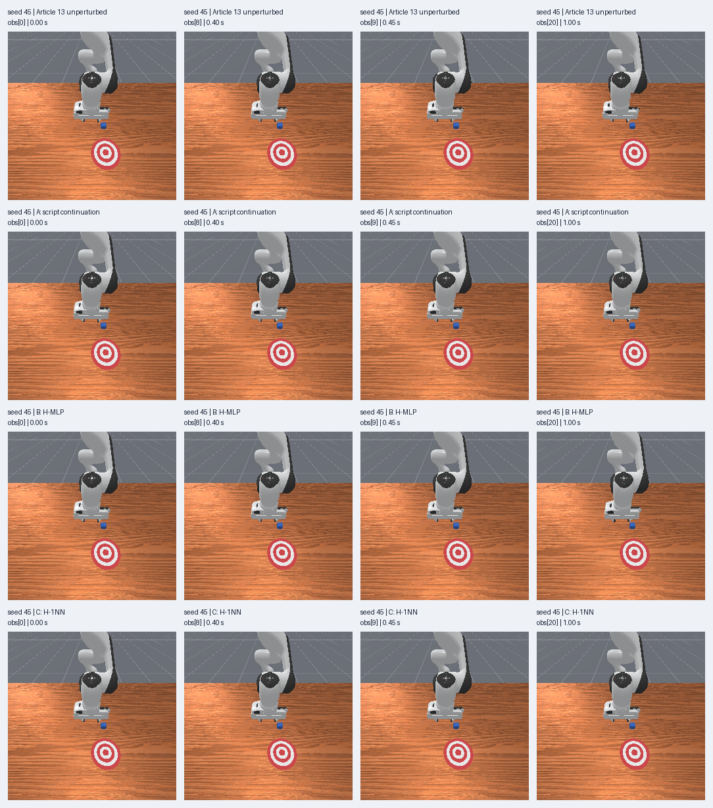
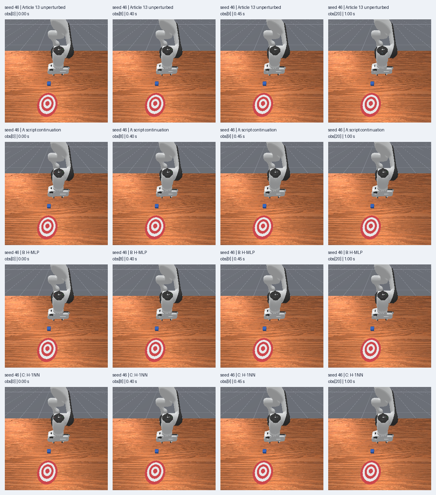
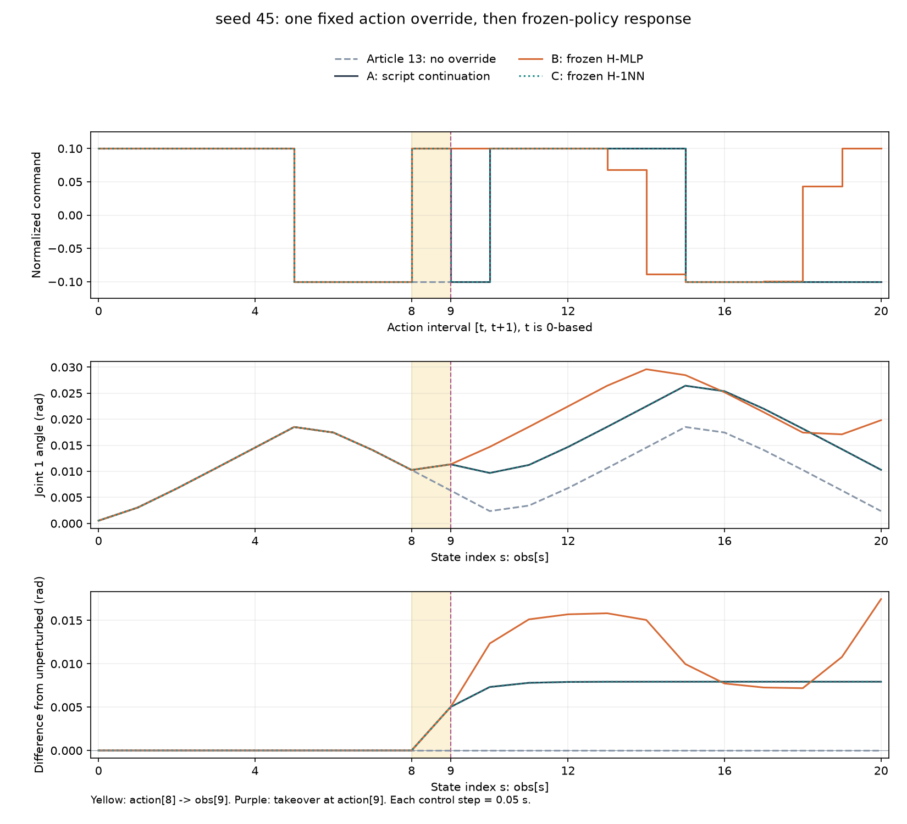
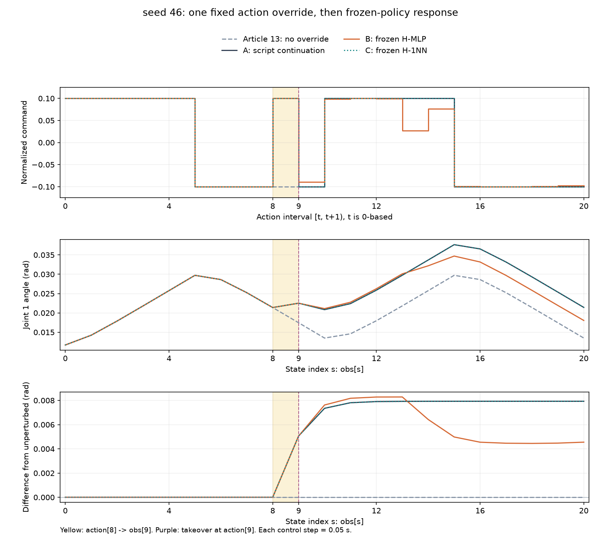

# 偏离参考之后：冻结策略的扰动响应评估

[下载离线复核包](../assets/experiments/14-perturbed-policy-response/perturbed-response-files.zip) · [运行说明](../assets/experiments/14-perturbed-policy-response/README.md) · [解压复核结果](../assets/experiments/14-perturbed-policy-response/portable-validation.json)

公开包包含可运行的CPU离线代码与必要的真实数值资料，解压后可复算已保存结果。默认不会启动仿真或训练。

[第十三篇](unseen-seed-evaluation.html)中，最近邻在两个新起点都沿用了原脚本的20个指令。本篇沿用已知的seed45、46，先让三组经历完全相同的前缀，再覆盖一次动作，观察接下来的11步。

结果中，H-1NN与同干预脚本组的动作、关节状态和相机图像仍逐项相同，干预造成的参考偏移保留到了末帧。H-MLP在seed45上末端偏差较大，在seed46上较小。六组任务success始终为false。本篇只报告这次固定干预下的实际响应。

## 先复现旧结果，再冻结新规则

本次用Python3.11.9、NumPy2.4.6、PyTorch2.14.1+cpu、Pillow13.0.0、ManiSkill3.0.1和SAPIEN3.0.3，沿用原环境，不安装或升级依赖。

H-MLP继续使用第十一篇H权重；H-1NN只查询第十二篇保存的40条训练历史，来源为seed42、43。标准化使用第八篇冻结的训练统计，所有新记录只用于评估。seed45、46已经使用过，不将它们称为新的独立测试集。

启动仿真前，离线复现了第十三篇全部80份策略输入、40次MLP指令和40次最近邻查询，差异为零。随后冻结本篇配置，并封存64项引用和2389份旧实验、日志与网站文件。

## 一次动作覆盖发生在什么时刻

所有动作从0编号。t=0～7沿用原脚本，t=8把第一维从-0.1改成+0.1，t=9起才交给各组的后续规则。

```text
共同前缀 actions[0:8]
    ↓
obs[8] -- action[8,0] = +0.1 --> obs[9]
                                      ↓
                        使用状态[6,7,8,9]产生action[9]
```

控制频率20Hz，每步0.05秒。覆盖动作从0.40秒推进到0.45秒，策略接管发生在读取0.45秒的obs[9]之后。每组20步对应21份观测，末状态obs[20]位于1.00秒。

环境是PushCube-v1、Panda、单环境、pd_joint_delta_pos，base_camera为256×256，物理100Hz。其余机械臂输入始终为0，夹爪输入为1。

本地控制器确认机械臂归一化输入映射到[-0.1,0.1]rad增量，并以当前关节位置为锚点。因此本次+0.1指令对应约+0.01rad的目标增量，原-0.1对应约-0.01rad；实际运动还取决于PD控制和动力学。夹爪1对应0.04m打开目标。动作、控制器目标和实际状态分别保存，不能互相替代。[ManiSkill控制器说明](https://maniskill.readthedocs.io/en/latest/user_guide/concepts/controllers.html)

## 从相同前缀分出三种后续响应

A-script-continuation在覆盖动作后继续原脚本；B-H-MLP使用冻结模型；C-H-1NN使用冻结训练历史的最近邻标签。两个seed各依次运行A、B、C，始终只有一个环境。

每组显式reset一次。初始状态与第十三篇A组比较，状态0～8继续与旧脚本逐项核对；接管前再比较本篇三组的状态6、7、8、9。实际结果不仅满足此前容差，qpos、qvel和方块位姿也逐项相同。

历史缓存从初始化开始持续接收真实观测，t=9不清空，不从旧参考复制状态。每个状态先按冻结统计处理qpos、qvel，再按此顺序拼成18维；四状态从旧到新组成72维。第一份实际策略输入由状态6、7、8、9构成。

```python
# 每一步先更新，即使本步发送的是共同脚本或覆盖动作。
cache.push(normalize(normalizer, current_qpos, current_qvel))
features = cache.features("H")  # (1,72)

if t < 8:
    action = script[t].copy()
elif t == 8:
    action = script[t].copy()
    action[0] = np.float32(0.1)
else:
    # B: 只传features给冻结模型；C: 只用features查询冻结候选。
    action = continuation(features)
```

上面的t只用于外部调度。模型看不到步号、来源、RGB、方块真值、脚本指令或历史动作。权重加载后使用eval()和inference_mode()；最近邻仍按float64均方根距离、训练来源编号和训练t稳定排序。[PyTorch2.14推理模式](https://docs.pytorch.org/docs/2.14/generated/torch.autograd.grad_mode.inference_mode.html)、[NumPy2.4 lexsort](https://numpy.org/doc/2.4/reference/generated/numpy.lexsort.html)

每组只有t=9～19的11次实际策略决策。前8个动作和覆盖动作都有独立来源标记，不记为模型输出。t=8的外部覆盖也不计为模型错误。

## 干预确实改变了状态

将本篇A组obs[9]与第十三篇同seed无干预A组的obs[9]比较，得到以下实际变化。

| seed | obs[9]角差（rad） | obs[9]角速度差（rad/s） | 变化RGB像素 |
| --- | --- | --- | --- |
| 45 | +0.005019248 | +0.120903481 | 2391 |
| 46 | +0.005063061 | +0.121516116 | 2483 |

两次角度差都超过预先固定的1e-6rad阈值，因此这次干预产生了可测运动变化。目标增量的差约为0.02rad，而单个控制步后的实际角度差约为0.005rad；目标与实际运动并不相等。这里没有为扩大画面差异追加动作。

下面拼图的四行依次是第十三篇无干预参考、本篇A、B、C；四列依次为状态0、8、9、20。每块保持原始256×256像素，标签放在图外。机器人、桌面和蓝色方块都可以辨认。

<figure class="experiment-figure"><figcaption><a href="../assets/experiments/14-perturbed-policy-response/seed-0045-frames.png">下载原尺寸图</a></figcaption></figure>

<figure class="experiment-figure"><figcaption><a href="../assets/experiments/14-perturbed-policy-response/seed-0046-frames.png">下载原尺寸图</a></figcaption></figure>

## 最近邻选中了什么

首次接管时，两种策略的实际发送指令与最近邻来源如下。RMS距离是在冻结标准化后的72维空间计算，没有物理长度单位。

| seed | MLP实际action[9,0] | 1NN实际action[9,0] | 训练seed | 训练t | RMS距离 |
| --- | --- | --- | --- | --- | --- |
| 45 | +0.099862240 | -0.100000001 | 43 | 9 | 5.970805599 |
| 46 | -0.089168541 | -0.100000001 | 42 | 19 | 1.439853572 |

seed46第一次查询选中的是训练seed42的t=19，标签仍为-0.1。这说明同一指令可以来自不同训练阶段。训练t只是候选记录的审计索引；该记录在评估前已冻结，当前轨迹没有读取未来状态。

两个seed上，最近邻后续11个指令都与原脚本的同一时刻指令相同。它与同干预A组的qpos、qvel和RGB逐项相同，但相对无干预参考仍有偏移。选中同方向指令不等于消除了干预影响。

## 参考偏差与策略差异分开看

三组都完成20步，比较使用共同状态9～20。第一种偏差相对第十三篇无干预脚本，包含干预带来的变化；第二种相对本篇同干预A组，用来描述后续规则产生的差异。

| seed | 组别 | 对无干预参考最大偏差（rad） | 状态20有符号偏差（rad） | 对同干预A最大偏差（rad） |
| --- | --- | --- | --- | --- |
| 45 | A-script-continuation | 0.007927501 | +0.007927501 | 0.000000000 |
| 45 | B-H-MLP | 0.017450383 | +0.017450383 | 0.009522882 |
| 45 | C-H-1NN | 0.007927501 | +0.007927501 | 0.000000000 |
| 46 | A-script-continuation | 0.007927242 | +0.007927242 | 0.000000000 |
| 46 | B-H-MLP | 0.008284017 | +0.004552486 | 0.003477784 |
| 46 | C-H-1NN | 0.007927242 | +0.007927242 | 0.000000000 |

seed45的MLP末端偏差约+0.017450rad，比同干预A组更大。seed46的MLP末端偏差约+0.004552rad，低于同干预A组的+0.007927rad，但运行中的最大偏差约0.008284rad。这些数值分别描述固定时间范围内的峰值与末端位置，不构成扰动恢复能力的证明。

<figure class="experiment-figure"><figcaption><a href="../assets/experiments/14-perturbed-policy-response/seed-0045-response.png">下载原尺寸图</a></figcaption></figure>

<figure class="experiment-figure"><figcaption><a href="../assets/experiments/14-perturbed-policy-response/seed-0046-response.png">下载原尺寸图</a></figcaption></figure>

图中的黄色区间表示action[8]推进到obs[9]，紫线表示action[9]开始接管。第一行是实际指令，第二行是实际关节角度，第三行是相对无干预参考的有符号角度差。A与C曲线重合有数值逐项比较支持。

偏离参考后的新状态没有已知正确动作标签。原脚本只提供同一时刻的对照，本篇没有把指令差命名为动作预测误差。第十三篇模型从reset开始自主执行，本篇则在共同前缀后接管，两者不能直接当成仅差一次覆盖的严格对照。

## 方块与回合边界

| seed | 组别 | 步数 | 仿真秒数 | 方块净位移（µm） | reward之和 | success |
| --- | --- | --- | --- | --- | --- | --- |
| 45 | A-script-continuation | 20 | 1.00 | 0.7916 | 1.381884 | false |
| 45 | B-H-MLP | 20 | 1.00 | 0.7916 | 1.389903 | false |
| 45 | C-H-1NN | 20 | 1.00 | 0.7916 | 1.381884 | false |
| 46 | A-script-continuation | 20 | 1.00 | 0.8340 | 1.505321 | false |
| 46 | B-H-MLP | 20 | 1.00 | 0.8340 | 1.510337 | false |
| 46 | C-H-1NN | 20 | 1.00 | 0.8340 | 1.505321 | false |

六组success始终为false，方块净位移均小于1微米，只能按实际微小数值记录。reward是该片段20步的实际总和，不以它宣布推物成功。

所有运行均在20步预算结束时停止，末步terminated与truncated都保持false。停止采集不等于环境回合已经终止。六次运行共120次step，每次尝试均在调用前持久化记账，没有补跑或自动重试。

## 完整逐步指令

以下是实际发送值，展示保留六位小数。B、C在t=0～8同样执行共同脚本和覆盖动作，只有t≥9才查询策略。精确数值及全部状态可从各表后的CSV和纯数值NPZ读取。

### seed45

| t | 阶段 | 无干预脚本 | A实际指令 | B实际指令 | C实际指令 |
| --- | --- | --- | --- | --- | --- |
| 0 | 共同脚本 | +0.100000 | +0.100000 | +0.100000 | +0.100000 |
| 1 | 共同脚本 | +0.100000 | +0.100000 | +0.100000 | +0.100000 |
| 2 | 共同脚本 | +0.100000 | +0.100000 | +0.100000 | +0.100000 |
| 3 | 共同脚本 | +0.100000 | +0.100000 | +0.100000 | +0.100000 |
| 4 | 共同脚本 | +0.100000 | +0.100000 | +0.100000 | +0.100000 |
| 5 | 共同脚本 | -0.100000 | -0.100000 | -0.100000 | -0.100000 |
| 6 | 共同脚本 | -0.100000 | -0.100000 | -0.100000 | -0.100000 |
| 7 | 共同脚本 | -0.100000 | -0.100000 | -0.100000 | -0.100000 |
| 8 | 强制覆盖 | -0.100000 | +0.100000 | +0.100000 | +0.100000 |
| 9 | 续写／策略 | -0.100000 | -0.100000 | +0.099862 | -0.100000 |
| 10 | 续写／策略 | +0.100000 | +0.100000 | +0.100000 | +0.100000 |
| 11 | 续写／策略 | +0.100000 | +0.100000 | +0.100000 | +0.100000 |
| 12 | 续写／策略 | +0.100000 | +0.100000 | +0.099997 | +0.100000 |
| 13 | 续写／策略 | +0.100000 | +0.100000 | +0.068309 | +0.100000 |
| 14 | 续写／策略 | +0.100000 | +0.100000 | -0.088330 | +0.100000 |
| 15 | 续写／策略 | -0.100000 | -0.100000 | -0.099814 | -0.100000 |
| 16 | 续写／策略 | -0.100000 | -0.100000 | -0.099884 | -0.100000 |
| 17 | 续写／策略 | -0.100000 | -0.100000 | -0.099241 | -0.100000 |
| 18 | 续写／策略 | -0.100000 | -0.100000 | +0.043704 | -0.100000 |
| 19 | 续写／策略 | -0.100000 | -0.100000 | +0.100000 | -0.100000 |

[完整精度动作CSV](../assets/experiments/14-perturbed-policy-response/seed-0045-actions.csv) · [全部21份关节状态CSV](../assets/experiments/14-perturbed-policy-response/seed-0045-states.csv)

### seed46

| t | 阶段 | 无干预脚本 | A实际指令 | B实际指令 | C实际指令 |
| --- | --- | --- | --- | --- | --- |
| 0 | 共同脚本 | +0.100000 | +0.100000 | +0.100000 | +0.100000 |
| 1 | 共同脚本 | +0.100000 | +0.100000 | +0.100000 | +0.100000 |
| 2 | 共同脚本 | +0.100000 | +0.100000 | +0.100000 | +0.100000 |
| 3 | 共同脚本 | +0.100000 | +0.100000 | +0.100000 | +0.100000 |
| 4 | 共同脚本 | +0.100000 | +0.100000 | +0.100000 | +0.100000 |
| 5 | 共同脚本 | -0.100000 | -0.100000 | -0.100000 | -0.100000 |
| 6 | 共同脚本 | -0.100000 | -0.100000 | -0.100000 | -0.100000 |
| 7 | 共同脚本 | -0.100000 | -0.100000 | -0.100000 | -0.100000 |
| 8 | 强制覆盖 | -0.100000 | +0.100000 | +0.100000 | +0.100000 |
| 9 | 续写／策略 | -0.100000 | -0.100000 | -0.089169 | -0.100000 |
| 10 | 续写／策略 | +0.100000 | +0.100000 | +0.098759 | +0.100000 |
| 11 | 续写／策略 | +0.100000 | +0.100000 | +0.099966 | +0.100000 |
| 12 | 续写／策略 | +0.100000 | +0.100000 | +0.099341 | +0.100000 |
| 13 | 续写／策略 | +0.100000 | +0.100000 | +0.026610 | +0.100000 |
| 14 | 续写／策略 | +0.100000 | +0.100000 | +0.076214 | +0.100000 |
| 15 | 续写／策略 | -0.100000 | -0.100000 | -0.099639 | -0.100000 |
| 16 | 续写／策略 | -0.100000 | -0.100000 | -0.099955 | -0.100000 |
| 17 | 续写／策略 | -0.100000 | -0.100000 | -0.099966 | -0.100000 |
| 18 | 续写／策略 | -0.100000 | -0.100000 | -0.098900 | -0.100000 |
| 19 | 续写／策略 | -0.100000 | -0.100000 | -0.097383 | -0.100000 |

[完整精度动作CSV](../assets/experiments/14-perturbed-policy-response/seed-0046-actions.csv) · [全部21份关节状态CSV](../assets/experiments/14-perturbed-policy-response/seed-0046-states.csv)


## 运行与独立验收

将公开实验包解压，在解压目录使用兼容环境运行；输出目录须尚不存在。

```bash
python -B evaluate.py --output-dir result
```

独立验收检查了六组N/N+1、动作边界、连续步数、仿真时间、原始回合标志、覆盖位置和接管掩码，逐像素重新打开126张PNG，并从保存状态重建全部实际72维输入。

MLP重新加载权重后的最大指令差为5.21540641784668e-08，低于冻结的1e-6容差；独立排序得到的邻居、标签和距离与实际运行一致。所有NPZ禁用pickle可读。64项引用及2389份此前结果、日志和网站文件SHA-256未变。

物理、模型推理和距离计算为CPU，RGB经CPU可访问接口独立复制。渲染API的设备信息与GPU枚举分别记录，未测量实际渲染利用率。每组一次显式seeded reset之外，ManiSkill构造器还会内部初始化。

实际日志保留了可选Pinocchio缺失警告，现用关节控制器及所有验收通过。初版对照图有标题与图例重叠，交付图从相同的已验收序列重新排版，初版图和日志继续保留。

[运行说明](../assets/experiments/14-perturbed-policy-response/README.md) · [全部指标](../assets/experiments/14-perturbed-policy-response/metrics.json) · [字段说明](../assets/experiments/14-perturbed-policy-response/schema.json) · [独立验收](../assets/experiments/14-perturbed-policy-response/validation.json)

## 本次结果能说明的范围

本篇保存了两个已知起点、一次固定动作干预和11步后续响应，没有重新训练或修改统计、阈值、权重与候选。H-1NN继续了原脚本指令，H-MLP的响应随起点而变化；两者都没有获得任务成功。

两个seed仍共享同一控制脚本，且此前已被使用。本次观察不能保证统计独立、广泛泛化、扰动恢复或推物能力。本文提供整理后的公开资料，可在兼容CPU环境离线复核。
