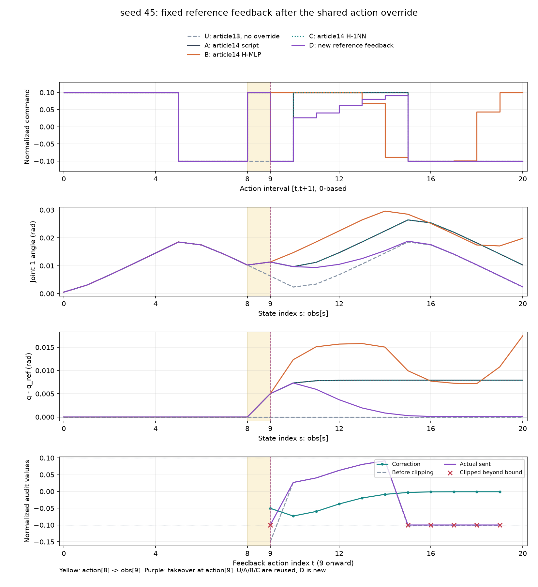
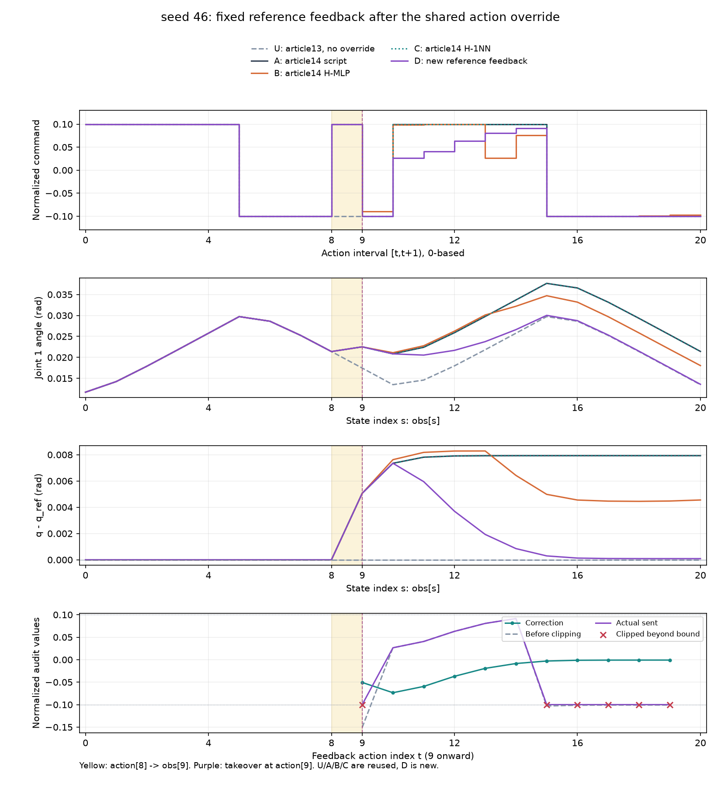
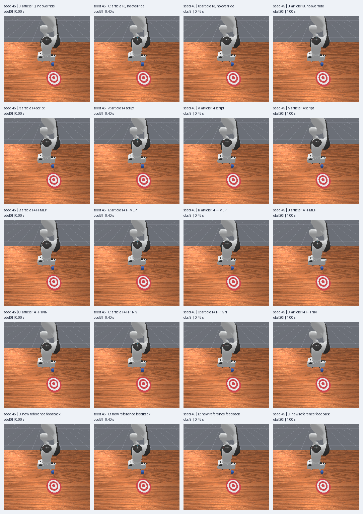
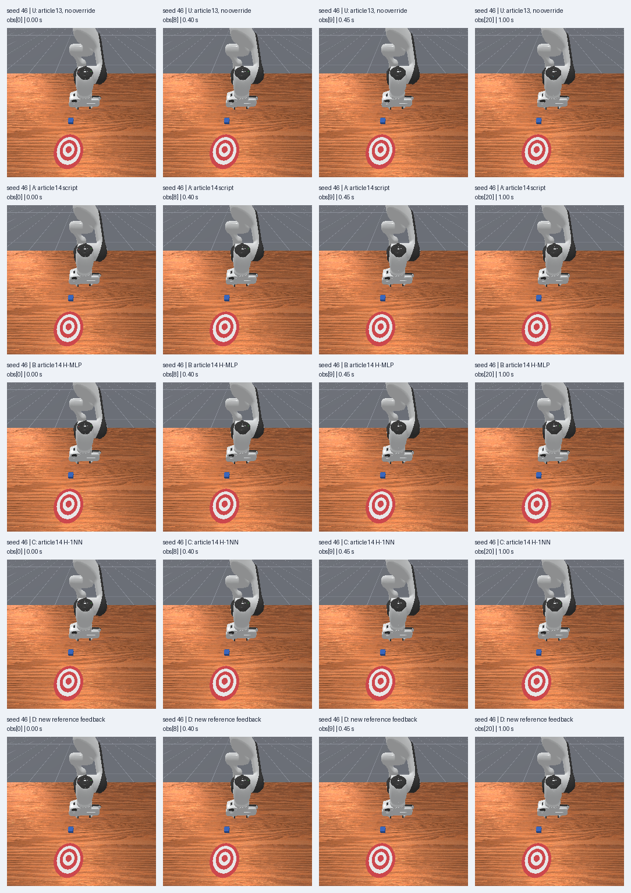

# 把偏差变成反馈：一个参考轨迹跟踪基线

[下载离线复核包](../assets/experiments/15-reference-feedback-baseline/reference-feedback-files.zip) · [运行说明](../assets/experiments/15-reference-feedback-baseline/README.md) · [解压复核结果](../assets/experiments/15-reference-feedback-baseline/portable-validation.json)

公开包包含可运行的CPU离线代码与必要的真实数值资料，解压后可复算已保存结果。默认不会启动仿真或训练。

[第十四篇](perturbed-policy-response.html)覆盖一次动作后，历史最近邻仍沿用脚本指令，末端保留约0.007927rad参考偏移。本篇加入一条明确的参考误差修正规则，在完全相同的前缀后观察后续11步。

两条新增运行中，末端角度偏差分别约为7.39×10⁻⁵rad和8.79×10⁻⁵rad；峰值与RMSE也按预定范围完整报告。两组success仍始终为false。这是已知参考可用时的手写控制演示，不能作为输入条件相同的模型比较。

## 哪一层反馈发生了变化

机器人底层一直使用PD控制器，旧H-MLP与H-1NN也读取实际关节状态进行闭环决策。本篇增加的外层规则，将“参考角度与当前角度的差”转成归一化动作修正。底层PD继续执行关节目标。

```text
参考时钟t → 已知参考角度q_ref[t]、前馈u_ff[t]
                          ↓
实际q_actual[t] → 位置误差 → 动作修正 → 限幅动作
                                          ↓
                         底层PD目标 → 实际下一时刻运动
```

环境沿用Python3.11.9、NumPy2.4.6、PyTorch2.14.1+cpu、Pillow13.0.0、ManiSkill3.0.1、SAPIEN3.0.3。没有安装或升级依赖。D控制器本身只执行NumPy标量计算，没有训练模型。

## 先冻结公式与单位

参考固定为第十三篇同seed的无干预A-script。当前动作t只读取参考obs[t]，前馈为参考actions[t,0]，不把obs[t+1]误配为当前目标。

```python
error_rad = q_ref[t] - q_actual[t]
correction = 1.0 * error_rad / 0.1  # 分母单位rad
u_raw = u_ff[t] + correction
limit = np.float64(np.float32(0.1))
u_sent = np.float32(np.clip(u_raw, -limit, limit))
```

gain=1.0，joint_delta_scale=0.1rad，名义command_limit=0.1。误差与修正按float64计算，发送值为float32。误差除以同单位的0.1rad之后，修正成为归一化指令量；不使用第八篇的状态统计标准化来代替物理单位换算。

本地控制器仍为use_delta=true、use_target=false、normalize_action=true，机械臂归一化[-1,1]映射到约[-0.1,0.1]rad，并以当前关节位置生成目标。夹爪输入1映射到0.04m打开目标。实际角度由PD与动力学推进得到，不能直接写成动作值或目标值。[ManiSkill控制器说明](https://maniskill.readthedocs.io/en/latest/user_guide/concepts/controllers.html)

为了沿用已有float32接口，限幅边界在float64中的精确表示为0.10000000149011612。was_clipped表示截断前数值严格超出边界；sent_at_bound表示实际发送的float32值恰好等于边界。零误差时，原脚本可以触边而不发生截断，两个标记含义不同。[NumPy2.4 clip说明](https://numpy.org/doc/2.4/reference/generated/numpy.clip.html)

增益、限幅和算法在采集前冻结，没有增加速度项、积分项或搜索，也没有依据结果调参。离线预检用40个真实参考状态验证零误差时的发送值与原脚本逐项相同。私有人工用例另外检查正负误差、超界及9种非有限输入拒绝情况；它们不作为真实仿真数据。

## 新增两条运行，旧对照全部复用

仍使用已经评估过的seed45、46，先45再46，每次只创建一个环境。任务为PushCube-v1、Panda、pd_joint_delta_pos、base_camera256×256，控制20Hz、物理100Hz。

t=0～7执行共同脚本；t=8第一维固定+0.1；读取obs[9]后，t=9～19才执行参考反馈。其余六个机械臂输入为0，夹爪输入为1。每组20步、21份观测、1.00秒、11次真实反馈决策。

初始化以及状态0～9与第十四篇同seed A组比较，qpos、qvel和方块位姿逐项相同，也满足此前冻结容差。额外运行只有两条D，共40次step，调用前持久化记账，没有重采旧参考或旧策略组。

以下U为第十三篇无干预脚本，A/B/C为第十四篇同干预脚本、H-MLP和H-1NN；只有D为本篇新增。表中指标统一使用共同状态9～20，共12份状态，包含反馈刚接管时的obs[9]。

| seed | 组 | 来源 | 最大偏差rad | 角度RMSE rad | 末端有符号偏差rad | 末端绝对偏差rad |
| --- | --- | --- | --- | --- | --- | --- |
| 45 | U | 历史复用 | 0.000000000 | 0.000000000 | +0.000000000 | 0.000000000 |
| 45 | A | 历史复用 | 0.007927501 | 0.007663299 | +0.007927501 | 0.007927501 |
| 45 | B | 历史复用 | 0.017450383 | 0.012291043 | +0.017450383 | 0.017450383 |
| 45 | C | 历史复用 | 0.007927501 | 0.007663299 | +0.007927501 | 0.007927501 |
| 45 | D | 本次新增 | 0.007320881 | 0.003327613 | +0.000073933 | 0.000073933 |
| 46 | U | 历史复用 | 0.000000000 | 0.000000000 | +0.000000000 | 0.000000000 |
| 46 | A | 历史复用 | 0.007927242 | 0.007668698 | +0.007927242 | 0.007927242 |
| 46 | B | 历史复用 | 0.008284017 | 0.006157697 | +0.004552486 | 0.004552486 |
| 46 | C | 历史复用 | 0.007927242 | 0.007668698 | +0.007927242 | 0.007927242 |
| 46 | D | 本次新增 | 0.007347689 | 0.003332764 | +0.000087906 | 0.000087906 |

D组的末端偏差仍大于1e-6rad，没有完全回到原参考。seed45最大偏差约0.007321rad、RMSE约0.003328rad，seed46分别约0.007348rad与0.003333rad。末端较小并不意味着整个过程始终接近参考，因此同时报告峰值和RMSE。

## 修正与限幅的真实记录

| seed | t | 误差rad | 前馈 | 修正 | 截断前 | 实际发送 | 发生截断 |
| --- | --- | --- | --- | --- | --- | --- | --- |
| 45 | 9 | -0.005019248 | -0.100000 | -0.050192480 | -0.150192481 | -0.100000001 | true |
| 45 | 10 | -0.007320881 | +0.100000 | -0.073208811 | +0.026791190 | +0.026791191 | false |
| 45 | 19 | -0.000074259 | -0.100000 | -0.000742585 | -0.100742587 | -0.100000001 | true |
| 46 | 9 | -0.005063061 | -0.100000 | -0.050630607 | -0.150630608 | -0.100000001 | true |
| 46 | 10 | -0.007347689 | +0.100000 | -0.073476890 | +0.026523111 | +0.026523111 | false |
| 46 | 19 | -0.000088183 | -0.100000 | -0.000881832 | -0.100881834 | -0.100000001 | true |

t=9时，当前角度高于参考，误差为负，反馈希望在负向前馈上继续增加负修正。实际发送值受到-0.1限幅。t=10原前馈转为+0.1，负修正使正向指令减小，随后状态逐步靠近参考。这些解释可以逐项核对保存的误差、修正和实际动作。

两组都在t=9、15、16、17、18、19发生截断，共6次。真实反馈阶段的6次触边都伴随截断；“触边而未截断”的真实计数为0。人工零误差用例的结果另存工作目录，不将它混入真实计数。

反馈误差定义为q_ref-q_actual。下面角度偏差图和指标使用q_actual-q_ref，两者符号相反，单位都为rad。

<figure class="experiment-figure"><figcaption><a href="../assets/experiments/15-reference-feedback-baseline/seed-0045-feedback.png">下载原尺寸图</a></figcaption></figure>

<figure class="experiment-figure"><figcaption><a href="../assets/experiments/15-reference-feedback-baseline/seed-0046-feedback.png">下载原尺寸图</a></figcaption></figure>

四行依次是实际指令、实际角度、相对参考的有符号偏差、反馈修正与限幅审计。黄色区间表示action[8]推进到obs[9]，紫线表示action[9]接管。图中的U/A/B/C全部来自保存文件，没有重新运行。

## 相机与任务结果

| seed | 步数 | 反馈决策 | 截断次数 | 触边次数 | 方块位移µm | reward之和 | success |
| --- | --- | --- | --- | --- | --- | --- | --- |
| 45 | 20 | 11 | 6 | 6 | 0.7916 | 1.370474 | false |
| 46 | 20 | 11 | 6 | 6 | 0.8340 | 1.521866 | false |

两组方块净位移均小于1微米，success始终false。reward是片段内实际总和，不以它宣布推物成功。两组末步terminated和truncated均为false，停止原因是20步预算结束，末观测仍保留。

以下五行分别对应U、A、B、C、D，四列为状态0、8、9、20。图块保持原始256×256像素，标签位于图外；机器人、桌面和蓝色方块可辨认。

<figure class="experiment-figure"><figcaption><a href="../assets/experiments/15-reference-feedback-baseline/seed-0045-frames.png">下载原尺寸图</a></figcaption></figure>

<figure class="experiment-figure"><figcaption><a href="../assets/experiments/15-reference-feedback-baseline/seed-0046-frames.png">下载原尺寸图</a></figcaption></figure>

## 全部实际反馈与指令

这里保留两组全部11次真实反馈，显示九位小数；原始CSV/NPZ提供完整精度。控制器目标另存于审计和rollout诊断字段，不把它当成下一时刻实际位置。

### seed45的11次真实反馈

| t | 参考rad | 实际rad | 误差rad | 修正 | 截断前指令 | 发送指令 | 截断 |
| --- | --- | --- | --- | --- | --- | --- | --- |
| 9 | +0.006321799 | +0.011341047 | -0.005019248 | -0.050192480 | -0.150192481 | -0.100000001 | true |
| 10 | +0.002363599 | +0.009684480 | -0.007320881 | -0.073208811 | +0.026791190 | +0.026791191 | false |
| 11 | +0.003420251 | +0.009383576 | -0.005963325 | -0.059633248 | +0.040366753 | +0.040366754 | false |
| 12 | +0.006777565 | +0.010502215 | -0.003724651 | -0.037246509 | +0.062753492 | +0.062753491 | false |
| 13 | +0.010614434 | +0.012563474 | -0.001949039 | -0.019490393 | +0.080509609 | +0.080509610 | false |
| 14 | +0.014551627 | +0.015407515 | -0.000855887 | -0.008558873 | +0.091441128 | +0.091441125 | false |
| 15 | +0.018509807 | +0.018800575 | -0.000290768 | -0.002907682 | -0.102907684 | -0.100000001 | true |
| 16 | +0.017453151 | +0.017572299 | -0.000119148 | -0.001191478 | -0.101191480 | -0.100000001 | true |
| 17 | +0.014095796 | +0.014179120 | -0.000083324 | -0.000833236 | -0.100833237 | -0.100000001 | true |
| 18 | +0.010258906 | +0.010334729 | -0.000075824 | -0.000758236 | -0.100758238 | -0.100000001 | true |
| 19 | +0.006321690 | +0.006395948 | -0.000074259 | -0.000742585 | -0.100742587 | -0.100000001 | true |

[完整精度反馈CSV](../assets/experiments/15-reference-feedback-baseline/seed-0045-feedback.csv)

### seed46的11次真实反馈

| t | 参考rad | 实际rad | 误差rad | 修正 | 截断前指令 | 发送指令 | 截断 |
| --- | --- | --- | --- | --- | --- | --- | --- |
| 9 | +0.017450524 | +0.022513585 | -0.005063061 | -0.050630607 | -0.150630608 | -0.100000001 | true |
| 10 | +0.013491762 | +0.020839451 | -0.007347689 | -0.073476890 | +0.026523111 | +0.026523111 | false |
| 11 | +0.014592182 | +0.020541664 | -0.005949482 | -0.059494823 | +0.040505178 | +0.040505178 | false |
| 12 | +0.017976381 | +0.021674225 | -0.003697844 | -0.036978442 | +0.063021559 | +0.063021556 | false |
| 13 | +0.021822328 | +0.023753809 | -0.001931481 | -0.019314811 | +0.080685191 | +0.080685191 | false |
| 14 | +0.025762023 | +0.026614163 | -0.000852140 | -0.008521397 | +0.091478605 | +0.091478601 | false |
| 15 | +0.029720759 | +0.030017037 | -0.000296278 | -0.002962779 | -0.102962781 | -0.100000001 | true |
| 16 | +0.028620329 | +0.028750394 | -0.000130065 | -0.001300648 | -0.101300649 | -0.100000001 | true |
| 17 | +0.025236074 | +0.025332462 | -0.000096388 | -0.000963882 | -0.100963883 | -0.100000001 | true |
| 18 | +0.021390084 | +0.021479638 | -0.000089554 | -0.000895541 | -0.100895543 | -0.100000001 | true |
| 19 | +0.017450348 | +0.017538531 | -0.000088183 | -0.000881832 | -0.100881834 | -0.100000001 | true |

[完整精度反馈CSV](../assets/experiments/15-reference-feedback-baseline/seed-0046-feedback.csv)


前缀与覆盖动作没有调用反馈公式，不能当作反馈输出。以下完整表按六位小数展示全部20步实际发送值。

### seed45全部20步指令

| t | D阶段 | U历史 | A历史 | B历史 | C历史 | D新增 |
| --- | --- | --- | --- | --- | --- | --- |
| 0 | 前缀 | +0.100000 | +0.100000 | +0.100000 | +0.100000 | +0.100000 |
| 1 | 前缀 | +0.100000 | +0.100000 | +0.100000 | +0.100000 | +0.100000 |
| 2 | 前缀 | +0.100000 | +0.100000 | +0.100000 | +0.100000 | +0.100000 |
| 3 | 前缀 | +0.100000 | +0.100000 | +0.100000 | +0.100000 | +0.100000 |
| 4 | 前缀 | +0.100000 | +0.100000 | +0.100000 | +0.100000 | +0.100000 |
| 5 | 前缀 | -0.100000 | -0.100000 | -0.100000 | -0.100000 | -0.100000 |
| 6 | 前缀 | -0.100000 | -0.100000 | -0.100000 | -0.100000 | -0.100000 |
| 7 | 前缀 | -0.100000 | -0.100000 | -0.100000 | -0.100000 | -0.100000 |
| 8 | 覆盖 | -0.100000 | +0.100000 | +0.100000 | +0.100000 | +0.100000 |
| 9 | 反馈 | -0.100000 | -0.100000 | +0.099862 | -0.100000 | -0.100000 |
| 10 | 反馈 | +0.100000 | +0.100000 | +0.100000 | +0.100000 | +0.026791 |
| 11 | 反馈 | +0.100000 | +0.100000 | +0.100000 | +0.100000 | +0.040367 |
| 12 | 反馈 | +0.100000 | +0.100000 | +0.099997 | +0.100000 | +0.062753 |
| 13 | 反馈 | +0.100000 | +0.100000 | +0.068309 | +0.100000 | +0.080510 |
| 14 | 反馈 | +0.100000 | +0.100000 | -0.088330 | +0.100000 | +0.091441 |
| 15 | 反馈 | -0.100000 | -0.100000 | -0.099814 | -0.100000 | -0.100000 |
| 16 | 反馈 | -0.100000 | -0.100000 | -0.099884 | -0.100000 | -0.100000 |
| 17 | 反馈 | -0.100000 | -0.100000 | -0.099241 | -0.100000 | -0.100000 |
| 18 | 反馈 | -0.100000 | -0.100000 | +0.043704 | -0.100000 | -0.100000 |
| 19 | 反馈 | -0.100000 | -0.100000 | +0.100000 | -0.100000 | -0.100000 |

[完整动作CSV](../assets/experiments/15-reference-feedback-baseline/seed-0045-actions.csv) · [全部状态CSV](../assets/experiments/15-reference-feedback-baseline/seed-0045-states.csv)

### seed46全部20步指令

| t | D阶段 | U历史 | A历史 | B历史 | C历史 | D新增 |
| --- | --- | --- | --- | --- | --- | --- |
| 0 | 前缀 | +0.100000 | +0.100000 | +0.100000 | +0.100000 | +0.100000 |
| 1 | 前缀 | +0.100000 | +0.100000 | +0.100000 | +0.100000 | +0.100000 |
| 2 | 前缀 | +0.100000 | +0.100000 | +0.100000 | +0.100000 | +0.100000 |
| 3 | 前缀 | +0.100000 | +0.100000 | +0.100000 | +0.100000 | +0.100000 |
| 4 | 前缀 | +0.100000 | +0.100000 | +0.100000 | +0.100000 | +0.100000 |
| 5 | 前缀 | -0.100000 | -0.100000 | -0.100000 | -0.100000 | -0.100000 |
| 6 | 前缀 | -0.100000 | -0.100000 | -0.100000 | -0.100000 | -0.100000 |
| 7 | 前缀 | -0.100000 | -0.100000 | -0.100000 | -0.100000 | -0.100000 |
| 8 | 覆盖 | -0.100000 | +0.100000 | +0.100000 | +0.100000 | +0.100000 |
| 9 | 反馈 | -0.100000 | -0.100000 | -0.089169 | -0.100000 | -0.100000 |
| 10 | 反馈 | +0.100000 | +0.100000 | +0.098759 | +0.100000 | +0.026523 |
| 11 | 反馈 | +0.100000 | +0.100000 | +0.099966 | +0.100000 | +0.040505 |
| 12 | 反馈 | +0.100000 | +0.100000 | +0.099341 | +0.100000 | +0.063022 |
| 13 | 反馈 | +0.100000 | +0.100000 | +0.026610 | +0.100000 | +0.080685 |
| 14 | 反馈 | +0.100000 | +0.100000 | +0.076214 | +0.100000 | +0.091479 |
| 15 | 反馈 | -0.100000 | -0.100000 | -0.099639 | -0.100000 | -0.100000 |
| 16 | 反馈 | -0.100000 | -0.100000 | -0.099955 | -0.100000 | -0.100000 |
| 17 | 反馈 | -0.100000 | -0.100000 | -0.099966 | -0.100000 | -0.100000 |
| 18 | 反馈 | -0.100000 | -0.100000 | -0.098900 | -0.100000 | -0.100000 |
| 19 | 反馈 | -0.100000 | -0.100000 | -0.097383 | -0.100000 | -0.100000 |

[完整动作CSV](../assets/experiments/15-reference-feedback-baseline/seed-0046-actions.csv) · [全部状态CSV](../assets/experiments/15-reference-feedback-baseline/seed-0046-states.csv)


## 如何只读复核

将公开实验包解压，在解压目录使用兼容环境运行；输出目录须尚不存在。

```bash
python -B evaluate.py --output-dir result
```

独立验收没有调用feedback_controller.feedback，而是从当前保存状态、参考obs[t]和参考actions[t,0]重算误差与修正，用独立min/max限幅核对float32发送值。两组全部反馈字段的float64差异为0，发送指令逐项相同，截断与触边标记一致。

验收还检查N/N+1、动作边界、连续步数和时间、回合标志、共同前缀，以及42张PNG与RGB逐像素一致。控制器目标按当前角度加缩放指令单独核对，不将目标误当实际运动。所有NPZ禁用pickle可读。[NumPy2.4 load文档](https://numpy.org/doc/2.4/reference/generated/numpy.load.html)

39项引用文件与2790份此前实验、日志及网站文件SHA-256未变。日志保留可选Pinocchio缺失警告，现用关节控制和全部验收通过，没有采集失败或补跑。

计算与物理在CPU执行，RGB通过CPU可访问接口复制；渲染设备API与GPU枚举单独记录，未测实际渲染利用率。每组一次显式seeded reset之外，构造器也有内部初始化。

[运行说明](../assets/experiments/15-reference-feedback-baseline/README.md) · [完整指标](../assets/experiments/15-reference-feedback-baseline/metrics.json) · [字段与单位](../assets/experiments/15-reference-feedback-baseline/schema.json) · [独立验收](../assets/experiments/15-reference-feedback-baseline/validation.json)

## 这条基线的适用范围

D额外获得完整参考轨迹和参考时钟，旧H策略没有这些输入。因此角度偏差的变化不能用来证明某个模型架构优劣。gain=1也只是这次预先规定的配置，没有优化它的证据。

两个seed已经在此前使用，每条只运行1秒，参考也完全已知。本次说明这条手写外层规则在固定干预下产生了怎样的响应，不保证统计独立、泛化、普遍恢复或推物能力。数据不加入训练，也没有更新已有策略。本文提供整理后的公开资料，可在兼容CPU环境离线复核。
