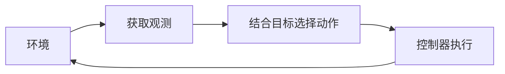

# 没有实机，如何开始学习具身智能？

想学习具身智能，却没有机械臂，应该从哪里开始？

你可以先使用公开数据和仿真环境，学习机器人如何获取观测、执行动作，以及根据结果调整下一步行为。LeRobot 的官方文档也为没有硬件的学习者列出了使用已有数据集、在仿真中评估策略等路径。[LeRobot 官方文档](https://huggingface.co/docs/lerobot/index)

真正需要先明确的是：你准备让机器人完成什么任务，又如何判断自己已经理解了这个过程。

这个系列从一个桌面推物任务出发，逐步走向数据采集、策略学习和世界模型。本篇先把任务中的基本关系讲清楚，并为第一次仿真实验确定一个可以检查的目标。

**从桌面上的一个方块开始**

设想一张桌子上放着一个方块，旁边标出目标区域。机械臂需要接近方块，将它推入目标区域。

为了方便入门，我们先考虑一个简化设定：末端保持固定高度和姿态，主要在桌面平面内移动。这里描述的是教学任务，具体环境的控制方式和成功条件，需要在实际使用时另行确认。

| 要素 | 本文中的设定 |
| --- | --- |
| 任务目标 | 将方块推入指定区域 |
| 观测输入 | 相机图像，以及选定的关节状态或末端状态 |
| 目标信息 | 通过图像中的目标标记或明确提供的目标表示给出 |
| 动作接口 | 表达末端在桌面平面内的期望移动 |
| 评估依据 | 方块是否进入目标区域、使用了多少步、是否发生预先定义的失败事件 |

这个任务会遇到接触、滑动、遮挡和推偏等情况。它已经足够让我们讨论一个核心问题：机器人如何根据环境的变化，决定下一步动作？

**先分清：环境的状态与机器人得到的观测**

环境状态描述场景在某个时刻的物理情况，例如方块的位置、速度，以及机械臂的关节位置和速度。

观测则是我们选择提供给策略的信息。它可以是相机图像、关节读数，也可以包含任务允许使用的目标信息。

两者不必相同。一张图像里，方块的一部分可能被夹爪挡住；仅凭单帧图像，也很难准确判断它当前的速度。

在仿真中，这个区别尤其容易被忽略。仿真器可能允许程序读取物体的精确位姿，但这些信息未必能由真实传感器直接获得。ManiSkill 的文档就区分了包含物体位姿等特权信息的状态观测，以及来自相机等传感器的数据。[ManiSkill 观测文档](https://maniskill.readthedocs.io/en/latest/user_guide/concepts/observation.html)

因此，开始实验前要写清楚：**哪些信息进入策略，哪些信息只用于评估。**

例如，我们可以让视觉策略使用相机图像和机器人自身状态，由评估程序读取方块的精确位置来判断任务是否成功。也可以建立使用完整状态的基线，但应明确标注输入条件，再进行比较。

**动作是一条控制指令**

“把方块往右推一点”对人来说很直观，对程序来说却还不够明确。

这里的“右”是相机画面右侧，还是机器人基座坐标系的某个方向？“一点”表示位移、速度，还是一个需要缩放的归一化数值？指令会持续多长时间？

这些问题由动作空间和控制器共同决定。以 ManiSkill 为例，策略输出的动作会交给选定的控制器；末端位姿控制器可以将期望的末端变化转换为关节目标。[ManiSkill 控制器与动作空间文档](https://maniskill.readthedocs.io/en/latest/user_guide/concepts/controllers.html)

在本文的平面推物设定中，我们可以用两个数表达期望的平面移动，但这只是一个简化接口。使用具体环境时，仍要检查动作的维度、坐标系、单位、缩放方式和执行频率。

而且，发出了移动指令，不代表末端一定准确到达目标，更不代表方块会移动相同距离。接触位置、摩擦和机器人运动都会影响结果。执行之后，需要重新观察。

**把一次动作连接成闭环**

现在可以把任务串起来：



机械臂观察当前场景，选择动作，执行后再次观察，再据此调整后续行为。这个反复获取反馈并调整动作的过程，就是闭环。

选择动作的规则通常称为策略。它可以是一段人工编写的规则，也可以是训练得到的模型；必要时还会使用过去的观测和动作。

对于推物任务，闭环的作用很具体：第一次推动后，方块可能只移动了一小段，也可能发生旋转。下一步应该根据新的观测来决定。

因此，一段展示机器人运动的视频，只能说明某次执行的过程。要评估一个方法，还需要约定测试初始条件、成功标准和步数限制，并记录多次尝试的结果。

**仿真能够帮助我们研究什么**

仿真为学习提供了一个便于设置场景、记录数据和重复试验的环境。你可以逐步检查：相机能否看到任务区域，动作方向是否符合预期，数据是否正确对应，以及策略在不同初始条件下如何表现。

这里需要区分两个问题：场景看起来是否合理，以及任务交互是否按预期发生。ManiSkill 的基础文档说明，物体的视觉形状与碰撞形状承担不同作用。画面中的外观，并不能单独证明碰撞和接触设置正确。[ManiSkill 仿真基础文档](https://maniskill.readthedocs.io/en/latest/user_guide/concepts/simulation_101.html)

实验记录也需要比“一段视频”更完整。至少应保留环境和依赖版本、观测与动作配置、初始条件、随机种子、成功定义，以及实际测试次数。随机种子是复现线索之一；跨机器、不同配置之间能否复现，还需要实际检查。ManiSkill 也单独讨论了随机数与环境状态的保存方式。[ManiSkill 可复现性文档](https://maniskill.readthedocs.io/en/latest/user_guide/concepts/rng.html)

仿真结果的结论范围也应与实验一致：它能说明方法在所测试仿真条件下的表现。真实机器人的摩擦、相机误差、控制延迟和硬件特性可能不同，迁移后的表现需要另外验证。

**世界模型在这里扮演什么角色**

策略回答的是：“接下来做什么？”

动作条件世界模型则尝试回答：“如果执行这个动作，之后可能发生什么？”

回到推物任务，我们可以考虑几个候选动作：正面推动、从侧面接近，或者先调整末端位置。世界模型根据当前观测或内部表示，以及候选动作，预测后续变化；规划器再利用预测结果比较不同方案。

预测的对象可以是图像，也可以是状态或视觉特征。例如 DINO-WM 在预训练视觉特征上学习动作相关的动态，并通过优化动作序列进行规划。这说明，用于行动的世界模型可以在特征空间中工作。[DINO-WM 论文](https://arxiv.org/abs/2411.04983)

这种方法还需要执行后的反馈：预测可能有误，动作实施后应获取新的观测，再更新判断。

评估时也要同时关心预测与行动。即使预测图像在视觉上变化不大，关键的接触位置误差也可能影响推物结果。对于服务规划的模型，应进一步检查闭环任务表现，而不能只看预测画面。

**第一次实验，先保存并检查一张图像**

理解上面的关系后，第一次动手可以设定为：

> 启动一个机器人仿真任务，获取一帧相机观测，保存为图片，并打开检查。

这一小步能够同时暴露环境初始化、相机设置、渲染和图像读写中的问题。完成时，应能回答下面三个问题：

- 图像里能否辨认出机械臂、桌面和任务物体？
- 这张图来自哪个相机，它是策略输入，还是用于展示的画面？
- 能否根据记录的版本、配置和初始化条件，再次生成对应场景？

完成后，再执行一条语义明确的控制指令，检查执行前后的观测，并保存动作。数据的基本单元也就逐渐清楚了：

```text
当前观测 → 执行的动作 → 下一时刻观测
```

继续积累这些记录，才有了后续数据检查、策略学习和世界模型训练的基础。

在实际运行之前，你也可以先填写一张任务卡，作为本篇文章的练习：

```text
任务：将桌面方块推入目标区域
策略能获得的信息：
目标如何表示：
动作的含义、坐标系与单位：
如何判断成功、失败或超时：
需要保存的观测、动作与实验配置：
```

如果这些空项还无法填写，就先把它们作为查阅环境文档时的问题。第一次实验的目标，是让这张任务卡中的描述与实际输出对应起来。

下一篇《第一次机器人仿真实验：保存一张相机图像》将围绕这个目标展开：从检查运行条件开始，获取图像，并逐项检查它是否可以成为后续实验的数据输入。
