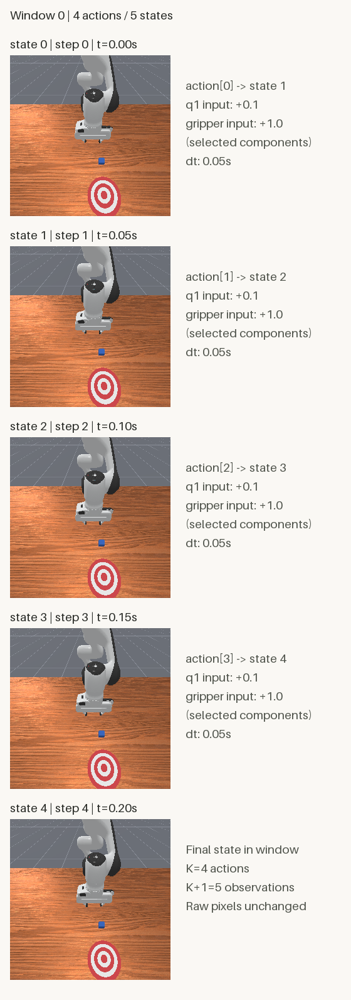

# 从单步到序列：构建机器人轨迹时间窗口

[第五篇](trajectory-to-dataset.html)让Dataset按索引返回一条transition，再一次读取4条。这次改变的是一条样本的含义：每条样本包含连续4个动作，以及它们连接的5份观测。

本篇已于2026-10-26完成实际验证。复用第四篇完整真实轨迹，在CPU上离线构造17个窗口；DataLoader得到5批，大小依次为4、4、4、4、1。没有启动仿真、采集新动作或训练模型。

## 先看一个真实窗口

下面是窗口0的状态0～4，覆盖0～0.20秒。每张图仍是原始base_camera RGB，右侧标注相邻动作的位置及两个选取的控制分量。标注在图块外，不属于模型输入。

<figure class="experiment-figure"><figcaption>窗口长度K=4个动作，对应K+1=5份观测。原始256×256图块未裁剪、缩放或改色，整张对照图560×1592。<a href="../assets/experiments/06-trajectory-windows/window_preview.png" download>下载原尺寸对照图</a></figcaption></figure>

方块没有明显位移，这些数据不代表推物成功。我们这次验证的是时间对应、存储独立性与边界规则。

[下载完整公开示例](../assets/experiments/06-trajectory-windows/window-files.zip)，包含可运行代码和完整来源数据，解压后不需要重新采集。也可以查看 [窗口Dataset](../assets/experiments/06-trajectory-windows/trajectory_window_dataset.py)、[运行脚本](../assets/experiments/06-trajectory-windows/inspect_windows.py)、[复用的第五篇模块](../assets/experiments/06-trajectory-windows/trajectory_dataset.py)、[全部窗口索引](../assets/experiments/06-trajectory-windows/window_index.json)、[首批次NPZ](../assets/experiments/06-trajectory-windows/sample_batch.npz)、[实际统计](../assets/experiments/06-trajectory-windows/sample_batch.json)、[字段说明](../assets/experiments/06-trajectory-windows/schema.json) 和 [验收结果](../assets/experiments/06-trajectory-windows/validation.json)。

## 第一步：读取完整轨迹

实际环境为Python3.11.9、NumPy2.4.6、PyTorch2.14.1+cpu、Pillow13.0.0，复用已有环境，没有安装或升级依赖。输入与参考代码等144份既有文件的哈希、82个包的版本保持不变。

输入是[第四篇](record-first-trajectory.html)的完整`trajectory.npz`：PushCube-v1、panda、seed42、base_camera、20个动作和21份观测。第五篇的`sample_batch.npz`只保存首批4条transition，不能当成这条完整轨迹。

在下载包解压目录，用兼容Python执行：

```powershell
python -B inspect_windows.py --trajectory source/trajectory.npz --output-dir result
```

完整来源已包含在`source`目录。省略`--trajectory`时也会默认读取脚本旁的这个文件。输出目录里已有同名文件会被保护，再次运行请换成`result-2`。`requirements.txt`记录实际使用版本；作者本次没有执行安装，其他系统与新环境安装需要另行验证。

本次真实导出摘要如下：

```json
{"result":"EXPORTED","windows":17,"K":4,"stride":1,"batch_sizes":[4,4,4,4,1],"arrays":17,"device":"cpu","preview_size":[560,1592]}
```

## 第二步：K个动作，连接K+1份观测

这里K明确表示动作或transition的数量，固定为4；stride=1表示窗口起点每次向后移动一个动作。

```text
window[0]: obs[0] → a[0] → obs[1] → a[1] → obs[2] → a[2] → obs[3] → a[3] → obs[4]
window[1]: obs[1] → a[1] → obs[2] → a[2] → obs[3] → a[3] → obs[4] → a[4] → obs[5]
...
window[16]: obs[16] → a[16] → ... → a[19] → obs[20]
```

对起点s，动作切片为`actions[s:s+K]`，观测切片为`observations[s:s+K+1]`。右端不包括在Python切片中；最后一个被包括的观测索引是s+K。

来源没有内部回合边界，N=20、K=4、stride=1，因此完整窗口数为`20-4+1=17`，起点0～16。不足4个动作的尾窗直接舍弃，没有补零或重复末帧。

| 窗口 | 状态索引 | 动作索引 | 仿真时间 |
| --- | --- | --- | --- |
| 首窗口0 | 0～4，共5份 | 0～3，共4个 | 0～0.20秒 |
| 窗口1 | 1～5，共5份 | 1～4，共4个 | 0.05～0.25秒 |
| 末窗口16 | 16～20，共5份 | 16～19，共4个 | 0.80～1.00秒 |

`window_index.json`保存所有17个窗口的索引和时间，source_id=0映射到完整来源文件的SHA256。它标识一个文件片段，不声称来源是一个完整结束的回合。

## 第三步：复用单步读取，再组合窗口

`trajectory_dataset.py`是第五篇代码的逐字节副本，哈希记录在本篇配置中。它负责显式选择环境0、检查输入、复制qpos/qvel/RGB并拒绝回合终止后的继续动作。窗口实现的核心是取出连续transition，再组合状态：

```python
transitions = [self.base[i] for i in range(start, stop)]
states = [sample["obs"] for sample in transitions]
states += [transitions[-1]["next_obs"]]

observations = {
    key: torch.stack([state[key] for state in states], dim=0)
    for key in ("qpos", "qvel", "rgb")
}
```

这是类内部片段，完整实现见下载脚本。`stop=start+K`是动作右开端点，同时也是最后观测索引。每个窗口内部仍然保持`observations[j] → actions[j] → observations[j+1]`。

可以直接读取一条：

```python
from trajectory_window_dataset import TrajectoryWindowDataset

dataset = TrajectoryWindowDataset("source/trajectory.npz", K=4, stride=1)
window = dataset[0]
print(len(dataset))                         # 17
print(window["observations"]["rgb"].shape)   # torch.Size([5, 3, 256, 256])
print(window["actions"].shape)               # torch.Size([4, 8])
print(window["metadata"]["state_indices"])   # tensor([0, 1, 2, 3, 4])
```

RGB沿用uint8/HWC到float32/CHW并除以255，没有裁剪、缩放或增强。qpos、qvel和动作保留原值：位置前7维rad、后2维m，速度分别为rad/s和m/s。动作仍是归一化指令，控制器语义可回看[第三篇](observations-and-actions.html)。

观测只含qpos、qvel、RGB；没有把物体真值、控制器目标、success、相机矩阵或tcp_pose混入这个最小输入集合。

## 第四步：批次轴B，和时间轴K不同

单个窗口已经有自己的时间轴。DataLoader在外面增加批次轴B，这与[PyTorch默认批量整理规则](https://docs.pytorch.org/docs/2.14/data.html#working-with-collate-fn)一致：

```python
import torch
from torch.utils.data import DataLoader

loader = DataLoader(
    dataset, batch_size=4, shuffle=False, drop_last=False,
    num_workers=0, pin_memory=False,
    generator=torch.Generator(device="cpu").manual_seed(42),
)
```

本篇的K和batch_size恰好都等于4，但含义不同。K控制一条样本覆盖多少动作；batch_size控制一次取几条窗口。

| 字段 | 单窗口 | 首批次，B=4 | 末批次，B=1 |
| --- | --- | --- | --- |
| qpos、qvel | `(5,9)` | `(4,5,9)` | `(1,5,9)` |
| RGB | `(5,3,256,256)` | `(4,5,3,256,256)` | `(1,5,3,256,256)` |
| actions | `(4,8)` | `(4,4,8)` | `(1,4,8)` |
| rewards、回合标志 | `(4,)` | `(4,4)` | `(1,4)` |
| 状态步数、仿真时间 | `(5,)` | `(4,5)` | `(1,5)` |

来源中的T/T+1是整段动作/状态时间轴，E是环境轴，已经显式取出环境0。窗口中的K/K+1是局部动作/状态轴；RGB的C/H/W是通道/高/宽。

实际批次索引为：

```text
batch 0: windows [0, 1, 2, 3]
batch 1: windows [4, 5, 6, 7]
batch 2: windows [8, 9, 10, 11]
batch 3: windows [12, 13, 14, 15]
batch 4: windows [16]
```

末批保留B=1，没有用无条件`squeeze()`删掉这个轴；`drop_last=False`保证最后一个窗口没有被丢弃。

## 第五步：重叠内容，不共享可修改存储

窗口0包含状态0～4，窗口1包含状态1～5，它们共享4个时刻的内容。来源依然只有21份观测、1秒仿真，17个重叠窗口不是17条独立轨迹。每窗0.20秒的时长也不能简单相加后声称获得了更多仿真时间。

[NumPy基本切片通常返回视图](https://numpy.org/doc/2.4/user/basics.indexing.html)，[torch.from_numpy也共享传入数组的存储](https://docs.pytorch.org/docs/2.14/generated/torch.from_numpy.html)。本篇先复用第五篇的独立副本，再stack成窗口；验收修改整个返回窗口的所有字段后，源缓存、重复读取和重叠窗口均与原始数值一致。

内容重叠与存储共享是两个问题：前者是滑动窗口的正常结果，后者需要通过明确复制和实际修改测试来控制。

## 第六步：文件片段与回合边界

本篇只接收单个连续片段。若某个动作返回terminated或truncated后，文件仍包含后续动作，来源加载器会报错，不把它自动解释成多个合法回合，也不跨reset或不同文件切窗。

如果终止恰好发生在完整窗口的最后一个动作，可以保留该动作及它返回的最后观测。实际来源两个终止标志全为false，末窗口的`ends_fragment=true`只说明读到了文件末尾，没有改写任何回合标志。

真实数据无法覆盖提前终止情形，因此另做16项私有人工数值测试：末动作terminated/truncated、终止后仍有动作、无效K/stride、K大于N、尾窗和空导出拒绝等。人工标志仅验证代码规则，不是新的仿真终止结果；夹具、日志和维护用验证器不公开。

K大于可用动作数时，Dataset长度为0，导出程序会明确报错且不写空示例。无效参数直接拒绝，尾窗不完整舍弃，没有隐藏填充策略。

## 第七步：保存与独立验收

`sample_batch.npz`只保存首批次的17个数值数组。层级使用斜杠键名，不把Python字典装进object数组：

```python
import numpy as np

with np.load("result/sample_batch.npz", allow_pickle=False) as batch:
    print(batch["observations/rgb"].shape)  # (4, 5, 3, 256, 256)
    print(batch["metadata/time_s"].shape)   # (4, 5)
```

39项真实数据检查通过，覆盖17个窗口中85次状态取用、68条transition对应关系、首末窗口、5个批次、最后B=1、类型与有限值、动作边界、独立存储和保存后重读。RGB与独立NumPy参考计算的最大误差为0，对照图5个图块与原始RGB逐像素一致，并已重新打开目视检查。

16项人工边界测试单独记录，没有混称为真实仿真验收。`sample_batch.json`保留导出阶段状态，最终结果见独立的`validation.json`。本次验收只读保存文件并运行CPU加载，没有重跑第四篇采集。

## 常见问题：有序列，是否就能开始训练

**窗口中的未来观测，在起点就能看到吗？** 不能。这里是一份离线序列记录，不代表5份观测都是起点时可用的输入。未来模型需要另外定义上下文、预测目标和可见时刻，本篇没有替模型作出这些约定。

**可以随机拆分17个窗口作为训练和验证吗？** 相邻窗口共享大量观测，这样拆分会让相同内容进入不同划分。本次没有做划分或训练；以后有多条轨迹时，应先考虑按轨迹/回合划分，再切窗口，其他相关性仍需另行检查。

**为什么没有看到大幅运动？** 本篇只复用已有真实轨迹，未追加动作或增强图像。小幅运动也能检查索引和维度，不构成推物成功或模型效果证据。

**输入或输出报错怎么办？** 解压完整文件包，保留三个Python脚本和source目录；确认使用完整trajectory.npz，输出改为新的目录。输入缺字段、越界、非有限值或非法回合拼接会被拒绝。

当前实现整体读取小轨迹，再从单步样本stack窗口，会产生重复读取和中间副本，未验证大规模吞吐。后续可以在来源与边界清晰后讨论多轨迹索引、数据划分和具体的预测任务。

## 官方参考资料

- [PyTorch 2.14：Dataset、DataLoader与批次轴](https://docs.pytorch.org/docs/2.14/data.html)
- [PyTorch 2.14：torch.from_numpy的共享存储](https://docs.pytorch.org/docs/2.14/generated/torch.from_numpy.html)
- [NumPy 2.4：索引、切片与视图](https://numpy.org/doc/2.4/user/basics.indexing.html)
- [Pillow 13.0.0：Image模块](https://pillow.readthedocs.io/en/stable/reference/Image.html)
