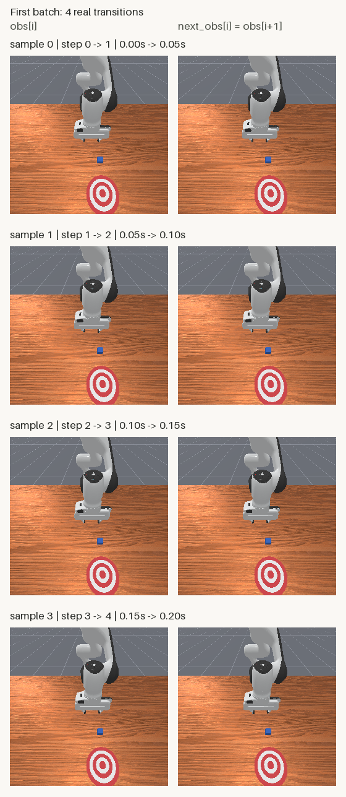

# 把轨迹变成数据集：用 PyTorch 批量读取机器人样本

[第四篇](record-first-trajectory.html)保存了20个动作、21份观测。这次继续使用那些真实文件，让程序能够按索引取出一条样本，再一次读入4条。

本篇已于2026-10-26完成验证。全程在CPU上离线处理，没有创建仿真环境、追加动作或训练模型。20条样本组成5个批次，首批次17个数值数组，36项独立检查通过。

## 先看实际读出的样本

下面是首批次的4条transition。左列是当前观测，右列是下一时刻观测；每个图块直接使用第四篇NPZ里的原始256×256 RGB，标签放在图外。

<figure class="experiment-figure"><figcaption>base_camera原始像素对照图，560×1288。相邻行的右图与下一行左图属于同一个时刻；画面相同是轨迹连接关系。<a href="../assets/experiments/05-trajectory-dataset/sample_preview.png" download>下载原尺寸对照图</a></figcaption></figure>

方块没有明显位移，本篇也没有推物成功或模型效果结论。图像只是帮助我们检查索引，数据管线的验收还包括数值、形状与存储独立性。

[下载完整公开示例](../assets/experiments/05-trajectory-dataset/dataset-files.zip)，解压后包含脚本、真实来源轨迹、首批次、字段说明和验收摘要。也可以单独查看 [Dataset实现](../assets/experiments/05-trajectory-dataset/trajectory_dataset.py)、[运行脚本](../assets/experiments/05-trajectory-dataset/inspect_dataset.py)、[首批次NPZ](../assets/experiments/05-trajectory-dataset/sample_batch.npz)、[实际统计](../assets/experiments/05-trajectory-dataset/sample_batch.json)、[字段说明](../assets/experiments/05-trajectory-dataset/schema.json) 和 [验收结果](../assets/experiments/05-trajectory-dataset/validation.json)。

## 第一步：从已有文件开始

本次复用Python3.11.9、NumPy2.4.6、PyTorch2.14.1+cpu、Pillow13.0.0。此前81份文件的SHA256和82个已安装包的版本均保持不变。

输入仍是第四篇的PushCube-v1、panda、seed=42、pd_joint_delta_pos轨迹，策略观测相机为base_camera。本次只读取文件，复现数据加载不需要启动ManiSkill或SAPIEN。

使用已有兼容Python环境，在下载包解压目录执行：

```powershell
python -B inspect_dataset.py --trajectory source/trajectory.npz --output-dir result
```

`source/trajectory.npz`已经包含在包内。也可省略`--trajectory`，脚本会读取自身旁边的这个文件。`result`用来保存新的结果；已有同名文件时程序会拒绝覆盖，再次执行请换成`result-2`。

本次实际导出的摘要为：

```json
{"result":"EXPORTED","samples":20,"batches":5,"first_indices":[0,1,2,3],"arrays":17,"device":"cpu","preview_size":[560,1288]}
```

新环境的版本要求见包内`requirements.txt`；本次没有执行安装或升级。新环境安装和其他操作系统组合需要另行验证。

## 第二步：21份观测，只产生20条样本

一条transition需要前后两份观测：

```text
sample[0]  = obs[0]  → action[0]  → obs[1]
sample[1]  = obs[1]  → action[1]  → obs[2]
...
sample[19] = obs[19] → action[19] → obs[20]
```

因此`len(dataset)=20`。最后一份观测给最后一个动作提供结果，不能单独再配出第21条transition。

[PyTorch Dataset接口](https://docs.pytorch.org/docs/2.14/data.html#map-style-datasets)通过`__len__`给出样本数量，通过`__getitem__`按索引提供样本。我们的实现只接收这份单环境轨迹格式，不会自动拼接多个回合。

```python
from trajectory_dataset import TrajectoryDataset

dataset = TrajectoryDataset("source/trajectory.npz")
sample = dataset[0]
print(len(dataset))                         # 20
print(sample["obs"]["qpos"].shape)          # torch.Size([9])
print(sample["next_obs"]["rgb"].shape)      # torch.Size([3, 256, 256])
print(sample["metadata"]["next_step_index"])  # tensor(1)
```

观测输入选择qpos、qvel、RGB，是原始策略观测的一个子集。相机矩阵、tcp_pose没有加入这个最小示例；仿真物体真值、控制器目标和success也没有混入输入。原始NPZ仍保留此前保存的字段。

## 第三步：显式取出环境轴

原始状态带有时间轴和环境轴，即使只有一个环境，环境维度仍然存在：

| 字段 | 来源形状 | 取第i条样本时 |
| --- | --- | --- |
| qpos、qvel | `(21,1,9)` | 当前`[i,0]`，下一时刻`[i+1,0]` |
| RGB | `(21,1,256,256,3)` | 当前`[i,0]`，下一时刻`[i+1,0]` |
| action | `(20,8)` | `[i]`，本身没有环境轴 |
| reward、回合标志 | `(20,1)` | `[i,0]`，得到标量 |

这里显式选择环境0，没有使用不带维度参数的`squeeze()`。这样可以看清究竟移除了哪个轴，也避免以后批大小或其他维度为1时删错维度。

原始数组中的T表示动作时间，T+1表示状态时间，E表示环境。取出一条样本后，它只包含一对相邻时刻；后面新增的B是样本批次轴。

## 第四步：转换图像，同时保留状态与动作原值

图像从HWC变成CHW，从uint8变成float32，再除以255。下面是实现中的转换片段，`source_rgb`表示带有状态时间轴和环境轴的原始RGB数组：

```python
hwc = source_rgb[i, 0]
chw = hwc.transpose(2, 0, 1).copy()
rgb = torch.from_numpy(chw).to(
    device="cpu", dtype=torch.float32
).div_(255.0)
```

没有裁剪、缩放或数据增强。原始整段RGB的实际范围是34～255；首批次当前RGB的实际范围约为0.13333334～1.0。除以255限定数值范围，但不会把每张图片的最暗像素强制拉到0。

qpos、qvel和动作保持原值：

| 字段 | 前7维机械臂 | 后续夹爪字段 |
| --- | --- | --- |
| qpos，9维 | rad | 两指位置，各为m |
| qvel，9维 | rad/s | 两指速度，各为m/s |
| action，8维 | 归一化指令，目标角增量`0.1*a` rad | 最后一维为绝对目标`0.015+0.025*a` m，两指联动 |

本批次的第一关节动作保持归一化输入+0.1，对应控制器请求的目标角增量+0.01 rad；夹爪输入1对应每指0.04 m目标。动作指令、控制器目标和测得的实际关节状态仍是不同的量，可回看[第三篇](observations-and-actions.html)。

## 第五步：返回独立副本

`np.load(..., allow_pickle=False)`读取纯数值NPZ；文件用完后关闭。[NumPy文档](https://numpy.org/doc/2.4/reference/generated/numpy.load.html)说明了这个参数与NPZ上下文管理方式。

还要处理内存共享。[torch.from_numpy](https://docs.pytorch.org/docs/2.14/generated/torch.from_numpy.html)会和传入的NumPy数组共享存储，因此状态字段先复制，再转换：

```python
def _tensor(value):
    return torch.from_numpy(np.array(value, copy=True))
```

它共享的是刚创建的新副本，不是Dataset保存的源数组。RGB也先创建独立CHW副本。当前样本、下一时刻样本和再次访问得到的张量，数值可以相同，存储彼此独立。

验收时修改了返回样本的全部字段，然后重新读取同一条与相邻一条，确认它们仍与来源文件一致。仅检查磁盘文件哈希不足以发现内存里的共享问题。

## 第六步：把4条样本组成一个批次

本次配置如下：

```python
import torch
from torch.utils.data import DataLoader

loader = DataLoader(
    dataset,
    batch_size=4,
    shuffle=False,
    drop_last=False,
    num_workers=0,
    pin_memory=False,
    generator=torch.Generator(device="cpu").manual_seed(42),
)
```

`num_workers=0`让数据在当前进程加载，便于在Windows检查错误；程序仍保留`if __name__ == "__main__":`入口保护。此次没有模型、梯度更新或GPU张量。

实际遍历得到：

```text
batch 0: [0, 1, 2, 3]
batch 1: [4, 5, 6, 7]
batch 2: [8, 9, 10, 11]
batch 3: [12, 13, 14, 15]
batch 4: [16, 17, 18, 19]
```

| 首批次字段 | 形状 | 类型 |
| --- | --- | --- |
| 当前/下一时刻qpos、qvel | `(4,9)` | float32 |
| 当前/下一时刻RGB | `(4,3,256,256)` | float32 |
| action | `(4,8)` | float32 |
| reward | `(4,)` | float32 |
| terminated、truncated | `(4,)` | bool |
| 样本索引、前后步数、环境索引 | `(4,)` | int64 |
| 前后仿真时间 | `(4,)` | float64 |
| is_last_sample | `(4,)` | bool |

这是4条transition的集合。因为没有shuffle，当前批次索引恰好连续；B仍然是样本轴，不能直接当作序列模型需要的T。构建历史窗口或动作序列需要另行定义切片和回合边界。

## 第七步：重新读文件，而不是只看程序退出码

`sample_batch.npz`保存首批次的17个数组。字典层级用斜杠写入键名，例如`obs/rgb`、`next_obs/qpos`，没有把Python字典塞进object数组：

```python
with np.load("result/sample_batch.npz", allow_pickle=False) as batch:
    print(batch["obs/rgb"].shape)   # (4, 3, 256, 256)
    print(batch["action"].shape)    # (4, 8)
```

独立验收只读已保存的文件并执行离线加载，36项检查通过，覆盖全部20条样本、5个批次、输入哈希、动作边界、类型与有限值、像素转换、保存后重读以及修改样本后的独立性。RGB与独立NumPy参考计算的最大误差为0；对照图8个图块与原始RGB逐像素一致，并已重新打开目视检查。

最后一条样本连接step19→20、0.95→1.0秒。它的`is_last_sample=true`只表示文件片段到此结束，原始`terminated=false`、`truncated=false`均未改动。数据加载花费的墙钟时间不属于这1秒仿真时间。

## 常见问题与下一步

**为什么相邻样本看起来重复？** 第i条的下一时刻就是第i+1条的当前时刻。内容相同是正常关系，存储是否独立需要另外检查。

**为什么不把所有字段都缩放到0～1？** 图像强度、关节位置、速度和控制指令语义不同。本篇只缩放图像，不在20条相邻数据上拟合状态归一化统计。

**找不到输入文件或提示形状错误怎么办？** 解压完整下载包，保留`source`目录；确认输入来自第四篇且字段符合`schema.json`。实现会拒绝缺字段、越界动作、非有限值、不连续步数或跨回合拼接，避免静默错配。

**输出目录已经存在怎么办？** 换一个没有同名文件的新目录。示例默认保护既有结果，不自动覆盖。

**这就是可用于训练的完整数据集了吗？** 这20条样本只演示读取方式，没有训练/验证划分、模型或泛化结论。相邻transition共享观测，未来有多条轨迹时，应考虑先按轨迹或回合划分再采样，减少数据泄漏。轨迹间其他相关性仍需要单独检查。

当前实现将一份小NPZ读入内存，没有验证大规模数据性能。后续可以在明确回合边界后再讨论多轨迹索引、历史窗口和数据划分。

## 官方参考资料

- [PyTorch 2.14：Dataset、DataLoader与批量加载](https://docs.pytorch.org/docs/2.14/data.html)
- [PyTorch 2.14：torch.from_numpy的共享存储语义](https://docs.pytorch.org/docs/2.14/generated/torch.from_numpy.html)
- [NumPy 2.4：numpy.load与allow_pickle](https://numpy.org/doc/2.4/reference/generated/numpy.load.html)
- [Pillow 13.0.0：Image模块与PNG保存](https://pillow.readthedocs.io/en/stable/reference/Image.html)
