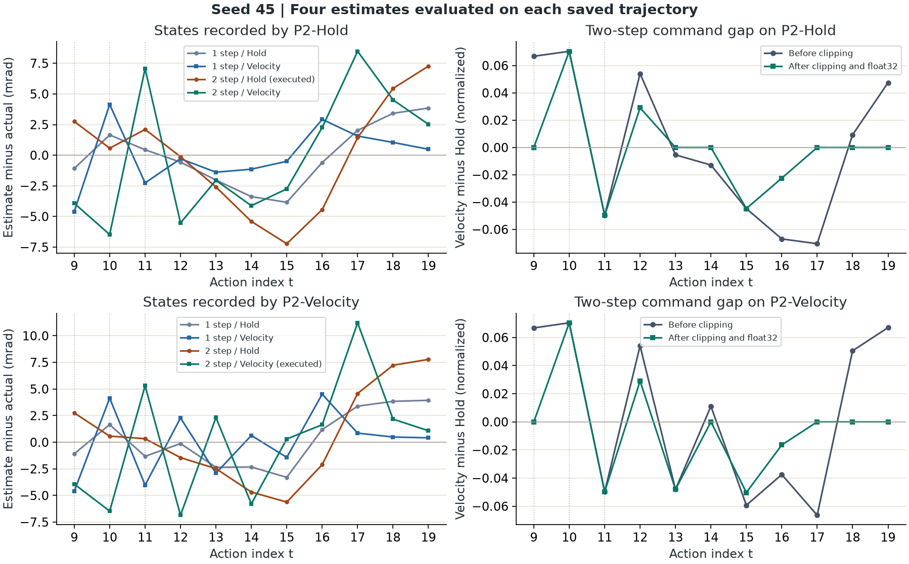
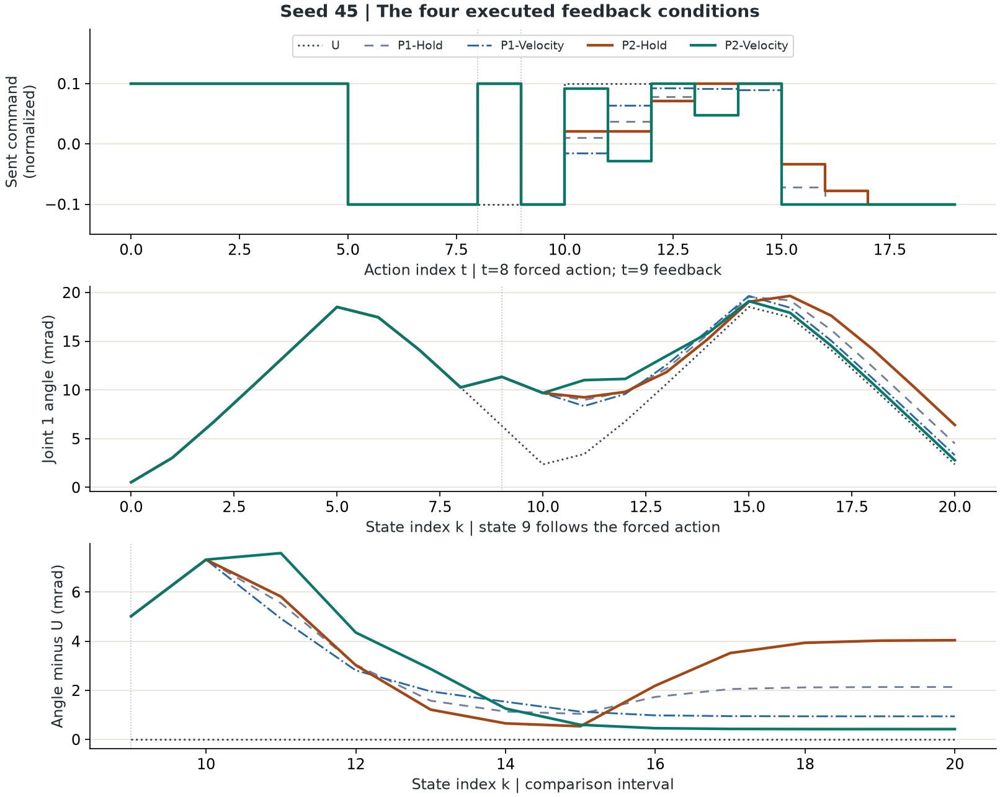
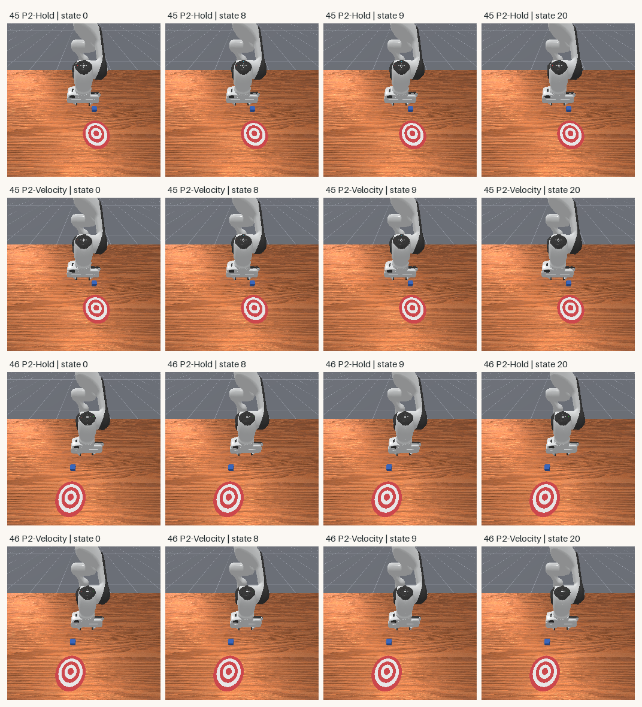

# 观测晚到两步：速度预测还能跟上吗？

外层观测晚两步时，沿旧速度外推 100 ms，在四条新增轨迹上的位置估计 RMSE 都比直接用旧位置更大。实际闭环里，两个 seed 的两步速度组又都比两步旧位置组有略小的跟踪 RMSE，但峰值偏差更大。

[下载完整离线复核包（约 43 MB）](../assets/experiments/22-two-step-observation-delay/two-step-delay-files.zip) · [运行说明](../assets/experiments/22-two-step-observation-delay/README.md) · [独立解压验收](../assets/experiments/22-two-step-observation-delay/portable-validation.json)

## 1. 用同一次干预比较四种反馈条件

第21篇用旧位置和同一时刻的旧速度估计当前关节位置。这次把外层观测年龄从一个控制周期延长到两个周期，并给每个延迟配上直接使用旧位置的 Hold。两个 seed 都曾使用过。每个 seed 的 U 轨迹提供该起点的无干预参考角度。第22篇只新增表中最后两种条件，各运行两次。 [第13篇脚本参考](unseen-seed-evaluation.html) · [第18篇一步 Hold](delayed-feedback-evaluation.html) · [第21篇一步 Velocity](delayed-velocity-prediction.html)

| 条件 | 外层测量年龄 | 用到的状态 | 来源 |
| --- | --- | --- | --- |
| U | 不适用 | 原脚本 | 第13篇，无覆盖 |
| P1-Hold | 50 ms | q[t−1] | 第18篇 P1 |
| P1-Velocity | 50 ms | q[t−1]、v[t−1] | 第21篇 PV |
| P2-Hold | 100 ms | q[t−2] | 本篇新增 |
| P2-Velocity | 100 ms | q[t−2]、v[t−2] | 本篇新增 |

任务为 PushCube-v1，单环境 Panda，采用 `pd_joint_delta_pos`。控制 20 Hz，物理 100 Hz，每次动作经过五个物理子步。`base_camera` 保存 256×256 RGB，使用 `minimal` 着色配置。实际接口记录为 `physx_cpu` 和 `sapien_cpu`，反馈计算与 RGB 复制均在 CPU 端完成。渲染的物理 GPU 利用率未测。 [运行环境](../assets/experiments/22-two-step-observation-delay/environment.json) · [ManiSkill v3.0.1 仿真时钟](https://github.com/mani-skill/ManiSkill/blob/v3.0.1/mani_skill/envs/sapien_env.py)

四个 P 组在动作 0～7 使用原脚本，在动作 8 把第一维从 −0.1 覆盖为 +0.1，从动作 9 开始外层反馈。新组按 seed45 的 Hold、Velocity，再按 seed46 的 Hold、Velocity 执行。每组显式 reset 一次并完成 20 步。新组与 U 的状态 0～8，以及四个 P 组之间的状态 0～9，关节位置、速度和方块位姿均逐项相同。

## 2. 动作已经执行，外层控制器还要等测量

动作 `t` 从状态 `t` 出发，结束后得到状态 `t+1`。动作 8 的覆盖先改变状态 9。一步组最早在动作 10 读到状态 9，两步组最早在动作 11 读到。延迟只加在外层观测上。参考位置、前馈、底层 PD 和动作发送使用当前控制周期。

| 决策动作 t | 控制时间 s | 一步组可用状态 | 两步组可用状态 |
| --- | ---: | ---: | ---: |
| 9 | 0.45 | 8 | 7 |
| 10 | 0.50 | 9 | 8 |
| 11 | 0.55 | 10 | 9 |

```python
m = t - delay_steps
age_s = float64(time_s[t] - time_s[m])
q_est = q[m] if method == "hold" else q[m] + v[m] * age_s
error_rad = q_ref[t] - q_est
u_raw = u_ff[t] + gain * error_rad / joint_delta_scale_rad
u_sent = float32(clip(u_raw, -limit, +limit))
```

`q` 用 rad，`v` 用 rad/s。增益为 1.0，物理尺度为 0.1 rad，限幅采用原 `float32` 边界的精确值 `0.10000000149011612`。观测按本条运行和时间索引，估计只使用 `m` 处的数据。当前真实角度在命令算完后才进入诊断。底层控制器仍以当前真实关节位置为锚点，发送值 0.1 对应约 0.01 rad 的目标增量，实际角度由物理步进得到。 [Panda 控制配置](https://github.com/mani-skill/ManiSkill/blob/v3.0.1/mani_skill/agents/robots/panda/panda.py) · [关节控制器源码](https://github.com/mani-skill/ManiSkill/blob/v3.0.1/mani_skill/agents/controllers/pd_joint_pos.py) · [NumPy 2.4 限幅](https://numpy.org/doc/2.4/reference/generated/numpy.clip.html)

以 seed45 为例，动作 9 时两步组的估计分别约为 0.014096 rad 和 0.007416 rad，当前实测角度约为 0.011341 rad。两条未限幅指令最终都被截到 −0.1。动作 10 读取的仍是覆盖前的状态 8，两组实际发送值已分开，约为 +0.02105 和 +0.09148。到动作 11，才第一次读到受覆盖影响的状态 9。 [两组全部时点记录](../assets/experiments/22-two-step-observation-delay/timing-cases.json)

## 3. 同一条轨迹上，先看位置估计

把四种规则分别代入每条新增轨迹的同一批保存状态。误差定义为当步估计减实际角度。每行有 11 个决策时刻，每个时刻复算四个候选。总计 176 条，只有标记为 `is_actual_rule` 的 44 条对应实际发送。

| 保存轨迹 | 一步 Hold RMSE / 峰值 mrad | 一步 Velocity RMSE / 峰值 mrad | 两步 Hold RMSE / 峰值 mrad | 两步 Velocity RMSE / 峰值 mrad |
| --- | ---: | ---: | ---: | ---: |
| 45 P2-Hold | 2.444 / 3.850 | 2.323 / 4.604 | 4.313 / 7.269 | 4.957 / 8.480 |
| 45 P2-Velocity | 2.535 / 3.938 | 2.894 / 4.604 | 4.348 / 7.781 | 5.273 / 11.218 |
| 46 P2-Hold | 2.458 / 3.858 | 2.345 / 4.644 | 4.334 / 7.299 | 4.992 / 8.539 |
| 46 P2-Velocity | 2.546 / 3.941 | 2.927 / 4.644 | 4.358 / 7.792 | 5.312 / 11.288 |

两步 Velocity 的估计 RMSE 在四条保存轨迹上均高于两步 Hold，峰值都出现在动作 17。对比相同保存状态的两步候选，每条 P2-Hold 轨迹有 6/11 次原始指令不同但限幅后相同，每条 P2-Velocity 轨迹有 5/11 次。其余分别有 5 次和 6 次在 `float32` 发送值上仍有差异。完整文件记录原始值、限幅值和发送值。 [176 条候选 CSV](../assets/experiments/22-two-step-observation-delay/same-state-candidates.csv) · [候选 NPZ](../assets/experiments/22-two-step-observation-delay/same-state-candidates.npz)

<figure class="experiment-figure"><figcaption>seed45。同一行中的四个估计使用同一份实际轨迹，右侧对照两步 Velocity 减 Hold 的候选指令。 <a href="../assets/experiments/22-two-step-observation-delay/seed-0045-diagnostics.png" download>下载原尺寸图</a> · <a href="../assets/experiments/22-two-step-observation-delay/seed-0046-diagnostics.png">查看 seed46</a></figcaption></figure>

## 4. 实际闭环里，跟踪 RMSE 和峰值给出不同信息

用四个反馈组真实执行后的第一关节角度减同 seed 的 U 角度。共同区间为状态 9～20，即 0.45～1.00 s，共 12 份状态。1 mrad 等于 0.001 rad。

| seed | 条件 | 最大绝对偏差 mrad | 跟踪 RMSE mrad | 末状态有符号 / 绝对偏差 mrad |
| ---: | --- | ---: | ---: | ---: |
| 45 | P1-Hold | 7.321 | 3.470 | +2.136 / 2.136 |
| 45 | P1-Velocity | 7.321 | 3.201 | +0.941 / 0.941 |
| 45 | P2-Hold | 7.321 | 3.970 | +4.041 / 4.041 |
| 45 | P2-Velocity | 7.587 | 3.724 | +0.421 / 0.421 |
| 46 | P1-Hold | 7.348 | 3.477 | +2.145 / 2.145 |
| 46 | P1-Velocity | 7.348 | 3.206 | +0.957 / 0.957 |
| 46 | P2-Hold | 7.348 | 3.980 | +4.043 / 4.043 |
| 46 | P2-Velocity | 7.593 | 3.723 | +0.386 / 0.386 |

同一种规则从一步改为两步，两个 seed 的跟踪 RMSE 均增加约 0.50～0.52 mrad。在两步条件内换用 Velocity，RMSE 分别少 0.246 和 0.257 mrad，峰值则分别多 0.266 和 0.245 mrad。估计误差来自固定保存状态，跟踪偏差来自实际执行过的不同状态序列。限幅和每一步的实际运动都会改变两者的关系。

<figure class="experiment-figure"><figcaption>seed45 的实际发送、关节角度及参考偏差。上图用动作索引，下面两图用状态索引。 <a href="../assets/experiments/22-two-step-observation-delay/seed-0045-tracking.png" download>下载原尺寸图</a></figcaption></figure>

<figure class="experiment-figure"><figcaption>seed46 的同一口径对照。 <a href="../assets/experiments/22-two-step-observation-delay/seed-0046-tracking.png" download>下载原尺寸图</a></figcaption></figure>

## 5. 方块与实际运行记录

每条来源均为 20 步和 1.00 s，末步的 terminated、truncated 和 success 均为 false。步数预算结束后保留环境原始标志。两个 seed 的方块净位移均小于 1 μm。下表的截断和触边只统计 11 次真实反馈，U 直接运行原脚本。

| seed | 条件 | 严格截断 / 触边 | 方块净位移 m | 累计 reward | success |
| ---: | --- | ---: | ---: | ---: | --- |
| 45 | U | — | 7.916e−7 | 1.365850 | false |
| 45 | P1-Hold | 7 / 7 | 7.916e−7 | 1.372056 | false |
| 45 | P1-Velocity | 6 / 6 | 7.916e−7 | 1.371135 | false |
| 45 | P2-Hold | 6 / 6 | 7.916e−7 | 1.373131 | false |
| 45 | P2-Velocity | 8 / 8 | 7.916e−7 | 1.371462 | false |
| 46 | U | — | 8.340e−7 | 1.528465 | false |
| 46 | P1-Hold | 7 / 7 | 8.340e−7 | 1.519599 | false |
| 46 | P1-Velocity | 6 / 6 | 8.340e−7 | 1.520907 | false |
| 46 | P2-Hold | 6 / 6 | 8.340e−7 | 1.518045 | false |
| 46 | P2-Velocity | 8 / 8 | 8.340e−7 | 1.520533 | false |

<figure class="experiment-figure"><figcaption>每行一条新增轨迹。标签在图块上方，16 块图与对应原始 PNG 逐像素相同。 <a href="../assets/experiments/22-two-step-observation-delay/rollout-frames.png" download>下载原尺寸图</a></figcaption></figure>

## 6. 解压复算全部动作与指标

在解压后的目录用 Python 3.11 和相容的 NumPy、Pillow 执行以下命令。复算写入新的目录。

```powershell
python -B inspect_two_step_delay.py --output replay-check --compare-saved
```

验收重读十条真实轨迹，逐像素核对 210 张相机图，再独立复算反馈、控制器目标、指令边界、指标和逐步数据。四条新运行共 80 次调用和 84 张原始 PNG。解压后的独立复算与包内 13 份结果一致。

[固定配置](../assets/experiments/22-two-step-observation-delay/config.json) · [轨迹来源](../assets/experiments/22-two-step-observation-delay/source_manifest.json) · [实际反馈 CSV](../assets/experiments/22-two-step-observation-delay/actual-feedback.csv) · [指标](../assets/experiments/22-two-step-observation-delay/metrics.json) · [字段](../assets/experiments/22-two-step-observation-delay/schema.json) · [验收](../assets/experiments/22-two-step-observation-delay/validation.json)

这组结果适用于两个已知起点、一次固定动作覆盖和已知参考时钟，比较窗口约半秒。实验只模拟外层测量滞后。实机的通信、动作队列和渲染等待均未测量。方块任务结果仍为未成功。
