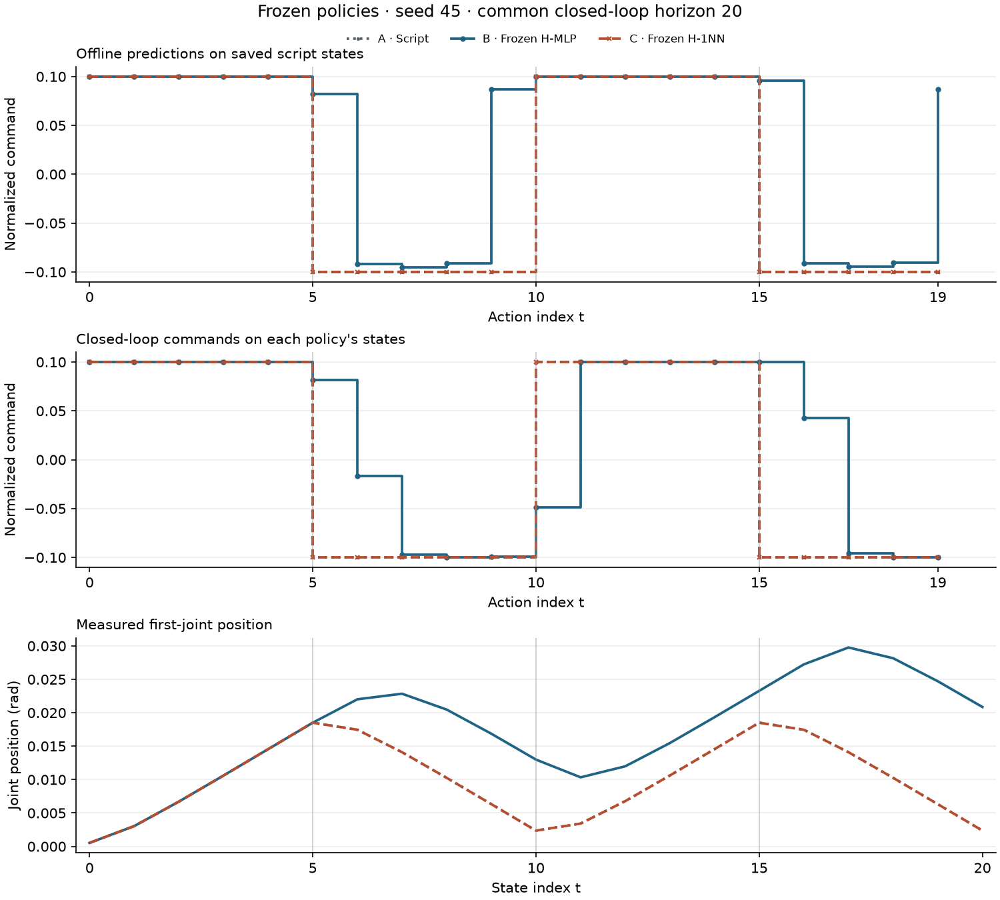
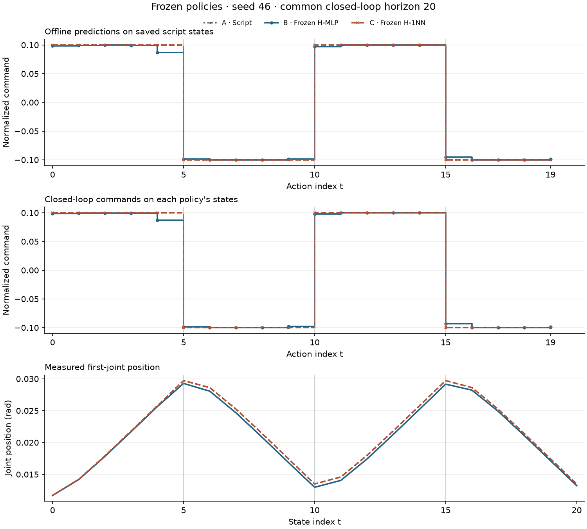
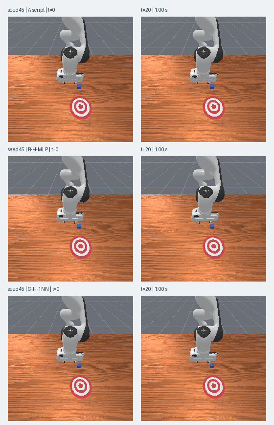
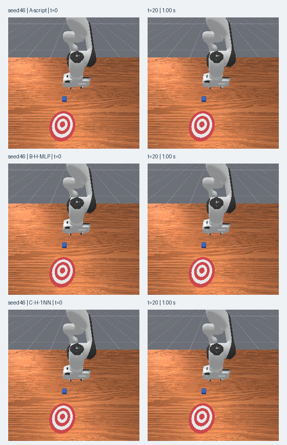

# 换个起点还成立吗：冻结策略的新种子评估

[下载离线复核包](../assets/experiments/13-unseen-seed-evaluation/unseen-seed-files.zip) · [运行说明](../assets/experiments/13-unseen-seed-evaluation/README.md) · [解压复核结果](../assets/experiments/13-unseen-seed-evaluation/portable-validation.json)

公开包包含可运行的CPU离线代码与必要的真实数值资料，解压后可复算已保存结果。默认不会启动仿真或训练。

[第十二篇](bc-data-diagnostics.html)发现，在反复使用的 seed44 上，四状态最近邻的离线指令符号一致数为 18/20，历史 MLP 为 16/20。这次先固定现有策略，再检查项目记录中没有发现既往评估证据的 seed45、46。

H-1NN 在两个新起点上都匹配了 20 个脚本指令，实际关节状态和相机 RGB 也与各自参考一致。H-MLP 在 seed45 上仍有四个离线符号误判，在 seed46 上二十个符号全部一致，但幅度有小量差异。六组运行的任务成功标志始终为 false。

## 先固定规则，再看新记录

本次只使用第十一篇已经保存的 H 权重和第十二篇的 40 条训练历史，标准化仍使用第八篇冻结统计。最近邻候选只能来自 seed42、43，seed44 用于预检复现，不加入候选。新起点产生的任何记录都只用于本次评估。

项目中 957 份来源、配置、日志和脚本记录经检查，没有发现 seed45、46 的既往评估记录。随后重新加载权重复现 seed44 的 20 步 H-MLP 预测，同时逐项复现 H-1NN 的邻居、距离和标签，才保存冻结配置并启动仿真。

两种策略都接收四份关节状态，按从旧到新的顺序组成 72 维输入。轨迹开头重复本条初始状态，每次新环境重新创建缓存。模型只读已经收到的 qpos、qvel。

```python
cache.push(normalize(normalizer, current_qpos, current_qvel))
inputs = cache.features("H")  # (1,72)，最多使用到当前状态
with torch.inference_mode():
    mlp_command = model(inputs).item()
```

推理同时调用 eval() 和 inference_mode()。 [PyTorch 2.14 inference_mode 文档](https://docs.pytorch.org/docs/2.14/generated/torch.autograd.grad_mode.inference_mode.html)

最近邻使用 float64 均方根差，距离并列时按训练 source_id、训练动作索引排序。下面的 train_t 属于训练候选的审计信息，当前仿真步号没有加入查询向量。

```python
delta = query.astype(np.float64) - train_H.astype(np.float64)
distance = np.sqrt(np.mean(delta ** 2, axis=1))
j = np.lexsort((train_t, train_source_id, distance))[0]
neighbor_command = train_label[j]
```

排序和固定距离规则沿用第十二篇。 [NumPy 2.4 lexsort 文档](https://numpy.org/doc/2.4/reference/generated/numpy.lexsort.html)

## 每个 seed 从同一起点运行三组

A-script 执行每五步换一次方向的固定脚本，B-H-MLP 使用冻结模型，C-H-1NN 查询冻结训练历史。环境仍是 PushCube-v1、Panda、单环境、pd_joint_delta_pos，base_camera 为 256×256，控制 20 Hz、物理 100 Hz。第一维由各组规则产生，其余机械臂维度为 0，夹爪维度为 1。 [ManiSkill 3.0.1 控制器说明](https://maniskill.readthedocs.io/en/latest/user_guide/concepts/controllers.html)

每组显式 reset 一次并检查初始状态。两个策略组的初始 qpos、qvel 和方块位姿与同 seed 的脚本组差异均为零。A 组还与旧来源及此前的新 A 组比较，以下列出其中三对实际差异。

| 新起点 | 对照起点 | 机械臂最大初始角差（rad） | 手指最大初始位置差（m） | 首帧变化像素 |
| --- | --- | ---: | ---: | ---: |
| seed45 | seed-0044 | 0.032826 | 0.000000 | 8074 |
| seed46 | seed-0044 | 0.038639 | 0.000000 | 8723 |
| seed46 | seed-0045 | 0.048414 | 0.000000 | 9250 |

机械臂角度和手指位移按各自单位统计，完整初始比较保存在 metrics.json。新 seed 的记录不因名称不同就被当成统计独立。

六组各执行 20 步和 1.00 秒，共尝试调用 120 次 env.step，每次调用前写入持久账本。三组动作均通过控制器边界检查，快照先独立复制。相机、物体真值和 success 另行记录供验收，策略输入只含关节状态。

## 先在脚本状态上做离线对照

每个 A 组实际保存 21 份状态和 20 个动作，离线评估只取有对应标签的前 20 份状态。两个冻结策略都读取同一份脚本状态，指标按样本汇总。

| seed | 方法 | MSE | MAE | 符号一致 |
| ---: | --- | ---: | ---: | ---: |
| 45 | H-MLP | 0.00708376 | 0.039809 | 16/20 |
| 45 | H-1NN | 0.00000000 | 0.000000 | 20/20 |
| 46 | H-MLP | 0.00001091 | 0.001462 | 20/20 |
| 46 | H-1NN | 0.00000000 | 0.000000 | 20/20 |

三个脚本换向位置的预测及最近邻来源如下。候选 source_id 0 对应 seed42，1 对应 seed43，训练中的轨迹内 t 用来追踪该条记录。

| seed | t | 脚本标签 | H-MLP 离线预测 | H-1NN 离线预测 | 最近训练来源 | 训练 t |
| ---: | ---: | ---: | ---: | ---: | --- | ---: |
| 45 | 5 | -0.10000 | +0.08244 | -0.10000 | seed43 | 5 |
| 45 | 10 | +0.10000 | +0.10000 | +0.10000 | seed43 | 10 |
| 45 | 15 | -0.10000 | +0.09563 | -0.10000 | seed43 | 15 |
| 46 | 5 | -0.10000 | -0.09867 | -0.10000 | seed42 | 5 |
| 46 | 10 | +0.10000 | +0.09717 | +0.10000 | seed42 | 10 |
| 46 | 15 | -0.10000 | -0.09506 | -0.10000 | seed42 | 15 |

seed45 的换向位置仍能看到 MLP 的反向预测。seed46 中，符号一致不表示预测数值完全等于脚本指令，因此还要看 MAE 和实际执行。

## 再看各策略自己走出的轨迹

<figure class="experiment-figure"><figcaption><a href="../assets/experiments/13-unseen-seed-evaluation/seed-0045-comparison.png">下载原尺寸图</a></figcaption></figure>

<figure class="experiment-figure"><figcaption><a href="../assets/experiments/13-unseen-seed-evaluation/seed-0046-comparison.png">下载原尺寸图</a></figcaption></figure>

H-1NN 的曲线与脚本参考重合。独立读取保存文件后，动作、qpos、qvel 和 RGB 四项在两个 seed 上都逐项相同。下面的角度偏差使用每个 seed 三组共同覆盖的 20 步计算，首次偏离以状态索引报告，阈值为 1e-6 rad。

| seed | 组别 | 实际步数 | 最大角度偏差（rad） | 首次偏离状态 | 方块净位移（µm） | 成功步数 |
| ---: | --- | ---: | ---: | ---: | ---: | ---: |
| 45 | A-script | 20 | 0.00000000 | 未超过 | 0.7916 | 0 |
| 45 | B-H-MLP | 20 | 0.01849375 | 5 | 0.7916 | 0 |
| 45 | C-H-1NN | 20 | 0.00000000 | 未超过 | 0.7916 | 0 |
| 46 | A-script | 20 | 0.00000000 | 未超过 | 0.8340 | 0 |
| 46 | B-H-MLP | 20 | 0.00058167 | 1 | 0.8340 | 0 |
| 46 | C-H-1NN | 20 | 0.00000000 | 未超过 | 0.8340 | 0 |

seed45 的 MLP 在状态 5 就超过偏离阈值，seed46 在状态 1 超过阈值。第一维指令的幅度小量差异也可能产生状态偏移。偏离参考后，模型读到的是自己的状态，此时脚本只能提供同一时刻的指令对照，不能为新状态提供正确动作标签。

<figure class="experiment-figure"><figcaption><a href="../assets/experiments/13-unseen-seed-evaluation/seed-0045-frames.png">下载原尺寸图</a></figcaption></figure>

<figure class="experiment-figure"><figcaption><a href="../assets/experiments/13-unseen-seed-evaluation/seed-0046-frames.png">下载原尺寸图</a></figcaption></figure>

各组方块都只有亚微米量级的净位移，success 全程为 false。累计奖励数值保留如下，任务结果同时由 success 说明。

| seed | A 累计 reward | B 累计 reward | C 累计 reward |
| ---: | ---: | ---: | ---: |
| 45 | 1.365850 | 1.392047 | 1.365850 |
| 46 | 1.528465 | 1.530500 | 1.528465 |

所有运行都在步数预算用完时停止，最后一条 terminated 和 truncated 均为 false。每组的最后观测仍保留，观测数是 N+1。六条片段各有自己的时间轴。

## 完整逐步记录

下表数值保留四位小数，精确预测、误差、邻居来源和距离见对应 CSV。离线列读取脚本状态，闭环列记录实际发送的指令。

### seed45

| t | 脚本标签 | MLP 离线 | 1NN 离线 | MLP 闭环指令 | 1NN 闭环指令 |
| ---: | ---: | ---: | ---: | ---: | ---: |
| 0 | +0.1000 | +0.1000 | +0.1000 | +0.1000 | +0.1000 |
| 1 | +0.1000 | +0.1000 | +0.1000 | +0.1000 | +0.1000 |
| 2 | +0.1000 | +0.1000 | +0.1000 | +0.1000 | +0.1000 |
| 3 | +0.1000 | +0.1000 | +0.1000 | +0.1000 | +0.1000 |
| 4 | +0.1000 | +0.0999 | +0.1000 | +0.0999 | +0.1000 |
| 5 | -0.1000 | +0.0824 | -0.1000 | +0.0817 | -0.1000 |
| 6 | -0.1000 | -0.0921 | -0.1000 | -0.0163 | -0.1000 |
| 7 | -0.1000 | -0.0952 | -0.1000 | -0.0975 | -0.1000 |
| 8 | -0.1000 | -0.0913 | -0.1000 | -0.0997 | -0.1000 |
| 9 | -0.1000 | +0.0867 | -0.1000 | -0.0994 | -0.1000 |
| 10 | +0.1000 | +0.1000 | +0.1000 | -0.0486 | +0.1000 |
| 11 | +0.1000 | +0.1000 | +0.1000 | +0.1000 | +0.1000 |
| 12 | +0.1000 | +0.1000 | +0.1000 | +0.1000 | +0.1000 |
| 13 | +0.1000 | +0.1000 | +0.1000 | +0.1000 | +0.1000 |
| 14 | +0.1000 | +0.1000 | +0.1000 | +0.1000 | +0.1000 |
| 15 | -0.1000 | +0.0956 | -0.1000 | +0.1000 | -0.1000 |
| 16 | -0.1000 | -0.0913 | -0.1000 | +0.0429 | -0.1000 |
| 17 | -0.1000 | -0.0949 | -0.1000 | -0.0959 | -0.1000 |
| 18 | -0.1000 | -0.0907 | -0.1000 | -0.0999 | -0.1000 |
| 19 | -0.1000 | +0.0869 | -0.1000 | -0.0999 | -0.1000 |

[seed45 完整精度 CSV](../assets/experiments/13-unseen-seed-evaluation/seed-0045-offline.csv)

### seed46

| t | 脚本标签 | MLP 离线 | 1NN 离线 | MLP 闭环指令 | 1NN 闭环指令 |
| ---: | ---: | ---: | ---: | ---: | ---: |
| 0 | +0.1000 | +0.0985 | +0.1000 | +0.0985 | +0.1000 |
| 1 | +0.1000 | +0.0994 | +0.1000 | +0.0994 | +0.1000 |
| 2 | +0.1000 | +0.0996 | +0.1000 | +0.0996 | +0.1000 |
| 3 | +0.1000 | +0.0994 | +0.1000 | +0.0995 | +0.1000 |
| 4 | +0.1000 | +0.0867 | +0.1000 | +0.0872 | +0.1000 |
| 5 | -0.1000 | -0.0987 | -0.1000 | -0.0988 | -0.1000 |
| 6 | -0.1000 | -0.0999 | -0.1000 | -0.0999 | -0.1000 |
| 7 | -0.1000 | -0.1000 | -0.1000 | -0.1000 | -0.1000 |
| 8 | -0.1000 | -0.0998 | -0.1000 | -0.0998 | -0.1000 |
| 9 | -0.1000 | -0.0985 | -0.1000 | -0.0975 | -0.1000 |
| 10 | +0.1000 | +0.0972 | +0.1000 | +0.0979 | +0.1000 |
| 11 | +0.1000 | +0.1000 | +0.1000 | +0.1000 | +0.1000 |
| 12 | +0.1000 | +0.1000 | +0.1000 | +0.1000 | +0.1000 |
| 13 | +0.1000 | +0.1000 | +0.1000 | +0.1000 | +0.1000 |
| 14 | +0.1000 | +0.0999 | +0.1000 | +0.0999 | +0.1000 |
| 15 | -0.1000 | -0.0951 | -0.1000 | -0.0934 | -0.1000 |
| 16 | -0.1000 | -0.0999 | -0.1000 | -0.0999 | -0.1000 |
| 17 | -0.1000 | -0.1000 | -0.1000 | -0.1000 | -0.1000 |
| 18 | -0.1000 | -0.0998 | -0.1000 | -0.0998 | -0.1000 |
| 19 | -0.1000 | -0.0985 | -0.1000 | -0.0985 | -0.1000 |

[seed46 完整精度 CSV](../assets/experiments/13-unseen-seed-evaluation/seed-0046-offline.csv)

## 如何只读复核

将公开实验包解压，在解压目录使用兼容环境运行；输出目录须尚不存在。

```bash
python -B evaluate.py --output-dir result
```

独立验收核对了六组 N/N+1、回合边界和连续步数，逐像素重新打开 126 张 PNG，并从保存状态重新构建实际 72 维输入。重载 MLP 权重后的最大指令差约为 3.73×10⁻⁸，独立排序得到的最近邻来源、索引、标签和距离均与实际运行一致。35 项引用文件和 331 份此前实验与网站文件的 SHA-256 保持一致。

[运行说明](../assets/experiments/13-unseen-seed-evaluation/README.md) · [全部指标](../assets/experiments/13-unseen-seed-evaluation/metrics.json) · [独立验收](../assets/experiments/13-unseen-seed-evaluation/validation.json)

本次没有用新记录更新模型、训练候选、统计或规则。H-1NN 在这两个起点复现了换向脚本，H-MLP 的误差则随起点改变。这是两条预先指定新起点下的小规模对照，仍共用原来的控制脚本，不能据此保证更广泛的泛化、统计独立或推物能力。
